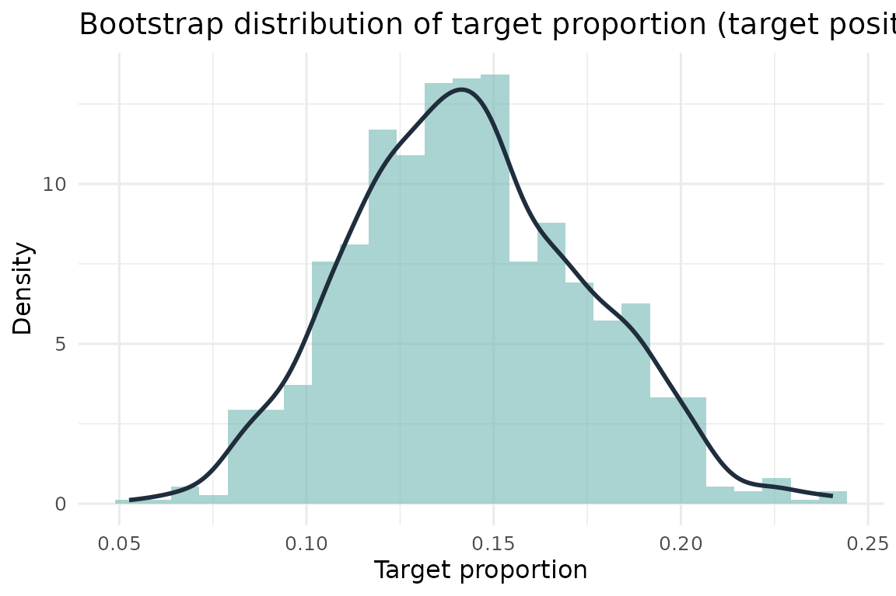
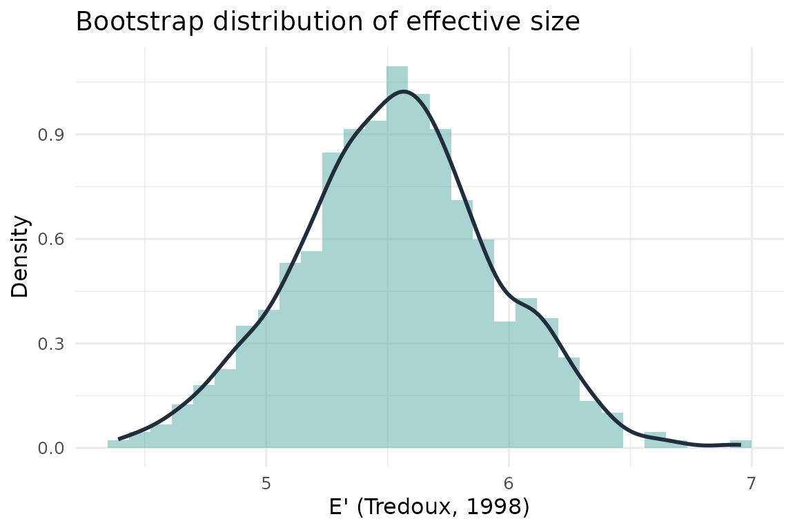
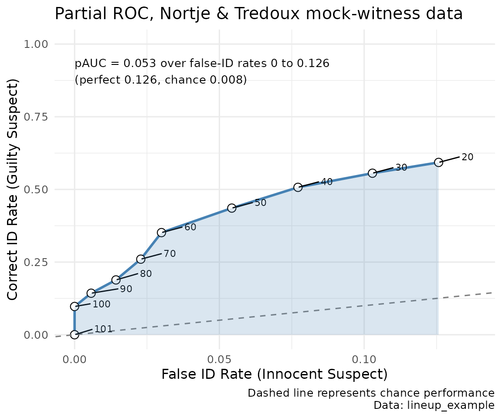
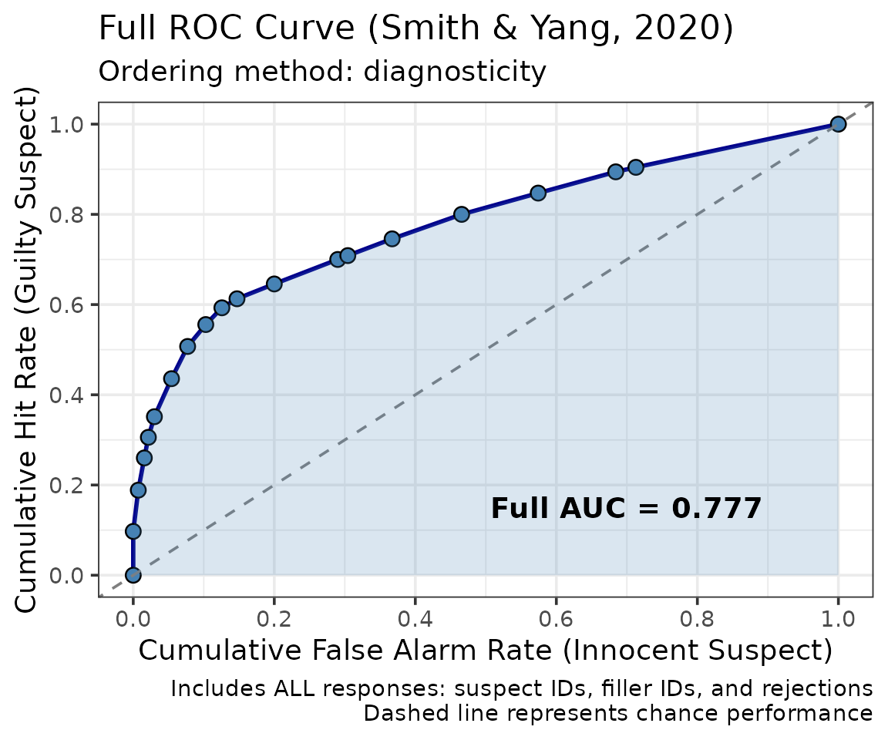

# r4lineups MAIN vignette: Statistical Inference on Lineup Fairness

> **Acknowledgement.** Large language models supplied by Anthropic and
> OpenAI were used in preparing this vignette, to assist with checking
> code, testing the veracity of the approaches described, and on
> occasion editing the text. Responsibility for the content rests with
> the authors.

The current release is also available from r-universe, which is updated
sooner than CRAN:

``` r

install.packages("r4lineups",
                 repos = c("https://cgtza2.r-universe.dev",
                           "https://cloud.r-project.org"))
```

``` r

library(r4lineups)
```

This is the **main vignette** for **r4lineups**. It covers the classical
measures of lineup fairness: lineup proportion, functional size,
effective size, and the diagnosticity ratio, together with ROC analysis
of confidence and accuracy. The package contains a good deal more than
this, and the other vignettes are listed at the [end of this
document](#other-vignettes).

This package contains functions to compute various properties of
laboratory or police lineups. Since the early 1970s eyewitness testimony
researchers have recognised the importance of estimating properties such
as lineup bias (is the lineup biased against the suspect, leading to a
rate of choosing higher than one would expect by chance?), and lineup
size (how many reasonable choices are in fact available to the witness?
A lineup is supposed to consist of a suspect and a number of additional
members, or foils, whom a poor quality witness might mistake for the
perpetrator). Lineup measures are descriptive, in the first instance,
but since the earliest articles in the literature researchers have
recognised the importance of reasoning inferentially about them.

The measures described below were originally proposed by Doob &
Kirshenbaum (1973), Wells, Leippe & Ostrom (1979), Malpass (1981),
Tredoux (1998, 1999), and Malpass, Tredoux & McQuiston-Surrett (2007).
Most of the measures assume that a sample of mock witnesses has been
given a description of the perpetrator, and a lineup, and asked to
choose someone from the lineup (either as the best match to the
description, or the best match to the lineup member the police likely
have in mind; see Malpass et al., 2007).

Much of the justification for what follows can be found in Tredoux
(1998), and Malpass et al. (2007).

## Data Format

The majority of functions in **r4lineups** require a numeric *vector*
representing lineup data, whilst other functions require you to pass a
*list* of lineup data. It is advisable to read the documentation to
determine the format of data needed by each specific function. Most
**r4lineups** functions will not work with a dataframe, even if the
dataframe contains only one column, and thus appears to be in vector
like format. If your lineup data is in dataframe format already, you can
easily convert it to a vector or a list.

For instance, if we have 10 mock witnesses, and each views a lineup with
6 members, then we could record their choices as a numeric vector, where
the elements represent the position of the lineup member chosen by each
witness:

``` r

lineup_vec_demo <- c(3, 2, 5, 6, 1, 3, 3, 5, 6, 4)
```

However, it is also possible to represent this set of choices as a
one-dimensional table:

``` r
table(lineup_vec_demo)
lineup_vec_demo
1 2 3 4 5 6 
1 1 3 1 2 2 
```

If we had our lineup choices recorded in a data frame, which is what we
might end up with if we import the data from a spreadsheet program, then
we could easily extract the variable representing choices in the
dataframe into a vector.

For instance, if the lineup choices shown above for 10 mock witnesses
were part of a larger dataset, and we had recorded the ages and
participant number of each participant, then the dataframe might appear
as shown below (we create the dataframe with simulated data here,
though):

``` r
participant_num <- paste("Partic_", 1:10, sep = "")
age             <- round(runif(10, 18, 80), 2)
line_df         <- data.frame(participant_num, age,
                              lineup_vec = lineup_vec_demo)
line_df
   participant_num   age lineup_vec
1         Partic_1 61.32          3
2         Partic_2 52.50          2
3         Partic_3 26.69          5
4         Partic_4 35.71          6
5         Partic_5 52.43          1
6         Partic_6 19.56          3
7         Partic_7 46.91          3
8         Partic_8 71.38          5
9         Partic_9 33.66          6
10       Partic_10 54.01          4
```

Extract the lineup choices, per participant, to a vector:

``` r

a_lineup_vec <- line_df$lineup_vec
```

Or make a table directly from the variable of choices:

``` r

a_lineup_table <- table(line_df$lineup_vec)
```

### Null foils, and why `table()` can mislead

One **important** issue is that a lineup vector records the choice each
witness made, but not the number of lineup members. If there were in
fact 7 members in our running example, but member 7 was chosen by
nobody, that would not be evident from the vector at all. Such an
unchosen member is called a **null foil**.

[`table()`](https://rdrr.io/r/base/table.html) makes this worse, because
it tabulates only the positions that were actually chosen and silently
omits the rest:

``` r
null_foil_vec <- rep(c(5, 3, 2, 1, 8, 6, 7), each = 4)

# Position 4 was never chosen, so this table has 7 entries, not 8
table(null_foil_vec)
null_foil_vec
1 2 3 5 6 7 8 
4 4 4 4 4 4 4 
```

Null foils are important, because a foil nobody would pick is not a
functioning alternative to the suspect. They are one of several things
that can make a lineup unfair: poor foils that draw only a few choices
weaken it in the same way, and a suspect who stands out does so whatever
the foils are like. A zero in a sample is also weaker evidence than it
looks. Even in a perfectly fair six-person lineup, a given member
receives no choices from ten mock witnesses with probability
$`(5/6)^{10} \approx .16`$. Treat an unchosen member as a prompt to look
at that photograph, not as proof that it fails as a foil. Use
[`lineup_table()`](https://cgtza2.github.io/r4lineups/reference/lineup_table.md)
instead, which tabulates over all `k` positions, keeps unchosen members
as explicit zeroes, and says so:

``` r
lineup_table(null_foil_vec, k = 8, suspect_pos = 3)
Lineup choices (k = 8, N = 28)

 pos: 1  2  3*  4  5  6  7  8
 cnt: 4  4   4  0  4  4  4  4

 * = nominated suspect

 Note: 1 null foil (position 4) received no choices.
 Unchosen members reduce effective size; see ?esize_m.
```

The result inherits from `table`, so it can be passed to
[`esize_m()`](https://cgtza2.github.io/r4lineups/reference/esize_m.md),
[`esize_T()`](https://cgtza2.github.io/r4lineups/reference/esize_T.md)
and the other table-taking functions in the package exactly as an
ordinary table would be. The measures in this package already handle
null foils correctly given a complete table; what
[`lineup_table()`](https://cgtza2.github.io/r4lineups/reference/lineup_table.md)
adds is visibility.

For the remaining functions, which take a vector rather than a table,
nominal lineup size must be passed explicitly as an argument for the
same reason.

### A larger dataset

Let’s look at a slightly larger data set. Only the first three rows are
shown here; `nortje2012` has 133 rows in total.

``` r

data(nortje2012)
```

| lineup_1 | lineup_2 | lineup_3 |
|:--------:|:--------:|:--------:|
|    2     |    7     |    1     |
|    5     |    1     |    3     |
|    2     |    2     |    3     |

nortje2012 data (first 3 rows of 133) {.table style="width:46%;"}

- For functions that require data for only one lineup or one lineup
  pair, you can convert the data from a given lineup to a vector by
  calling for e.g. `lineup_vec <- nortje2012$lineup_1` or alternatively
  `lineup_vec <- nortje2012[[1]]`

- For functions that require several lineups or several lineup pairs,
  you can convert the data to a list,
  e.g. `lineup_list <- as.list(nortje2012)`

``` r

lineup_vec   <- nortje2012$lineup_1
lineup_list  <- as.list(nortje2012)
lineup_tab   <- lineup_table(lineup_vec, k = 8)
```

`lineup_vec` and `lineup_tab` are used throughout the rest of this
vignette.

- **Nominal Size**

  The notion of ‘Nominal size’ refers to the number of physical members
  of a lineup. Functions relying on nominal size for accurate
  calculations require you to manually specify nominal size. If the
  specified nominal size is not reflected in the dataframe or vector
  passed to the function, execution of the function is halted with the
  following error message: *“User-declared nominal size does not match
  observed nominal size. Please check vector of target positions.”*

------------------------------------------------------------------------

## r4lineups Sample Datasets

This package contains several sample datasets, listed below:

1.  `nortje2012`: A dataframe of lineup choices for 3 independent
    lineups, from a study conducted by Nortje & Tredoux (2012)
2.  `line73`: Lineup data from Doob & Kirshenbaum (1973)
3.  `mockdata`: Lineup data from a study conducted by Nortje & Tredoux
    (2012)
4.  `mickwick`: Confidence and accuracy data for lineup choices
5.  `lineup_example`: Target-present/target-absent identification data,
    to be passed to the ROC and CAC functions such as
    [`make_roc()`](https://cgtza2.github.io/r4lineups/reference/make_roc.md)
6.  Foil images (used in the face similarity work) can be found at
    <https://github.com/tmnaylor/malpass_foils>

Each dataset is loaded by name, e.g. `data(nortje2012)` or
`data(lineup_example)`. Further details can be found in the
documentation for each dataset,
e.g. [`?nortje2012`](https://cgtza2.github.io/r4lineups/reference/nortje2012.md).

The package can also generate data.
[`simulate_lineup_data()`](https://cgtza2.github.io/r4lineups/reference/simulate_lineup_data.md)
simulates target-present and target-absent lineups with confidence
ratings from a signal detection model, with control over
discriminability, decision criterion, lineup size and the quality of
each foil, and returns data in the format the ROC, CAC and model-fitting
functions expect. It is useful for trying out an analysis before data
are collected and for power analysis; see
[`vignette("simulation_power_analysis")`](https://cgtza2.github.io/r4lineups/articles/simulation_power_analysis.md).

------------------------------------------------------------------------

## Lineup Proportion

Proportion refers to the proportion of witnesses selecting a particular
member of a lineup. This package provides calculations of proportion for
individual lineup members
([`lineup_prop_vec()`](https://cgtza2.github.io/r4lineups/reference/lineup_prop_vec.md)),
and for all members of a lineup with a subsidiary function
([`allprop()`](https://cgtza2.github.io/r4lineups/reference/allprop.md)).

The calculation of the proportion of mock witnesses choosing the suspect
is essentially a measure of lineup bias (see Malpass, 1981; Tredoux,
1998), especially when one tests whether it exceeds the proportion
expected by chance guessing alone (1/nominal_size).

The measures in this vignette all rest on mock witnesses, who have not
seen the perpetrator, so they can be used to vet a lineup before it is
shown to a real witness. Bias can also be estimated from the responses
of real witnesses to target-present and target-absent lineups; such
measures are *resultant*, in that they can only be computed after an
experiment or case. Lee and Penrod (2019) proposed d’(IFa), the
difference between the z-transformed rates at which innocent suspects
and fillers are chosen from target-absent lineups, as such an index of
lineup bias. Because their filler rate pools all the fillers, a
perfectly fair lineup does not give d’(IFa) = 0, and
[`make_multid()`](https://cgtza2.github.io/r4lineups/reference/make_multid.md)
reports the value a fair lineup would give alongside the observed one.
Lee, Mansour and Penrod (2024) found that resultant measures, including
d’(IFa), predicted eyewitness performance better than mock-witness
measures did. The model, its bias indices and the relevant references
are described in
[`vignette("multid_model")`](https://cgtza2.github.io/r4lineups/articles/multid_model.md).

### Calculating proportion for a single target/lineup member

``` r
lineup_prop_vec(lineup_vec, target_pos = 3, k = 8)
[1] 0.1428571
```

This function requires three arguments: a vector of lineup data (here
`lineup_vec`, the choices for `nortje2012$lineup_1` that we extracted
above), the position of the target in the lineup (`target_pos`), and
nominal size (`k`). The example returns the proportion of mock witnesses
choosing the lineup member occupying position 3, which is 0.14 — that
is, about 14% of the witnesses. Chance expectation for an 8-person
lineup is 1/8 = 0.125, so this member was chosen at close to the chance
rate.

#### Compute bootstrapped estimates

The original work on lineup bias suggested testing whether the computed
proportion = 1/nominal_size using a z test of proportions, or a binomial
probability (see Tredoux, 1998), or a confidence interval around the
proportion (see Tredoux, 1998), but very few studies actually use enough
mock witnesses to strongly warrant this approach, since it assumes
approximation to a normal distribution, and the size of the lineup
places hard limits that are often not observed by computed confidence
intervals.

The bootstrap is a useful alternative for the sampling variability of
most lineup measures, especially the nonlinear ones such as effective
size. For a single member’s proportion, though, an exact binomial
interval is usually the better choice, for the reason shown at the end
of this section.

To calculate a bootstrapped lineup proportion for a single lineup
member, we pass the
[`lineup_prop_boot()`](https://cgtza2.github.io/r4lineups/reference/lineup_prop_boot.md)
function as an argument to the `boot()` function supplied by the package
**boot**. We do not work directly with the `lineup_prop_boot` function;
all we need to know to bootstrap is the lineup vector, the position of
the target (`target_pos`), and the number of bootstrap resamples we
desire (`R`).

``` r
bootobject <- boot::boot(lineup_vec, lineup_prop_boot, target_pos = 3, R = 1000)
bootobject

ORDINARY NONPARAMETRIC BOOTSTRAP


Call:
boot::boot(data = lineup_vec, statistic = lineup_prop_boot, R = 1000, 
    target_pos = 3)


Bootstrap Statistics :
     original        bias    std. error
t1* 0.1428571 -0.0004586466   0.0289372
```

We then compute confidence intervals:

``` r
cis <- boot::boot.ci(bootobject, conf = 0.95, type = "bca", target_pos = 3)
cis
BOOTSTRAP CONFIDENCE INTERVAL CALCULATIONS
Based on 1000 bootstrap replicates

CALL : 
boot::boot.ci(boot.out = bootobject, conf = 0.95, type = "bca", 
    target_pos = 3)

Intervals : 
Level       BCa          
95%   ( 0.0902,  0.1955 )  
Calculations and Intervals on Original Scale
```

If you are not familiar with how the `boot` or the `boot.ci` functions
work, you could consult the documentation for the **boot** package.
However, by using the functions as shown here you will be able to
bootstrap without needing to understand them in detail. Briefly, the
argument `conf` sets the confidence level, and `type` specifies the type
of confidence interval to be returned. With `type = "bca"` the function
returns the bias-corrected and accelerated interval, which is generally
the best-behaved of the options for a statistic like this one. Other
choices include `"perc"` (percentile), `"norm"` (normal approximation)
and `"basic"`; `boot.ci` will compute several at once if you pass a
vector of types.

#### Comparing against a normal-theory interval

The bootstrap interval can be compared with the classical interval,
which is what the earlier literature used. There is no r4lineups
function for this, because base R already provides it: a lineup
proportion is just a binomial proportion, so
[`stats::binom.test()`](https://rdrr.io/r/stats/binom.test.html) (exact)
and [`stats::prop.test()`](https://rdrr.io/r/stats/prop.test.html)
(normal approximation with continuity correction) apply directly.

``` r
n_chose_3 <- sum(lineup_vec == 3)
n_total   <- length(lineup_vec)

# Exact (Clopper-Pearson) interval
binom.test(n_chose_3, n_total)$conf.int
[1] 0.08825399 0.21406762
attr(,"conf.level")
[1] 0.95

# Normal-theory interval
prop.test(n_chose_3, n_total)$conf.int
[1] 0.09037086 0.21662699
attr(,"conf.level")
[1] 0.95
```

Compare these with the BCa interval above. For a proportion near the
middle of its range and a reasonable sample size the three tend to agree
closely. They diverge when the proportion is near 0 or 1, or when the
sample of mock witnesses is small, and there the ordinary bootstrap is
**not** the safer choice. A resample can only contain choices that
occurred in the sample, so a member nobody chose is never chosen in any
resample:

``` r
never_chosen <- rep(2:6, 6)   # 30 mock witnesses; member 1 never chosen
b0 <- boot::boot(never_chosen, lineup_prop_boot, target_pos = 1, R = 1000)
range(b0$t)                              # every resample gives 0
[1] 0 0
binom.test(0, length(never_chosen))$conf.int
[1] 0.0000000 0.1157033
attr(,"conf.level")
[1] 0.95
```

The percentile interval is $`[0, 0]`$, which claims certainty that the
member is never chosen, and the BCa interval cannot be computed at all.
More resamples do not help, because the bootstrap cannot generate an
outcome the sample lacks. The exact Clopper–Pearson interval,
$`[0, .116]`$ here, is the appropriate summary for a member proportion
at or near a boundary, and a Bayesian posterior
([`vignette("bayesian_inference")`](https://cgtza2.github.io/r4lineups/articles/bayesian_inference.md))
is another option.

### Calculating proportion for each lineup member

Should you want to calculate a proportion for each member of a given
lineup, the
[`allprop()`](https://cgtza2.github.io/r4lineups/reference/allprop.md)
function can be called. This might be the case when there is no
pre-specified suspect in the lineup, as some researchers do in
laboratory experiments. Instead of manually specifying the target
position, a vector indexing all target positions is automatically
generated from the argument `k`, within the function itself.

``` r
allprop(lineup_vec, k = 8)
        prop
1 0.14285714
2 0.13533835
3 0.14285714
4 0.04511278
5 0.28571429
6 0.04511278
7 0.17293233
8 0.03007519
```

The function then returns the proportion of mock witnesses selecting
each lineup member.

#### Compute bootstrapped estimates

We can generate bootstrap estimates for all the computed proportions,
too, with
[`lineup_boot_allprop()`](https://cgtza2.github.io/r4lineups/reference/lineup_boot_allprop.md).
This function takes a vector of lineup data and the nominal lineup size.

``` r
lineuprops_ci <- lineup_boot_allprop(lineup_vec, k = 8, R = 1000)
lineuprops_ci
       ci_low    ci_high
1 0.082706767 0.19548872
2 0.082706767 0.18796992
3 0.081853490 0.20300752
4 0.015037594 0.08270677
5 0.205667634 0.36090226
6 0.015037594 0.08270677
7 0.112781955 0.24060150
8 0.007518797 0.06015038
```

The object `lineuprops_ci` is a dataframe of 2 columns and `k` rows, in
which `ci_low` and `ci_high` contain the lower and upper confidence
limits respectively, and the number of rows equals nominal size.

*Note:* *k* = nominal size, and must always be explicitly declared (for
more info, see the **Data Format** section, above).

**A caution about inspecting all `k` intervals at once.** Each of these
intervals is computed at the nominal 95% level individually. No
correction is applied for the fact that you are looking at `k` of them
together, so the chance that *at least one* excludes 1/k by accident is
appreciably higher than 5%. If you want a statement about the lineup as
a whole rather than about one nominated member, raise the level for each
interval, e.g. a Bonferroni-style `conf = 1 - 0.05 / k`:

``` r
lineup_boot_allprop(lineup_vec, k = 8, conf = 1 - 0.05 / 8, R = 1000)
       ci_low    ci_high
1 0.065932074 0.24386511
2 0.060150376 0.21804511
3 0.067669173 0.23473395
4 0.007518797 0.10094435
5 0.163254847 0.39308379
6 0.007518797 0.11663662
7 0.090225564 0.26335704
8 0.000000000 0.09022556
```

### Visualising the bootstrap distribution

It is often more informative to look at the whole bootstrap distribution
than at its endpoints.
[`lineup_bias_boot_dist()`](https://cgtza2.github.io/r4lineups/reference/lineup_bias_boot_dist.md)
returns the replicates and
[`plot_lineup_bias_distribution()`](https://cgtza2.github.io/r4lineups/reference/plot_lineup_bias_distribution.md)
draws them:

``` r

bias_dist <- lineup_bias_boot_dist(lineup_vec, target_pos = 3, k = 8, R = 1000)
plot_lineup_bias_distribution(bias_dist, target_pos = 3)
```



Note that a bootstrapped proportion is a count divided by the number of
witnesses, so the replicates can only take values that are multiples of
1/N. The plot bins at exactly that resolution, giving one bar per
attainable proportion. If you override this with `bins` or `binwidth`,
you may see spurious gaps and uneven bar heights, because some bins will
contain no attainable value at all.

------------------------------------------------------------------------

## Functional Size

We defined nominal size above as the number of physical members of a
lineup, but it is clear from experience that not all lineup members are
good foils, and some might not end up being chosen at all. They are not
good tests of witness memory, in short. Wells et al. (1979) proposed the
notion of ‘functional size’ as a measure of the number of plausible
lineup members, and defined it as the inverse of the proportion of mock
witnesses choosing the suspect.

Functional size = $`\frac{N}{D}`$

where $`N`$ is the number of mock witnesses and $`D`$ the number of them
who chose the suspect.

You can compute functional size by inverting the result of the
[`lineup_prop_vec()`](https://cgtza2.github.io/r4lineups/reference/lineup_prop_vec.md)
function, or by calling
[`func_size()`](https://cgtza2.github.io/r4lineups/reference/func_size.md),
but we suggest you use the function
[`func_size_report()`](https://cgtza2.github.io/r4lineups/reference/func_size_report.md)
which provides more detail, including bootstrapped confidence intervals.

To compute functional size with confidence intervals, call
[`func_size_report()`](https://cgtza2.github.io/r4lineups/reference/func_size_report.md),
and pass a vector of lineup data, as well as one scalar indicating
target position, and another indicating nominal size:

``` r
func_size_report(lineup_vec, target_pos = 3, k = 8, R = 1000)
Functional size of lineup is 7
Confidence intervals [95%]
Normal Theory 4.921 11.668 
Bootstrap: percentile (R = 1000) 4.926 12.091 
Bootstrap: bias-corrected (R = 1000) 4.926 12.091 
Exact (Clopper-Pearson) 4.671 11.331 
```

**Functional size can exceed nominal size.** This surprises people, but
it follows directly from the definition: if fewer than 1/k of the mock
witnesses choose the suspect, the inverse of that proportion is larger
than k. You can see it in the output above — the point estimate is below
the nominal size of 8, but the upper confidence limits run well past it.

It is not an error, and it does not mean the lineup contains more
members than it does. It means the suspect was chosen at below-chance
rates, which is informative in itself, but it also shows why functional
size is awkward as a measure of “how many usable members are in this
lineup”: the measure is unbounded above, while the quantity it is meant
to describe is bounded by k. Malpass (1981) and Tredoux (1998) both
discuss this, and it is a large part of the motivation for the effective
size measures that follow.

------------------------------------------------------------------------

## Effective Size

The measure of functional size proposed by Wells et al. (1979) does not
take the choosing rates of foils other than the suspect into account,
and Malpass (1981) thus proposed a measure of the number of plausible
lineup foils that takes all the data from a lineup table into account.
He called this measure ‘effective size’.

Malpass’ Effective size A =
$`k_{a}-\sum_{i=1}^{k_{a}}\frac{|o_{i}-e_{a}|}{2e_{a}}`$

where $`o_{i}`$ is the (observed) number of mock witnesses who choose
lineup member i; $`e_{a}`$ is the adjusted nominal chance expectation
\[N(l/$`k_{a}`$)\], and $`k_{a}`$ is the adjusted nominal number of
alternatives in the lineup (original number − number of null foils).

Malpass’ measure of effective size poses problems for statistical
inference based on distribution theory, though, as argued by Tredoux
(1998). Tredoux instead proposed an alternate measure of effective size,
known as E’, derived from earlier work by Agresti and Agresti (1978).

This package allows you to calculate effective size in several different
ways.

### 1. Malpass’s original (1981) and adjusted effective size (see: Tredoux, 1998)

Malpass’ original formula for effective size proposed a denominator
computed by entering the number of foils that attracted non-zero choice
frequencies. Tredoux (1998) argued against this practice, pointing out
that zero frequencies could arise from random guessing with appreciable
frequency. He suggested a minor amendment of Malpass’ original formula,
as follows.

Malpass’ Effective size B = $`k-\sum_{i=1}^{k}\frac{|o_{i}-e|}{2e}`$

Both Malpass measures can be displayed by calling
[`esize_m()`](https://cgtza2.github.io/r4lineups/reference/esize_m.md)
and passing lineup choices (or a table) plus nominal size. The function
always returns the Tredoux-adjusted estimate; `both = TRUE` additionally
prints the original Malpass estimate for comparison.

``` r
esize_m(lineup_tab, k = 8, both = TRUE)
Effective size (Malpass, 1981) =  5.962406 
Effective size (Malpass, 1981, 
             adj Tredoux, 1998) =  5.962406 
[1] 5.962406
```

Every member of `lineup_1` was chosen at least once, so here the two
formulations coincide. They come apart as soon as there is a null foil,
which is where the distinction between $`k`$ and $`k_a`$ bites:

``` r
# Position 4 was never chosen
esize_m(lineup_table(null_foil_vec, k = 8), k = 8, both = TRUE)
Effective size (Malpass, 1981) =  7 
Effective size (Malpass, 1981, 
             adj Tredoux, 1998) =  7 
[1] 7
```

The adjusted estimate deducts the unchosen member. Note that both
figures happen to be 7 in this particular example, but for different
reasons: the adjusted formula starts from k = 8 and deducts the null
foil, while the original formula starts from $`k_a`$ = 7 chosen members
and finds them perfectly uniform. Using
[`lineup_table()`](https://cgtza2.github.io/r4lineups/reference/lineup_table.md)
rather than [`table()`](https://rdrr.io/r/base/table.html) is what makes
the null foil visible in the first place.

#### Compute bootstrapped estimates (Malpass’s adjusted)

Tredoux (1998) argued that it is better to use the alternate measure of
E’, but this was in a time when bootstrapping methods for statistical
inference were not widely known, and we therefore include a function
that allows you to compute bootstrap estimates of the measures, with
confidence intervals.

To do this, one must first generate a bootstrap sample using the
[`gen_boot_samples()`](https://cgtza2.github.io/r4lineups/reference/gen_boot_samples.md)
function, then
[`gen_esize_m()`](https://cgtza2.github.io/r4lineups/reference/gen_esize_m.md),
and then
[`gen_esize_m_ci()`](https://cgtza2.github.io/r4lineups/reference/gen_esize_m_ci.md).
Their usage is shown below.

``` r
# Create a dataframe of bootstrapped lineup data
bootdata <- gen_boot_samples(lineup_vec, 1000)

# Calculate effective size for each lineup in bootdata.
# Nominal size is again declared by the user.
lineupsizes <- gen_esize_m(bootdata, k = 8)

# Pass the vector of bootstrapped effective sizes to gen_esize_m_ci
# to calculate lower and upper CIs with the desired level of alpha
gen_esize_m_ci(lineupsizes, perc = .025)
    2.5% 
5.345865 
gen_esize_m_ci(lineupsizes, perc = .975)
   97.5% 
6.285714 
```

#### Compute bootstrap descriptive statistics

This function allows you to calculate descriptive statistics for a
bootstrapped vector/df of effective sizes (see the object `lineupsizes`,
above). We pass this to
[`gen_boot_propmean_se()`](https://cgtza2.github.io/r4lineups/reference/gen_boot_propmean_se.md).
Descriptive statistics are reported in some detail.

``` r
gen_boot_propmean_se(lineupsizes)
Boot prop. (mean)   =  5.820346 
Boot prop. (median) =  5.827068 
SD of boot prop     =  0.2395503 
SE of boot prop     =  0.24 
2.5% boot CI lvl    =  5.345865 
97.5% boot CI lvl   =  6.285714 
```

### 2. Tredoux’s measure of Effective Size, E’

Tredoux (1998) proposed a measure of effective size that is amenable to
statistical inference using distribution theory.

E’ = $`\frac{1}{1-I}`$, where I = $`1-\sum_{i=1}^k(\frac{O_i}{N})^2`$

and where k, N, and $`O_i`$ are all as defined earlier.

Substituting for I gives $`E' = 1/\sum_{i=1}^k (O_i/N)^2`$. This is the
reciprocal of Simpson’s (1949) concentration index, known in ecology as
the inverse Simpson index and in economics as the inverse Herfindahl
index, and it can be read as the effective number of members drawing
choices: if all k members are chosen equally often, E’ = k, and if one
member draws every choice, E’ = 1. The other vignettes use this
$`1/\sum p_i^2`$ form; it is the same quantity as Tredoux’s E’.

To compute Tredoux’s measure of effective size, E’, use the function
[`esize_T()`](https://cgtza2.github.io/r4lineups/reference/esize_T.md).
We can compute confidence intervals around the measure of E’ using
normal distribution theory, and using bootstrap intervals, with the
function
[`esize_T_boot()`](https://cgtza2.github.io/r4lineups/reference/esize_T_boot.md)
from **r4lineups**, as well as `boot()` and `boot.ci()` from the
**boot** package. Usage is shown below. Recall that `lineup_tab` was
created near the start of this vignette with
`lineup_table(lineup_vec, k = 8)`.

``` r
# Compute effective size from a lineup table
esize_T(lineup_tab)
[1] 5.693273

# Compute bootstrapped effective size
esize_boot <- boot::boot(lineup_vec, esize_T_boot, R = 1000)
esize_boot

ORDINARY NONPARAMETRIC BOOTSTRAP


Call:
boot::boot(data = lineup_vec, statistic = esize_T_boot, R = 1000)


Bootstrap Statistics :
    original     bias    std. error
t1* 5.693273 -0.1578132   0.4144991
```

When requesting confidence intervals, name the types you actually want:

``` r
esize_boot_ci <- boot::boot.ci(esize_boot, type = c("perc", "bca"))
esize_boot_ci
BOOTSTRAP CONFIDENCE INTERVAL CALCULATIONS
Based on 1000 bootstrap replicates

CALL : 
boot::boot.ci(boot.out = esize_boot, type = c("perc", "bca"))

Intervals : 
Level     Percentile            BCa          
95%   ( 4.681,  6.333 )   ( 5.029,  6.589 )  
Calculations and Intervals on Original Scale
Some BCa intervals may be unstable
```

Calling `boot.ci()` without a `type` argument asks for *all* interval
types, and produces two warnings that should be understood rather than
ignored:

- *“bootstrap variances needed for studentized intervals”*. The
  studentized (bootstrap-t) interval needs an estimate of the variance
  of the statistic at each bootstrap replicate, which
  [`esize_T_boot()`](https://cgtza2.github.io/r4lineups/reference/esize_T_boot.md)
  does not return. That interval simply cannot be computed here, and
  asking for it is what triggers the warning.
- *“extreme order statistics used as endpoints”*. The requested
  percentile falls in the extreme tail of the available replicates, so
  the endpoint is being read off the very smallest or largest values,
  where it is unstable. The remedy is more replicates (a larger `R`),
  not a different interval type.

These calls demonstrate empirical bootstrap intervals, which have
important inferential limits. **Do not test exact fairness by checking
whether a percentile or BCa interval for plug-in E’ contains nominal
size.** At N=100 and k=6, the most even possible count vector is
(17,17,17,17,16,16), so the largest empirical E’ is 10000/1668 = 5.9952.
Every bootstrap value is at most that number: an interval made from its
quantiles cannot contain the perfectly fair population value 6. More
resamples do not fix this nonregular boundary problem. Normal-theory and
corrected-estimator intervals also require separate sampling assessment;
none is a universally reliable replacement. Bayesian credible intervals
describe the stated posterior and should not be treated as tests of
exact equality to k.

You can also look at the whole bootstrap distribution:

``` r

esize_dist <- esize_boot_dist(lineup_vec, k = 8, metric = "tredoux", R = 1000)
plot_esize_distribution(esize_dist, metric = "E' (Tredoux, 1998)")
```



#### E’ has small-sample bias, downward for fair lineups

The estimator above is a **plug-in**: sample proportions are substituted
for the unknown choice probabilities. The plug-in estimate of the
concentration $`\sum p_i^2`$ is biased upward. That does not by itself
fix the direction of the bias in its reciprocal, E’, because the
expectation of a nonlinear function is not the function of the
expectation. For fair and near-fair lineups, where the question is
usually important, E’ is biased **downward**. For $`N`$ choices spread
evenly over $`k`$ members the bias is approximately

``` math
E[\hat{E}'] \approx \frac{Nk}{N + k - 1}, \qquad
\text{bias} = -\frac{k(k-1)}{N + k - 1}
```

which is not negligible at the sample sizes mock-witness studies
typically use. A perfectly fair six-person lineup returns about 5.47
rather than 6 with 50 choices, and about 4.87 with 20:

``` r

set.seed(4242)
k <- 6L

bias_demo <- do.call(rbind, lapply(c(20, 50, 100, 500), function(N) {
  est <- replicate(2000, {
    counts <- tabulate(sample.int(k, N, replace = TRUE), nbins = k)
    c(plug_in = esize_T(counts), corrected = esize_T(counts, unbiased = TRUE))
  })
  data.frame(
    `N choices`  = N,
    `Plug-in E'` = round(mean(est["plug_in", ]), 3),
    `Predicted`  = round(N * k / (N + k - 1), 3),
    `Corrected`  = round(mean(est["corrected", ]), 3),
    check.names  = FALSE
  )
}))

knitr::kable(
  bias_demo, row.names = FALSE,
  caption = "Mean E' from simulated fair six-person lineups, where the true effective size is exactly 6. Simulated data, 2000 replications per row."
)
```

| N choices | Plug-in E’ | Predicted | Corrected |
|----------:|-----------:|----------:|----------:|
|        20 |      4.884 |     4.800 |     6.168 |
|        50 |      5.470 |     5.455 |     6.022 |
|       100 |      5.718 |     5.714 |     6.004 |
|       500 |      5.941 |     5.941 |     6.000 |

Mean E’ from simulated fair six-person lineups, where the true effective
size is exactly 6. Simulated data, 2000 replications per row. {.table}

The downward bias is not universal. When one member draws most choices
it can reverse: for two members chosen with probabilities .9 and .1 and
$`N = 10`$, exact enumeration over all binomial outcomes gives a mean
plug-in E′ of 1.230 against a true value of 1.220.

[`esize_T()`](https://cgtza2.github.io/r4lineups/reference/esize_T.md)
accepts `unbiased = TRUE`, which replaces the concentration with its
unbiased estimator, $`\sum O_i(O_i-1)/(N(N-1))`$, and reports the
reciprocal, $`N(N-1)/\sum O_i(O_i-1)`$. The reciprocal of an unbiased
estimate is not itself unbiased: the corrected E′ removes most of the
bias for near-fair lineups, as the table shows, but it is more variable,
and in the concentrated two-member example above it overshoots further
(mean 1.269). The default is the plug-in estimator; the correction is
available when wanted:

``` r
c(plug_in = esize_T(lineup_tab),
  corrected = esize_T(lineup_tab, unbiased = TRUE))
  plug_in corrected 
 5.693273  5.903161 
```

Which to report depends on the question. For **describing** the choice
distribution actually observed, the plug-in value is the quantity of
interest. For **inference** about the lineup that produced those
choices, which is the framing of Tredoux (1998), the corrected form
usually has less bias when choices are spread across members, at the
cost of more variance. Neither is uniformly better. Either way, state
which was used.

#### Getting the choice distribution without mock witnesses

E’ needs a distribution of choices across lineup members, which normally
means running a mock-witness study. There is an alternative:
**target-absent lineups from an identification experiment supply a
choice distribution too**. Its effective size is a *resultant* measure
of how choices spread in practice, and Fitzgerald, Tredoux and Juncu
(2023) use it this way. It is not the same measurement as a mock-witness
E′: a witness viewing a target-absent lineup has a memory of the culprit
and may reject the lineup, whereas a mock witness chooses from a
description, and the two families of measures can disagree (Lee, Mansour
& Penrod, 2024).

If your data record which member was chosen, E’ follows directly:

``` r
data(lineup_example)

ta <- lineup_example[!lineup_example$target_present, ]
chosen <- ta$lineup_member[ta$lineup_member > 0]

c(plug_in   = esize_T(table(factor(chosen, levels = 1:6))),
  corrected = esize_T(table(factor(chosen, levels = 1:6)), unbiased = TRUE))
  plug_in corrected 
 4.225584  4.253132 
```

This is the reason the package records `lineup_member` rather than only
the collapsed `identification` label: a dataset that stores just
suspect/filler/reject cannot support this calculation, because it no
longer knows *which* filler was chosen. Note that the bias above applies
here too, and target-absent choosers are often fewer than mock witnesses
would be, so the correction is more important rather than less.

### 3. Effective Size Per Foils

Malpass (1981) proposed an additional method for computing effective
size, based on the number of foils who are chosen at a rate nearly equal
to chance expectation. We propose that ‘nearly equal’ could mean that
chance expectation falls within a confidence interval constructed around
the proportion of mock witnesses choosing the lineup member.

To calculate effective size by counting the number of foils who fall
within the CI for chance guessing, we pass a vector of lineup data, a
vector of target positions and nominal size.

``` r
eff_size_per_foils(lineup_vec, target_pos = seq_len(8), k = 8,
                   conf = 0.95, R = 1000)
[1] 4
```

Applying this function to our data, we see that effective size for this
lineup is 4: four of the eight members were chosen at a rate not
distinguishable from chance.

Note that the value returned is a **count of members**, not a continuous
quantity, so it moves only in whole steps as `conf` is varied, and it
stays flat across any range of `conf` in which no member’s interval
crosses 1/k.

The direction of the change with `conf` can look backwards at first. A
member is counted when its interval **contains** chance, that is, when
its choice rate cannot be distinguished from 1/k. A higher `conf` gives
wider intervals, which makes it harder to show that any member departs
from chance, so more members are counted and the effective size rises. A
higher confidence level is a stricter test of *unfairness*, and so a
more lenient test of each foil. The same logic means the measure rises
when there are few mock witnesses, because every interval is then wide:
with a small sample, a large count can reflect low power rather than a
fair lineup.

``` r

for (conf in c(0.5, 0.7, 0.95, 0.99)) {
  cat("conf =", conf, "->",
      eff_size_per_foils(lineup_vec, target_pos = seq_len(8), k = 8,
                         conf = conf, R = 1000), "\n")
}
conf = 0.5 -> 3 
conf = 0.7 -> 3 
conf = 0.95 -> 4 
conf = 0.99 -> 4 
```

As with
[`lineup_boot_allprop()`](https://cgtza2.github.io/r4lineups/reference/lineup_boot_allprop.md),
on which this function is built, the intervals are not corrected for the
fact that `k` of them are examined at once.

### Comparing two effective sizes

To test if the effective sizes of two independent lineups are
significantly different from one another, we can take the difference
between the effective sizes and calculate confidence intervals. This
function,
[`effsize_compare()`](https://cgtza2.github.io/r4lineups/reference/effsize_compare.md),
requires a dataframe containing lineup data for two independent lineups.
Here, we create a new dataframe containing two independent lineups from
`nortje2012`.

``` r
# Get data
linedf <- nortje2012[1:2]

# Compare effective size
effsize_compare(linedf)

The two Effective sizes are  5.693273   4.967425
If the interval includes 0, ns at p = .05
Confidence intervals of difference [95%]
Normal Theory -0.302 1.887
Bootstrap: percentile (R = 1000) -0.4 1.737
Bootstrap: bias-corrected (R = 1000) -0.292 1.836
```

The effective size for lineup_1 is therefore not significantly different
from the effective size for lineup_2.

------------------------------------------------------------------------

## Diagnosticity Ratio

Wells and Lindsay (1980) proposed the use of a ‘diagnosticity ratio’
computed from witness choices in a target present lineup and a target
absent lineup (i.e. the ratio of those). Such a ratio could tell us the
trade off between hits and false positives, and be used to evaluate
modifications to lineup procedures, for instance.

The ratio is P(suspect ID \| target present) / P(suspect ID \| target
absent), which makes it a **likelihood ratio** in the diagnostic-testing
sense; because the two proportions come from independent groups of
witnesses it can also be read as a risk ratio.

We can calculate the diagnosticity ratio for a set of identification
parades using either
[`diag_ratio_W()`](https://cgtza2.github.io/r4lineups/reference/diag_ratio_W.md)
for Wells & Lindsay’s (1980) formula, or
[`diag_ratio_T()`](https://cgtza2.github.io/r4lineups/reference/diag_ratio_T.md)
for Wells’ adjusted diagnosticity ratio (see: Tredoux, 1998).

Both functions require the same set of arguments: a vector of lineup
choices in which the target was present (TP), a vector of lineup choices
in which the target was absent (TA), as well as target positions and
nominal size for TP and TA lineups, respectively. These last arguments
are specified explicitly.

``` r
# Target present & target absent lineup data for 1 lineup pair
TP_lineup <- nortje2012$lineup_1
TA_lineup <- nortje2012$lineup_3

# Compute diagnosticity ratio
diag_ratio_W(TP_lineup, TA_lineup, pos_pres = 3, pos_abs = 7, k1 = 8, k2 = 8)
[1] 6.333333
diag_ratio_T(TP_lineup, TA_lineup, pos_pres = 3, pos_abs = 7, k1 = 8, k2 = 8)
[1] 5.571429
```

We can also calculate the large-sample variance of the log diagnosticity
ratio, which is useful for applying some inferential methods:

``` r
var_diag_ratio(TP_lineup, TA_lineup, 3, 7, 8, 8)
[1] 0.3709273
```

*Note:* This variance is on the **log-ratio scale**, not the raw ratio
scale. A delta-method variance on the raw scale multiplies it by the
squared ratio. See Tredoux (1998) for the large-sample assumptions.

### Differences between Independent Diagnosticity Ratios

We can compare diagnosticity ratios to other diagnosticity ratios, as
detailed in Tredoux (1998). He showed a method for computing the
equivalence of k diagnosticity ratios, in particular.

#### Homogeneity using normal theory estimates

The homogeneity function requires the specific parameters used in the
estimation of diagnosticity ratio homogeneity. For each lineup pair (TP
and TA), we need the natural log of the diagnosticity ratio (referred to
here as lnd), its variance (var_lnd), and a weight for each ratio equal
to the inverse of its variance (wi). This is used to calculate a pooled
estimator (i.e., the mean of the set of diagnosticity ratios). From
this, we compute a chi-square deviate with *k*−1 degrees of freedom, and
calculate its significance.

All these calculations are built into
[`homog_diag()`](https://cgtza2.github.io/r4lineups/reference/homog_diag.md),
and so do not need to be calculated separately.

**Two different questions.** It is important to make a point of
clarification here about what this test does and does not tell you,
because its output is easy to misread. The chi-square is Cochran’s *Q*,

``` math
Q = \sum_{i=1}^{k} w_i \left( \ln d_i - \ln \bar{d} \right)^2 ,
```

which measures how far the *k* ratios lie **from each other** (strictly,
from their pooled value $`\bar{d}`$). That is a separate question from
whether the pooled ratio differs from 1, which is what a confidence
interval on $`\bar{d}`$ addresses:

| Question | Answered by |
|----|----|
| Do these *k* lineup pairs share a common diagnosticity ratio? | chi-square (*Q*) and its *p* value |
| Is the average ratio different from 1, i.e. is there diagnosticity at all? | confidence interval on the pooled ratio |

These can, and often do, disagree — we show a case below where *Q* is
enormous while the interval on the pooled ratio comfortably covers 1.
When *Q* is significant, the pooled ratio is an average of quantities
that are not estimating the same thing, and should not be reported as a
single summary.
[`homog_diag()`](https://cgtza2.github.io/r4lineups/reference/homog_diag.md)
now prints the per-pair ratios and a note to this effect, so the two
questions do not get conflated.

1.  For each lineup pair, load data for TP and TA lineups into separate
    vectors. Then, make a list containing all vectors for TP lineups,
    and another containing the TA lineups. The positions of each lineup
    pair should correspond in each list. For example, if the first
    element of the TP lineup list is TP lineup data for lineup pair 1,
    then the first element of the TA lineup list should be the TA lineup
    data for lineup pair 1.

``` r

# Target present data:
TP_lineup1 <- rep(1:6, length.out = 100)
TP_lineup2 <- rep(1:5, length.out = 70)
TP_lineup3 <- rep(1:4, length.out = 20)
lineup_pres_list <- list(TP_lineup1, TP_lineup2, TP_lineup3)

# Target absent data:
TA_lineup1 <- rep(6:1, length.out = 100)
TA_lineup2 <- rep(5:1, length.out = 70)
TA_lineup3 <- rep(4:1, length.out = 20)
lineup_abs_list <- list(TA_lineup1, TA_lineup2, TA_lineup3)
```

2.  Next, the function requires the suspect position for each lineup
    pair. If the TP and TA suspect positions differ, supply a
    two-element vector in TP, TA order for that pair. A single position
    can be supplied for each pair when it is shared by the TP and TA
    lineups.

``` r

pos_list <- c(3, 2, 1)
```

3.  To ensure the data have been coded accurately, we then specify
    nominal size for each lineup pair. The order must correspond with
    the positions of each respective lineup in the lineup lists (i.e.,
    if lineup 1 has *k* = 6, then the first element of vector `k` = 6).

``` r

k <- c(6, 5, 4)
```

4.  Finally, we pass the above arguments to
    [`homog_diag()`](https://cgtza2.github.io/r4lineups/reference/homog_diag.md),
    which assesses the homogeneity of k independent diagnosticity
    ratios.

``` r
homog_diag(lineup_pres_list, lineup_abs_list, pos_list, k)
Diagnosticity ratio for each lineup pair:
 pair     d       95% CI
    1 1.000 [0.54, 1.84]
    2 1.000 [0.52, 1.94]
    3 1.000 [0.34, 2.93]

Mean diagnosticity ratio: 1
Chi-square estimate (q): 0
Sig: 1

Note: no evidence of heterogeneity (p >= 0.05), so the ratios are
consistent with a common value and the pooled mean is a reasonable summary.
```

These three lineups were built with
[`rep()`](https://rdrr.io/r/base/rep.html) and are close to uniform by
construction. Every pair has the suspect chosen equally often whether
the target was present or absent, so each *d* = 1 exactly: the ratios
are homogeneous (they agree with one another) *and* non-diagnostic (they
agree on the value 1). Both questions get the same answer here, which is
why this example cannot show you the difference between them.

Now a set of ratios that genuinely differ. Each of these three lineup
pairs is diagnostic — the suspect is chosen more often when the target
is present — but they differ substantially in **how** diagnostic they
are:

``` r
# A helper: n1 witnesses choose position 1, the rest spread over positions 2-6
choose_pos1 <- function(n1) c(rep(1, n1), rep(2:6, length.out = 100 - n1))

# Suspect ID rate falls from .60 to .32 across the three TP lineups,
# and rises from .10 to .20 across the three TA lineups
het_pres <- list(choose_pos1(60), choose_pos1(45), choose_pos1(32))
het_abs  <- list(choose_pos1(10), choose_pos1(15), choose_pos1(20))

homog_diag(het_pres, het_abs, pos_list = c(1, 1, 1), k = c(6, 6, 6))
Diagnosticity ratio for each lineup pair:
 pair     d        95% CI
    1 6.000 [3.26, 11.04]
    2 3.000  [1.79, 5.02]
    3 1.600  [0.99, 2.60]

Mean diagnosticity ratio: 2.782997
Chi-square estimate (q): 11.18942
Sig: 0.003717485

Note: the ratios are heterogeneous (p < 0.05), so they do not share a
common diagnosticity ratio. Q measures how far the ratios lie from their
pooled value, which is a different question from whether the pooled ratio
differs from 1. The mean above averages ratios that genuinely differ and
should not be reported as a single summary for these lineups; interpret the
pairs separately.
```

The per-pair table makes the result readable: the ratios are 6.0, 3.0
and 1.6, all pointing the same way but far enough apart that *Q* = 11.19
on 2 *df* rejects homogeneity (*p* = .004). The first two intervals
exclude 1 decisively; the third, \[0.99, 2.60\], only just covers it, so
pair 3 is the weakest of the set on its own evidence. The substantive
conclusion is that these lineups are not equally diagnostic — the first
discriminates guilty from innocent suspects close to four times as
sharply as the third — and that is a claim about the *pairs*, which is
only available because we did not stop at the pooled number.

##### A cautionary case: why you must not pool when *Q* is significant

Heterogeneity is not always as tidy as that. Consider three pairs whose
ratios differ in **direction** rather than just in degree — one lineup
strongly incriminating, one uninformative, and one that points the wrong
way (the suspect is chosen *more* often when the target is absent, which
is what a badly biased lineup looks like):

``` r
mixed_pres <- list(choose_pos1(60), choose_pos1(30), choose_pos1(20))
mixed_abs  <- list(choose_pos1(10), choose_pos1(30), choose_pos1(45))

homog_diag(mixed_pres, mixed_abs, pos_list = c(1, 1, 1), k = c(6, 6, 6))
Diagnosticity ratio for each lineup pair:
 pair     d        95% CI
    1 6.000 [3.26, 11.04]
    2 1.000  [0.65, 1.53]
    3 0.444  [0.28, 0.70]

Mean diagnosticity ratio: 1.060829
Chi-square estimate (q): 45.62598
Sig: 1.237212e-10

Note: the ratios are heterogeneous (p < 0.05), so they do not share a
common diagnosticity ratio. Q measures how far the ratios lie from their
pooled value, which is a different question from whether the pooled ratio
differs from 1. The mean above averages ratios that genuinely differ and
should not be reported as a single summary for these lineups; interpret the
pairs separately.
```

Here *d* = 6.00, 1.00 and 0.44. The chi-square is enormous (*Q* = 45.6,
*p* \< .0001), and yet the pooled ratio is 1.06 — barely distinguishable
from no diagnosticity at all. Nothing has gone wrong: because
$`\bar{d}`$ is a precision-weighted mean on the log scale, averaging
$`\ln 6 = +1.79`$, $`\ln 1 = 0`$ and $`\ln 0.44 = -0.81`$ lands very
close to zero. The ratios cancel.

This is precisely the situation the note in the output is warning about.
The pooled figure of 1.06 is not a finding about these lineups; it is an
artefact of averaging three quantities that are not estimating a common
parameter. Reporting it — or worse, concluding from it that the lineups
showed no diagnosticity — would be a serious misreading. Read the
per-pair rows instead, which say something quite specific and quite
important: pair 1 is strongly diagnostic, pair 2 is uninformative, and
pair 3 is diagnostic in the wrong direction.

The order of operations is therefore: look at *Q* first, and only
interpret the pooled ratio if *Q* gives you no reason to reject a common
value.

#### Homogeneity with bootstrapped confidence intervals

[`homog_diag_boot()`](https://cgtza2.github.io/r4lineups/reference/homog_diag_boot.md)
returns bootstrapped estimates of the homogeneity of k diagnosticity
ratios, and takes the same arguments as
[`homog_diag()`](https://cgtza2.github.io/r4lineups/reference/homog_diag.md)
(which provides normal theory estimates), plus `R` for the number of
bootstrap replications. It also requires suspect positions: they cannot
be inferred from the observed choices.

The percentile interval it reports for the mean is an interval on the
**pooled** ratio, so the same caution applies: interpret it only when
the chi-square has not rejected homogeneity.

``` r
homog_diag_boot(lineup_pres_list = het_pres,
                lineup_abs_list = het_abs,
                pos_list = c(1, 1, 1),
                k = c(6, 6, 6),
                R = 200,
                seed = 1)
Diagnosticity ratio for each lineup pair:
 pair     d        95% CI
    1 6.000 [3.26, 11.04]
    2 3.000  [1.79, 5.02]
    3 1.600  [0.99, 2.60]

Mean diagnosticity ratio is 2.783 
Confidence intervals (percentile) 2.059 3.7 
Chi-squared estimate is 11.189 
Confidence intervals (percentile): 2.601 24.833 
Sig (asymptotic, df = 2):  0.003717 

Note: the ratios are heterogeneous (p < 0.05), so they do not share a
common diagnosticity ratio. Q measures how far the ratios lie from their
pooled value, which is a different question from whether the pooled ratio
differs from 1. The mean above averages ratios that genuinely differ and
should not be reported as a single summary for these lineups; interpret the
pairs separately.
```

Both routes agree, as they should. Note that the bootstrap interval on
the mean, \[2.06, 3.70\], excludes 1 — the set of lineups is diagnostic
on average — while the chi-square still says the three ratios are not
interchangeable.

Running the same call on the cautionary data illustrates the problem:

``` r
homog_diag_boot(lineup_pres_list = mixed_pres,
                lineup_abs_list = mixed_abs,
                pos_list = c(1, 1, 1),
                k = c(6, 6, 6),
                R = 200,
                seed = 1)
Diagnosticity ratio for each lineup pair:
 pair     d        95% CI
    1 6.000 [3.26, 11.04]
    2 1.000  [0.65, 1.53]
    3 0.444  [0.28, 0.70]

Mean diagnosticity ratio is 1.061 
Confidence intervals (percentile) 0.827 1.327 
Chi-squared estimate is 45.626 
Confidence intervals (percentile): 32.879 59.368 
Sig (asymptotic, df = 2):  1.237e-10 

Note: the ratios are heterogeneous (p < 0.05), so they do not share a
common diagnosticity ratio. Q measures how far the ratios lie from their
pooled value, which is a different question from whether the pooled ratio
differs from 1. The mean above averages ratios that genuinely differ and
should not be reported as a single summary for these lineups; interpret the
pairs separately.
```

The interval on the pooled ratio is \[0.83, 1.33\] and covers 1, while
the chi-square is 45.6 with *p* \< .0001. Read on its own, the interval
says “no diagnosticity”; that reading is wrong, and pair 1 (*d* = 6.0,
CI \[3.26, 11.04\]) shows why. The two statistics are not in conflict,
because they are not answering the same question — which is the whole
point of checking *Q* before you look at the pooled interval.

------------------------------------------------------------------------

## ROC Analysis (Confidence ~ Accuracy)

The
[`make_roc()`](https://cgtza2.github.io/r4lineups/reference/make_roc.md)
function allows you to compute and plot an ROC curve for data from an
eyewitness experiment, where accuracy is recorded for target present and
target absent lineups. We follow the ideas suggested by Mickes, Wixted,
and others (see references).

### Data format for ROC analysis

The ROC functions require a dataframe with three columns:
`target_present` (logical), `identification` (character: “suspect”,
“filler”, or “reject”), and `confidence` (numeric).

An important point about study design: the raw data you collect should
record **which lineup member each witness chose**, exactly as in the
earlier sections of this vignette. The suspect/filler/reject
classification is derived from that choice together with the known
position of the suspect — it is not something to record instead of the
choice. Keeping the original position lets you compute every measure in
this vignette from the same dataset, and lets you re-derive the
classification if the suspect position is later corrected.

The derivation is straightforward:

``` r
# Raw data as it should be collected: the member chosen (0 = rejected the lineup)
raw <- data.frame(
  target_present = c(TRUE, TRUE, TRUE, FALSE, FALSE, FALSE),
  chosen_member  = c(3, 5, 0, 3, 2, 0),
  confidence     = c(90, 70, 40, 80, 60, 50)
)

# The suspect occupies position 3 in both the TP and TA lineups
suspect_pos <- 3

raw$identification <- ifelse(raw$chosen_member == 0, "reject",
                      ifelse(raw$chosen_member == suspect_pos, "suspect",
                             "filler"))
raw
  target_present chosen_member confidence identification
1           TRUE             3         90        suspect
2           TRUE             5         70         filler
3           TRUE             0         40         reject
4          FALSE             3         80        suspect
5          FALSE             2         60         filler
6          FALSE             0         50         reject
```

The bundled `lineup_example` dataset is already in the derived form.
Only the first 8 rows are shown:

| target_present | lineup_member | suspect_pos | identification | confidence |
|:--------------:|:-------------:|:-----------:|:--------------:|:----------:|
|     FALSE      |       2       |      1      |     filler     |     40     |
|     FALSE      |       3       |      1      |     filler     |     50     |
|      TRUE      |       2       |      1      |     filler     |     40     |
|      TRUE      |       1       |      1      |    suspect     |     80     |
|      TRUE      |       1       |      1      |    suspect     |     60     |
|     FALSE      |       0       |      1      |     reject     |     20     |
|      TRUE      |       1       |      1      |    suspect     |     60     |
|      TRUE      |       1       |      1      |    suspect     |     70     |

lineup_example (first 8 rows of 1400) {.table}

### Computing and plotting the ROC

Each ROC and CAC analysis comes in two forms:

- [`make_rocdata()`](https://cgtza2.github.io/r4lineups/reference/make_rocdata.md),
  [`make_cacdata()`](https://cgtza2.github.io/r4lineups/reference/make_cacdata.md)
  and
  [`make_fullroc_data()`](https://cgtza2.github.io/r4lineups/reference/make_fullroc_data.md)
  compute and return the **data only**.
- [`make_roc()`](https://cgtza2.github.io/r4lineups/reference/make_roc.md),
  [`make_cac()`](https://cgtza2.github.io/r4lineups/reference/make_cac.md)
  and
  [`make_fullroc()`](https://cgtza2.github.io/r4lineups/reference/make_fullroc.md)
  wrap those, additionally build the plot, and return a classed object
  with the plot stored in `$plot`.

Either form can be passed to
[`plot()`](https://rdrr.io/r/graphics/plot.default.html):

``` r

roc1 <- make_rocdata(lineup_example, lineup_size = 6)
plot(roc1)
```


ROC Curve for Confidence ~ Accuracy

Printing the wrapper object gives the numerical summary:

``` r
roc_result <- make_roc(lineup_example, lineup_size = 6, show_plot = FALSE)
roc_result

=== Lineup ROC Analysis ===

Partial AUC: 0.053 
Target-present trials (N): 700 
Target-absent trials (N): 700 
Lineup size: 6 
Confidence levels: 9 

ROC Data:

[38;5;246m# A tibble: 10 × 5
[39m
   confidence correct_id_rate false_id_rate n_correct_ids n_false_ids
        
[3m
[38;5;246m<dbl>
[39m
[23m           
[3m
[38;5;246m<dbl>
[39m
[23m         
[3m
[38;5;246m<dbl>
[39m
[23m         
[3m
[38;5;246m<dbl>
[39m
[23m       
[3m
[38;5;246m<dbl>
[39m
[23m

[38;5;250m 1
[39m        101          0            0                   0           0

[38;5;250m 2
[39m        100          0.097
[4m1
[24m       0                  68           0

[38;5;250m 3
[39m         90          0.143        0.005
[4m7
[24m
[4m1
[24m           100           4

[38;5;250m 4
[39m         80          0.189        0.014
[4m3
[24m            132          10

[38;5;250m 5
[39m         70          0.26         0.022
[4m9
[24m            182          16

[38;5;250m 6
[39m         60          0.351        0.03              246          21

[38;5;250m 7
[39m         50          0.436        0.054
[4m3
[24m            305          38

[38;5;250m 8
[39m         40          0.507        0.077
[4m1
[24m            355          54

[38;5;250m 9
[39m         30          0.556        0.103             389          72

[38;5;250m10
[39m         20          0.593        0.126             415          88

Plot: use plot(x), or save the object and extract x$plot
```

The pAUC is a **partial** area, so it is not on the familiar 0.5-to-1
scale of the full AUC. It covers false-ID rates from 0 up to the largest
observed, 0.126 here, so a perfect procedure would score 0.126 and
chance (the diagonal) 0.008. The observed 0.053 is therefore well above
chance. pAUC values are comparable only between curves integrated over
the same false-ID range, which is what
[`compare_pauc()`](https://cgtza2.github.io/r4lineups/reference/compare_pauc.md)
enforces
([`vignette("pauc_statistical_comparison")`](https://cgtza2.github.io/r4lineups/articles/pauc_statistical_comparison.md)).

The value returned by
[`plot()`](https://rdrr.io/r/graphics/plot.default.html) is an ordinary
**ggplot2** object, so you can adjust it with the usual `+` syntax
rather than being limited to the arguments of the plotting function:

``` r

plot(roc1) +
  ggplot2::theme_minimal(base_size = 12) +
  ggplot2::labs(title = "Partial ROC, Nortje & Tredoux mock-witness data")
```



### Full ROC curves

[`make_fullroc()`](https://cgtza2.github.io/r4lineups/reference/make_fullroc.md)
implements the Smith, Yang & Wells (2020) full ROC, which uses all
responses — suspect IDs, filler IDs and rejections — rather than suspect
IDs alone. The ordering method is shown in the plot subtitle, since it
materially affects the result:

``` r
full_roc1 <- make_fullroc(lineup_example, lineup_size = 6, show_plot = FALSE)
Ordering categories by their sample diagnosticity ratios is optimistically biased: the ordering is estimated from the same data used to compute the AUC. With roughly 700 lineups per arm the bias can be substantial. Use order = "apriori" for inference or between-condition comparisons; see vignette("fullroc_analysis").
plot(full_roc1)
```



See the [Full ROC
analysis](https://cgtza2.github.io/r4lineups/articles/fullroc_analysis.md)
vignette for the details, including why `order = "apriori"` is
preferable for inference.

------------------------------------------------------------------------

## Similarity of Faces in a Lineup

The face similarity approach included in version 1 of **r4lineups** —
the interactive `face_sim()` function, which prompted for image files
and reported factor loadings — is **no longer supported**.

It has been superseded by an approach based on modern face embeddings,
which is reproducible from a script rather than a dialog box. Embedding
similarity is a property of the photographs as a face-recognition model
sees them; it is not the same as resemblance judged by people, nor a
measure of lineup fairness, and no validated cut-off links the two. See
the [Face
similarity](https://cgtza2.github.io/r4lineups/articles/face_similarity.md)
vignette for the current methods, and note that these require the Python
dependencies installed by
[`install_r4lineups_python()`](https://cgtza2.github.io/r4lineups/reference/install_r4lineups_python.md).

------------------------------------------------------------------------

## Technical Details

### The measures, and what each assumes

| Measure | Function | Estimand | Key assumption |
|----|----|----|----|
| Lineup proportion | [`lineup_prop_vec()`](https://cgtza2.github.io/r4lineups/reference/lineup_prop_vec.md) | Share of witnesses choosing one member | Binomial; chance value is $`1/k`$ |
| Functional size | [`func_size()`](https://cgtza2.github.io/r4lineups/reference/func_size.md) | $`N / (\text{choices of the suspect})`$ | Infinite when nobody chooses the suspect; intervals may also have an infinite upper limit |
| Effective size (Malpass) | [`esize_m()`](https://cgtza2.github.io/r4lineups/reference/esize_m.md) | Number of plausible alternatives, absolute-deviation form | Adjusted version counts all $`k`$; original counts only chosen members |
| Effective size E’ | [`esize_T()`](https://cgtza2.github.io/r4lineups/reference/esize_T.md) | $`1/\sum p_i^2`$, the inverse-Simpson index | Plug-in form biased downward at small $`N`$; see above |
| Diagnosticity ratio | [`diag_ratio_T()`](https://cgtza2.github.io/r4lineups/reference/diag_ratio_T.md) | Ratio of suspect-choice rates, target-present against target-absent | The two lineups are independent samples |

### Nominal, adjusted and effective size

Three different counts appear throughout and are easily confused.

**Nominal size** $`k`$ is how many people stand in the lineup.
**Adjusted nominal size** $`k_a`$ is $`k`$ less the null foils — members
nobody chose in this sample, which, as noted above, may include
functioning foils that happened to draw no choices. **Effective size**
is an estimate of how many members function as genuine alternatives, and
is generally not a whole number.

The distinction is important because most functions here take $`k`$ as
an argument and will not detect that it is wrong.
[`lineup_table()`](https://cgtza2.github.io/r4lineups/reference/lineup_table.md)
exists to make null foils visible before that happens:
[`table()`](https://rdrr.io/r/base/table.html) silently omits members
with zero counts, so a lineup of eight with one null foil produces a
seven-entry table and nothing in the output says a member is missing.

### Inference

Three routes are available, and they answer slightly different
questions:

- **Normal-theory intervals**
  ([`esize_T_ci_n()`](https://cgtza2.github.io/r4lineups/reference/esize_T_ci_n.md),
  [`prop.test()`](https://rdrr.io/r/stats/prop.test.html)) are quick and
  adequate when counts are large and the estimate is away from a
  boundary.
- **Bootstrap intervals**
  ([`esize_T_boot()`](https://cgtza2.github.io/r4lineups/reference/esize_T_boot.md)
  with [`boot::boot.ci()`](https://rdrr.io/pkg/boot/man/boot.ci.html),
  [`lineup_prop_boot()`](https://cgtza2.github.io/r4lineups/reference/lineup_prop_boot.md))
  make no distributional assumption about the transformed statistic,
  which helps for nonlinear measures such as effective size. They fail
  at a boundary, though: a member nobody chose gets a $`[0, 0]`$
  interval however many resamples are drawn. For a member proportion
  near 0 or 1 use the exact
  [`binom.test()`](https://rdrr.io/r/stats/binom.test.html) interval or
  a posterior.
- **Bayesian posteriors**
  ([`esize_T_bayes()`](https://cgtza2.github.io/r4lineups/reference/esize_T_bayes.md),
  [`func_size_bayes()`](https://cgtza2.github.io/r4lineups/reference/func_size_bayes.md))
  give credible intervals and direct probability statements such as
  $`P(E' < 4.5 \mid \text{data})`$. A threshold at the nominal size is
  uninformative, because $`P(E' < k) = 1`$ under any continuous
  posterior. See
  [`vignette("bayesian_inference")`](https://cgtza2.github.io/r4lineups/articles/bayesian_inference.md).

Bounded quantities are the recurring difficulty: E’ cannot exceed $`k`$
and a proportion cannot leave $`[0, 1]`$, but a normal-theory interval
can and does cross those limits in small samples. That is the main
reason to prefer an exact interval, the posterior or, away from a
boundary, the bootstrap.

### Assumptions common to the fairness measures

1.  Each mock witness contributes one choice, so the counts partition
    the sample.
2.  Choices are independent across witnesses.
3.  The nominal size passed to the function is the true number of lineup
    members. Where null foils are present, effective size is the
    quantity of interest and nominal size overstates the alternatives
    available.
4.  Mock-witness measures describe the lineup **relative to a
    description**. A different description can give a different answer
    for the same lineup; see
    [`vignette("face_similarity")`](https://cgtza2.github.io/r4lineups/articles/face_similarity.md)
    on what follows from that.

## Other vignettes

This vignette covers the classical fairness measures. The package
includes a number of others:

- [Bayesian
  inference](https://cgtza2.github.io/r4lineups/articles/bayesian_inference.md)
  — Bayesian estimation of lineup fairness measures
- [Calibration and decision
  analysis](https://cgtza2.github.io/r4lineups/articles/calibration_decision_analysis.md)
- [Face
  similarity](https://cgtza2.github.io/r4lineups/articles/face_similarity.md)
  — the current, embedding-based approach
- [Full ROC
  analysis](https://cgtza2.github.io/r4lineups/articles/fullroc_analysis.md)
  — Smith, Yang & Wells (2020) full ROC curves
- [Information and error rate
  analysis](https://cgtza2.github.io/r4lineups/articles/information_error_rate_analysis.md)
- [Lineup memory
  models](https://cgtza2.github.io/r4lineups/articles/lineup_memory_models.md)
  — pyWitness model fitting
- [Model
  comparison](https://cgtza2.github.io/r4lineups/articles/model_comparison.md)
- [Multiple-source signal detection
  model](https://cgtza2.github.io/r4lineups/articles/msdt_model.md)
- [Multi-d’
  model](https://cgtza2.github.io/r4lineups/articles/multid_model.md) —
  Lee & Penrod (2019) signal detection indices, including d’(IFa) as a
  resultant measure of lineup bias
- [pAUC statistical
  comparison](https://cgtza2.github.io/r4lineups/articles/pauc_statistical_comparison.md)
- [RAC
  analysis](https://cgtza2.github.io/r4lineups/articles/rac_analysis.md)
- [SDT GLM
  analysis](https://cgtza2.github.io/r4lineups/articles/sdt_glm_analysis.md)
- [SDT summary
  comparisons](https://cgtza2.github.io/r4lineups/articles/sdt_summary_comparisons.md)
- [Simulation and power
  analysis](https://cgtza2.github.io/r4lineups/articles/simulation_power_analysis.md)
- [Winter 2HT
  model](https://cgtza2.github.io/r4lineups/articles/winter_2ht_model.md)

You can also list them from the console with
`browseVignettes("r4lineups")`.

------------------------------------------------------------------------
