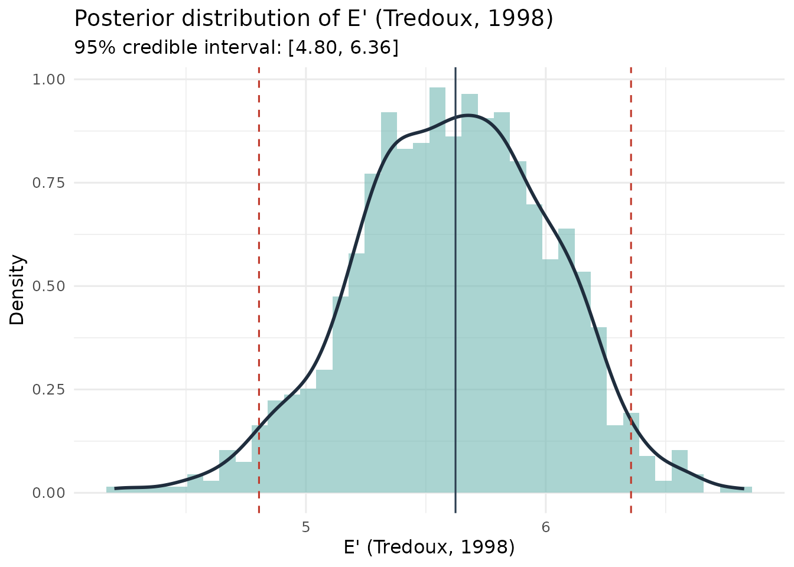
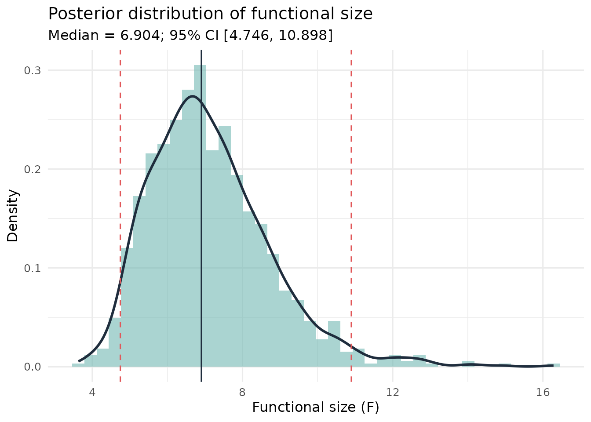
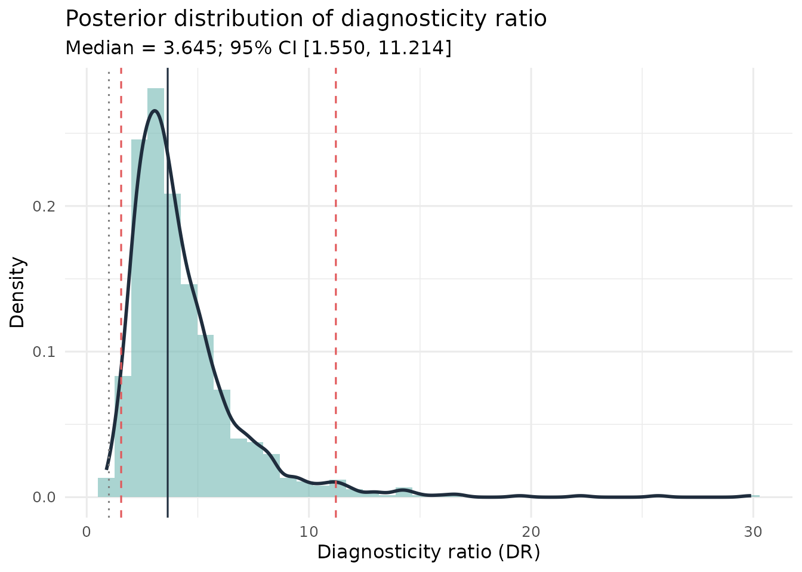
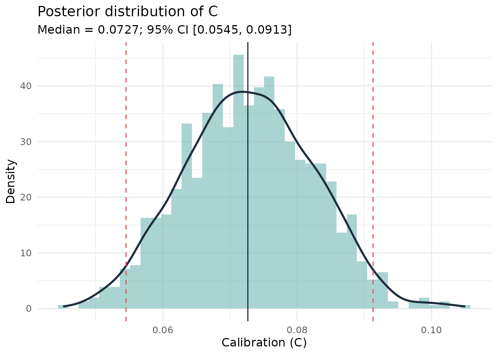
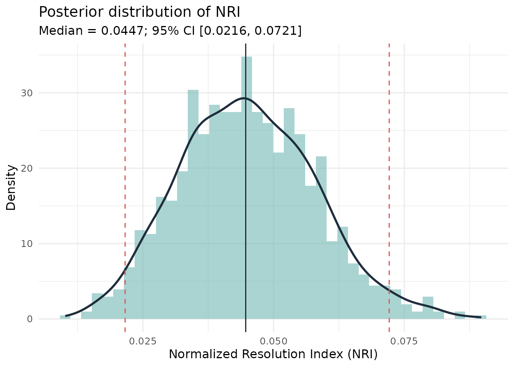
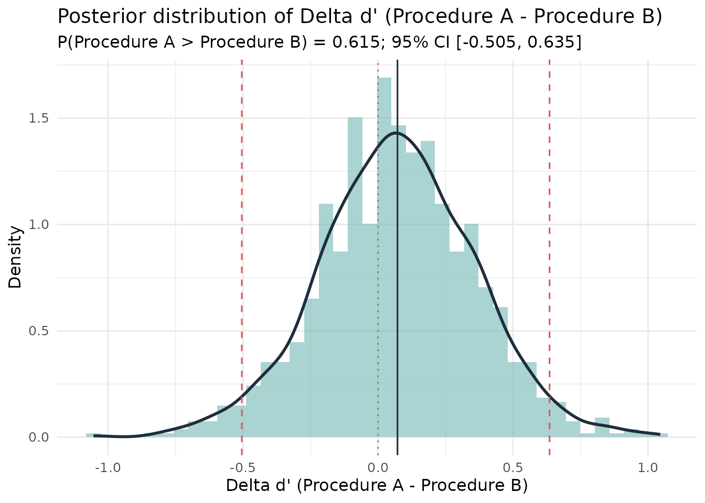

# Bayesian Inference for Lineup Measures

> **Acknowledgement.** Large language models supplied by Anthropic and
> OpenAI were used in preparing this vignette, to assist with checking
> code, testing the veracity of the approaches described, and on
> occasion editing the text. Responsibility for the content rests with
> the authors.

## Purpose

This vignette shows the Bayesian posterior summaries in **r4lineups**
for lineup fairness and confidence-based eyewitness measures.

Use these functions when you want credible intervals or direct
probability statements such as $`P(E' < 6 \mid data)`$,
$`P(F < 6 \mid data)`$, or $`P(DR > 1 \mid data)`$. The examples use
small posterior samples so that the vignette runs quickly during package
checks; increase `S` for final analyses.

### If you have only used frequentist methods

Most readers of this package will have been trained in the frequentist
tradition, so it is worth setting out plainly what is different here.
Nothing in what follows requires accepting a philosophical position; it
is mainly about what question the interval answers.

**The question you probably want to ask.** Having measured a six-person
lineup and obtained an effective size of 4.8, the natural question is:
*what is the probability that this lineup’s effective size is below 6?*
A frequentist confidence interval cannot answer that. It is a statement
about the procedure — that intervals constructed this way contain the
true value 95% of the time — not about this lineup. The true effective
size either is or is not below 6, and frequentist probability does not
attach to it.

A Bayesian **credible interval** does answer it. “There is a 95%
probability that E′ lies between 4.1 and 5.6, given these data” is a
statement about the quantity, and it is the statement most people
believe they are making when they report a confidence interval.

**How that is achieved.** By treating the unknown quantity as having a
distribution. Three steps:

1.  A **prior** describes what is believed before seeing the data. Here
    the priors are deliberately weak — `alpha = 0.5` is the Jeffreys
    prior for proportions, which is close to saying “no lineup member is
    favoured, and I am not confident about that either”.
2.  The **data** update it through the likelihood.
3.  The result is the **posterior**, a full distribution for the
    quantity, from which any summary can be read: a median, an interval,
    or a direct probability such as $`P(E' < 6)`$.

**Why the functions return draws rather than formulas.** Effective size
is $`1/\sum p_i^2`$ — a nonlinear function of the choice probabilities.
There is no tidy closed form for its posterior. Instead the functions
sample `S` draws from the posterior of the probabilities and transform
each draw. The resulting collection of `S` values *is* the posterior of
E′, and any summary is computed from it. This is why `S` matters: too
few draws and the summaries are noisy. Note that these are independent
Monte Carlo draws, not MCMC, so there is no chain to check for
convergence.

**What you gain in practice**, beyond the interpretation:

- **Bounded quantities behave properly.** E′ cannot exceed lineup size
  and a proportion cannot be negative. Normal-theory intervals can and
  do run outside those bounds at small samples; a posterior on the
  natural scale cannot.
- **Direct probabilities.** $`P(DR > 1)`$ is often exactly what a report
  needs, and is awkward to extract from a p-value.
- **Small samples degrade gracefully.** With few mock witnesses the
  posterior becomes wide, which is the honest result, rather than
  producing a narrow interval resting on an asymptotic approximation
  that does not hold.

**What it does not give you.** It is not a way of getting a decisive
answer from thin data. A weak prior and a small sample give a wide
posterior, and that width is the finding.

``` r

library(r4lineups)
```

## Data Shapes

The Bayesian fairness functions use mock-witness lineup choices:

- a **lineup vector**, where each value is the chosen lineup position;
  or
- a **lineup table**, where each cell is the count for one lineup
  position.

The Bayesian calibration function uses the standard confidence-based
data frame with `target_present`, `identification`, and `confidence`.
The SDT comparison uses summary counts: hits, misses, false alarms, and
correct rejections for two conditions.

## Effective Size

[`esize_T_bayes()`](https://cgtza2.github.io/r4lineups/reference/esize_T_bayes.md)
fits a Dirichlet-multinomial model to the lineup choice counts and
transforms each posterior draw of the choice-probability vector to
Tredoux’s effective size $`E'`$.

``` r

data(nortje2012)

lineup_vec <- nortje2012$lineup_1
k <- max(lineup_vec, na.rm = TRUE)
lineup_tab <- table(factor(lineup_vec, levels = seq_len(k)))

set.seed(1)
esize_post <- esize_T_bayes(
  lineup_tab,
  alpha = 0.5,
  S = 1000,
  threshold = k
)

esize_post
#> Bayesian Posterior: Effective Size E' (Tredoux, 1998)
#> ------------------------------------------------
#>   k (positions): 8    N (choices): 133    S (draws): 1000
#>   Prior: Dirichlet(alpha = 0.50)
#>   Posterior mean:   5.614
#>   Posterior median: 5.624
#>   95% credible interval: [4.804, 6.355]
#>   P(E' < 8.00 | data): 1.000
#>   P(E' > 8.00 | data): 0.000
```

``` r

plot(esize_post)
```



The threshold argument makes the posterior useful for fairness
benchmarks. For example, with a six-person lineup one might inspect
$`P(E' < 6 \mid data)`$ as a posterior probability that the effective
size falls below nominal size.

## Functional Size

[`func_size_bayes()`](https://cgtza2.github.io/r4lineups/reference/func_size_bayes.md)
models the suspect-selection rate with a beta-binomial posterior and
transforms posterior draws to functional size.

``` r

set.seed(2)
func_post <- func_size_bayes(
  lineup_vec,
  target_pos = 3,
  alpha = 0.5,
  S = 1000,
  threshold = k
)

func_post
#> Bayesian Functional Size - Beta-Binomial model
#>   Prior: Jeffreys-type Beta(0.50, 0.50)
#>   n = 133, suspect IDs = 19 (rate = 0.143)
#>   Posterior mean F:   7.144
#>   Posterior median F: 6.904
#>   95% credible interval: [4.746, 10.898]
#>   P(F < 8.000 | data): 0.7480
#>   P(F > 8.000 | data): 0.2520
```

``` r

plot(func_post)
```



## Diagnosticity Ratio

[`diag_ratio_T_bayes()`](https://cgtza2.github.io/r4lineups/reference/diag_ratio_T_bayes.md)
models target-present and target-absent suspect-selection rates with
independent beta-binomial posteriors and returns the posterior of the
diagnosticity ratio.

``` r

tp_vec <- nortje2012$lineup_1
ta_vec <- nortje2012$lineup_2

set.seed(3)
diag_post <- diag_ratio_T_bayes(
  lineup_pres = tp_vec,
  lineup_abs = ta_vec,
  pos_pres = 3,
  pos_abs = 3,
  k1 = max(tp_vec, na.rm = TRUE),
  k2 = max(ta_vec, na.rm = TRUE),
  alpha = 0.5,
  S = 1000,
  threshold = 1
)

diag_post
#> Bayesian Diagnosticity Ratio (Tredoux) - Beta-Binomial model
#>   Prior: Jeffreys-type Beta(0.50, 0.50)
#>   TP lineup: n = 133, suspect IDs = 19
#>   TA lineup: n = 133, suspect IDs = 5
#>   Posterior mean DR:   4.337
#>   Posterior median DR: 3.645
#>   95% credible interval: [1.550, 11.214]
#>   P(DR < 1.000 | data): 0.0010
#>   P(DR > 1.000 | data): 0.9990
```

``` r

plot(diag_post)
```



The threshold `1` is useful because $`DR > 1`$ indicates that suspect
identifications are more common in the target-present lineup than in the
target-absent lineup.

## Calibration

[`calibration_bayes()`](https://cgtza2.github.io/r4lineups/reference/calibration_bayes.md)
places beta posteriors on accuracy within confidence bins and propagates
uncertainty into calibration $`C`$, over/underconfidence $`O/U`$, and
normalized resolution $`NRI`$.

``` r

data(lineup_example)

set.seed(4)
cal_post <- calibration_bayes(
  lineup_example,
  confidence_bins = c(0, 60, 80, 100),
  alpha = 0.5,
  S = 1000
)

cal_post
#> Bayesian Calibration Analysis - Beta-Binomial model
#>   n = 503; 3 confidence bins; prior alpha = 0.50
#>   C (calibration):      mean = 0.0729, median = 0.0727, 95% CI [0.0545, 0.0913]
#>   O/U (over/underconf): mean = -0.2268, median = -0.2266, 95% CI [-0.2564, -0.1931]
#>   NRI (resolution):     mean = 0.0450, median = 0.0447, 95% CI [0.0216, 0.0721]
#>   (Frequentist: C = 0.0727, O/U = -0.2290, NRI = 0.0453)
```

``` r

plot(cal_post, metric = "C")
```



``` r

plot(cal_post, metric = "NRI")
```



## SDT d’ Comparison

[`sdt_compare()`](https://cgtza2.github.io/r4lineups/reference/sdt_compare.md)
compares two conditions using summary SDT counts. It draws from
posterior hit and false-alarm rates, converts each draw to $`d'`$, and
reports the posterior for $`\Delta d' = d'_A - d'_B`$.

``` r

set.seed(5)
sdt_post <- sdt_compare(
  hits_A = 45, misses_A = 55, fas_A = 12, crs_A = 88,
  hits_B = 38, misses_B = 62, fas_B = 10, crs_B = 90,
  label_A = "Procedure A",
  label_B = "Procedure B",
  alpha = 0.5,
  S = 1000
)

sdt_post
#> Bayesian SDT Comparison: Procedure A vs Procedure B
#>   Prior: Jeffreys Beta(0.50, 0.50) on HR and FAR
#>   Posterior mean d': Procedure A = 1.042, Procedure B = 0.971
#>   Delta d' (Procedure A - Procedure B):
#>     Posterior mean:   0.072
#>     Posterior median: 0.072
#>     95% CI: [-0.505, 0.635]
#>   P(d'_Procedure A > d'_Procedure B | data): 0.6150
#>   P(d'_Procedure B > d'_Procedure A | data): 0.3850
#>   (Frequentist z-test: z = 0.254, p = 0.7994)
```

``` r

plot(sdt_post)
```



## Workflow Position

These Bayesian functions complement, rather than replace, the
frequentist and bootstrap functions elsewhere in the package:

- use normal-theory functions for quick classical intervals where
  assumptions are acceptable;
- use bootstrap functions when you want sampling-distribution
  uncertainty with minimal distributional assumptions;
- use Bayesian functions when credible intervals and direct posterior
  probabilities are the clearest way to express uncertainty.

For substantive reports, run enough posterior draws for stable summaries
and check sensitivity to the prior concentration, for example
`alpha = 0.1`, `0.5`, and `1`.

``` r

sensitivity <- do.call(rbind, lapply(c(0.1, 0.5, 1.0), function(a) {
  set.seed(11)
  post <- esize_T_bayes(lineup_tab, alpha = a, S = 2000, threshold = k)
  data.frame(
    `Prior alpha`      = a,
    `Posterior median` = round(post$posterior_median, 3),
    `Lower`            = round(post$credible_interval[["lower"]], 3),
    `Upper`            = round(post$credible_interval[["upper"]], 3),
    check.names = FALSE
  )
}))

knitr::kable(
  sensitivity, row.names = FALSE,
  caption = "Sensitivity of the E' posterior to prior concentration, nortje2012 lineup 1 (nominal size 8)."
)
```

| Prior alpha | Posterior median | Lower | Upper |
|------------:|-----------------:|------:|------:|
|         0.1 |            5.530 | 4.702 | 6.255 |
|         0.5 |            5.622 | 4.785 | 6.346 |
|         1.0 |            5.706 | 4.861 | 6.485 |

Sensitivity of the E’ posterior to prior concentration, nortje2012
lineup 1 (nominal size 8). {.table}

If the three rows agree closely, as they generally will once there are a
few dozen choices, the prior is doing little and the result is driven by
the data. Disagreement is a signal that the sample is too small for the
data to dominate, and should be reported rather than resolved by picking
a prior.

### Technical Details

#### What is being sampled

| Function | Model | Transformation applied to each draw |
|----|----|----|
| [`esize_T_bayes()`](https://cgtza2.github.io/r4lineups/reference/esize_T_bayes.md) | Dirichlet-multinomial on the k choice counts | $`E' = 1/\sum_i p_i^2`$ |
| [`func_size_bayes()`](https://cgtza2.github.io/r4lineups/reference/func_size_bayes.md) | Beta-binomial on suspect selections | $`F = 1/p_{\text{suspect}}`$ |
| [`diag_ratio_T_bayes()`](https://cgtza2.github.io/r4lineups/reference/diag_ratio_T_bayes.md) | Independent beta-binomials for the two lineups | $`DR = p_{\text{TP}} / p_{\text{TA}}`$ |
| [`calibration_bayes()`](https://cgtza2.github.io/r4lineups/reference/calibration_bayes.md) | Beta posterior on accuracy within each confidence bin | C, O/U and NRI |
| [`sdt_compare()`](https://cgtza2.github.io/r4lineups/reference/sdt_compare.md) | Beta posteriors on hit and false-alarm rates | $`\Delta d' = d'_A - d'_B`$ |

In each case the posterior of the *transformed* quantity is obtained by
transforming draws, not by approximating the transformation. This
matters for quantities like $`DR`$, a ratio whose sampling distribution
is markedly skewed: the posterior inherits that skew correctly, where a
symmetric normal-theory interval would not.

#### The prior

`alpha` is the concentration parameter of the Dirichlet or beta prior,
applied symmetrically. `alpha = 0.5` is the Jeffreys prior, `alpha = 1`
is uniform, and smaller values place more weight near the boundaries.
All are weak; with more than a few dozen observations the likelihood
dominates, which the sensitivity check above is there to confirm.

#### Monte Carlo error

Summaries are computed from `S` independent draws, so they carry Monte
Carlo error of order $`1/\sqrt{S}`$. These are not Markov chains, so
autocorrelation and convergence diagnostics do not apply. `S = 1000` is
adequate for a median, but tail probabilities and interval endpoints
need more — use 10,000 or more where a reported number depends on them.

#### Assumptions

1.  Choices are independent across witnesses, and each witness
    contributes one.
2.  The Dirichlet-multinomial treats members as exchangeable *a priori*.
    That is a statement about prior ignorance, not a claim that foils
    are interchangeable in fact; the data are what distinguish them.
3.  [`diag_ratio_T_bayes()`](https://cgtza2.github.io/r4lineups/reference/diag_ratio_T_bayes.md)
    treats the two lineups as independent samples.
4.  [`sdt_compare()`](https://cgtza2.github.io/r4lineups/reference/sdt_compare.md)
    assumes equal-variance signal detection, as the classical $`d'`$
    does.

### References

Agresti, A., & Agresti, B. F. (1978). Statistical analysis of
qualitative variation. *Sociological Methodology, 9*, 204-237.

Tredoux, C. G. (1998). Statistical inference on measures of lineup
fairness. *Law and Human Behavior, 22*(2), 217-237.

### Further Reading

- [`?esize_T_bayes`](https://cgtza2.github.io/r4lineups/reference/esize_T_bayes.md),
  [`?func_size_bayes`](https://cgtza2.github.io/r4lineups/reference/func_size_bayes.md),
  [`?diag_ratio_T_bayes`](https://cgtza2.github.io/r4lineups/reference/diag_ratio_T_bayes.md),
  [`?calibration_bayes`](https://cgtza2.github.io/r4lineups/reference/calibration_bayes.md),
  [`?sdt_compare`](https://cgtza2.github.io/r4lineups/reference/sdt_compare.md)
- The main vignette for the frequentist and bootstrap counterparts, and
  for the small-sample bias of the plug-in E′ estimator
