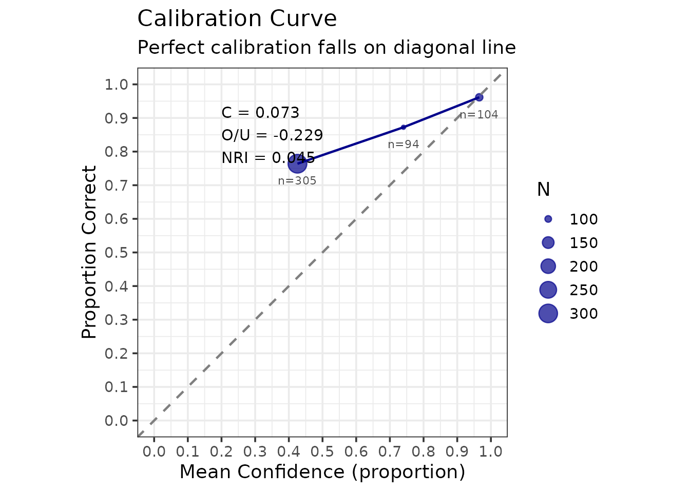
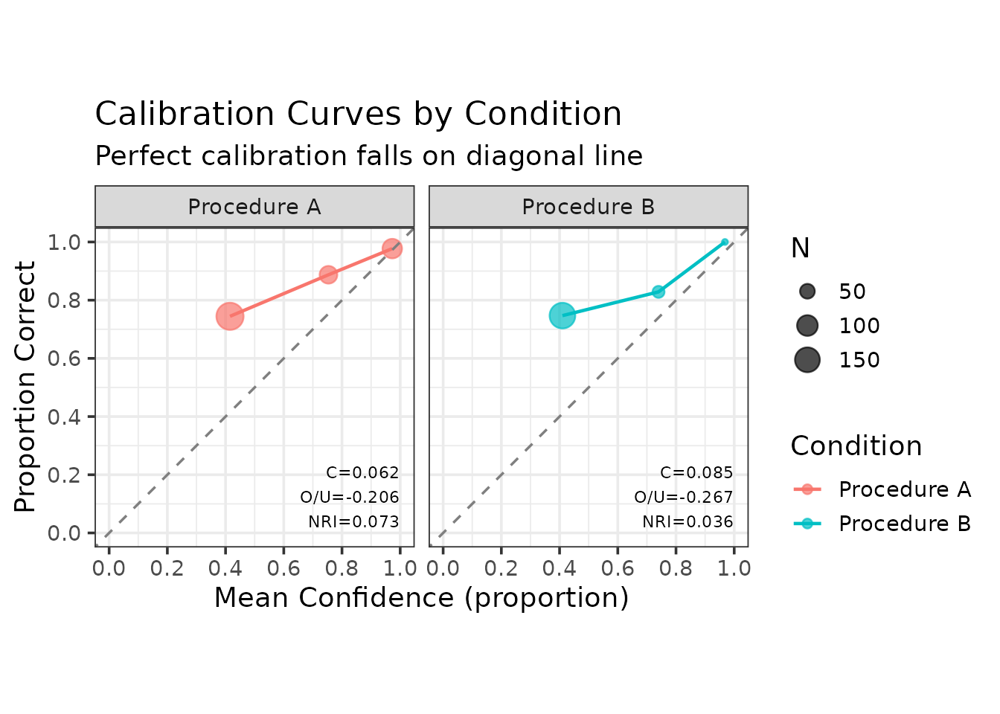
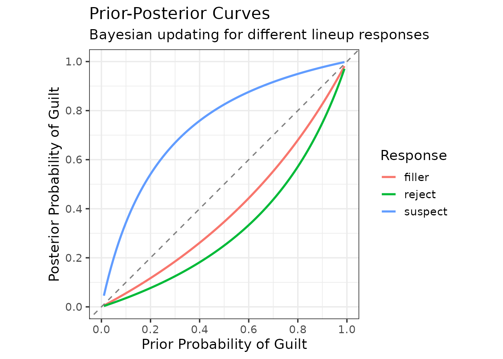
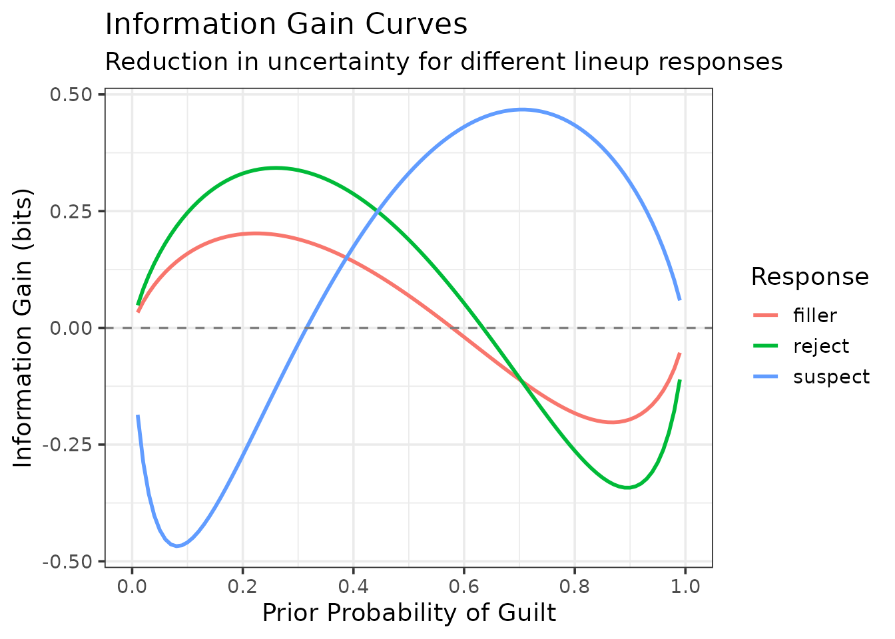
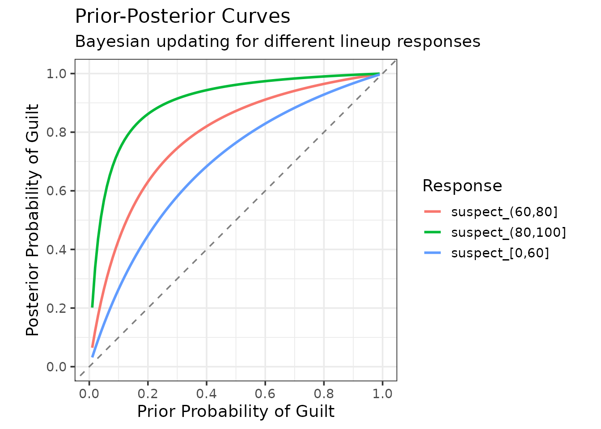
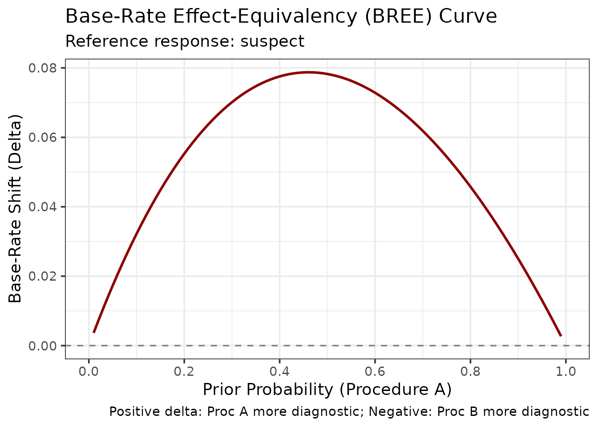
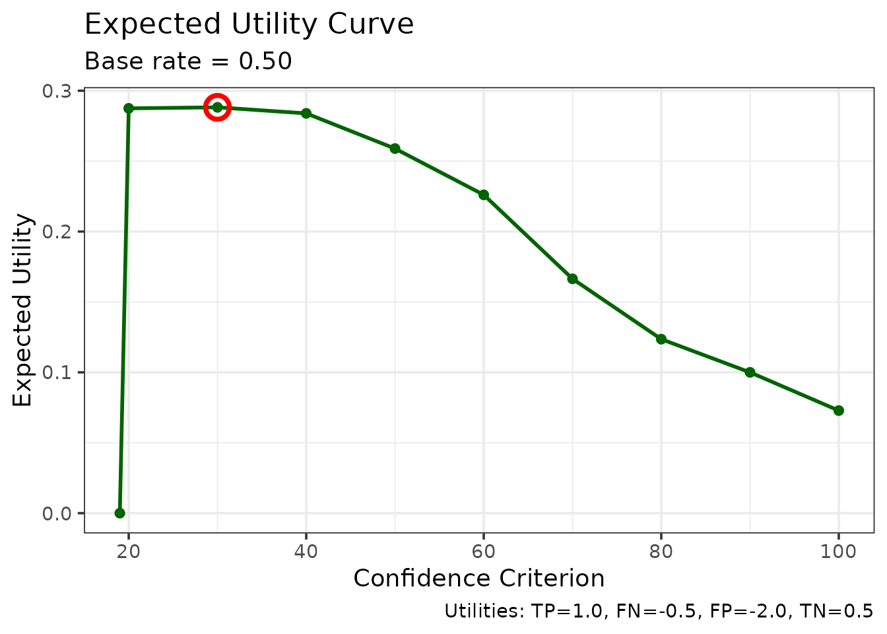
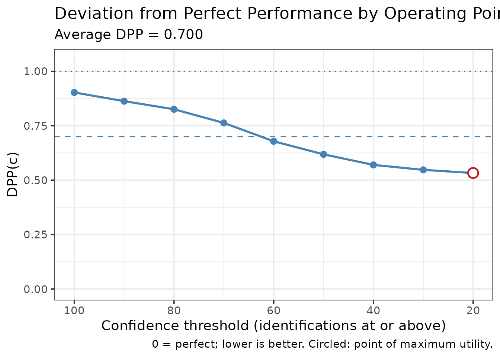
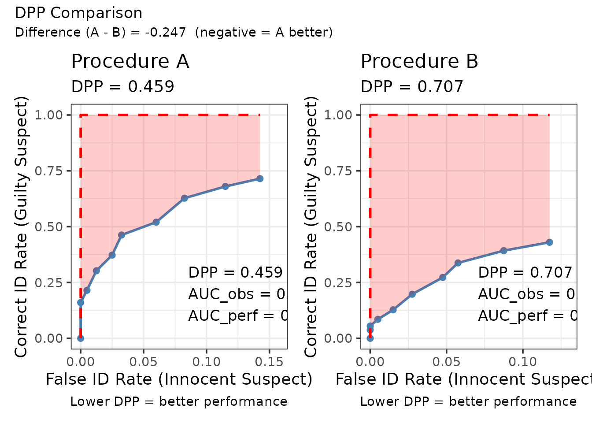
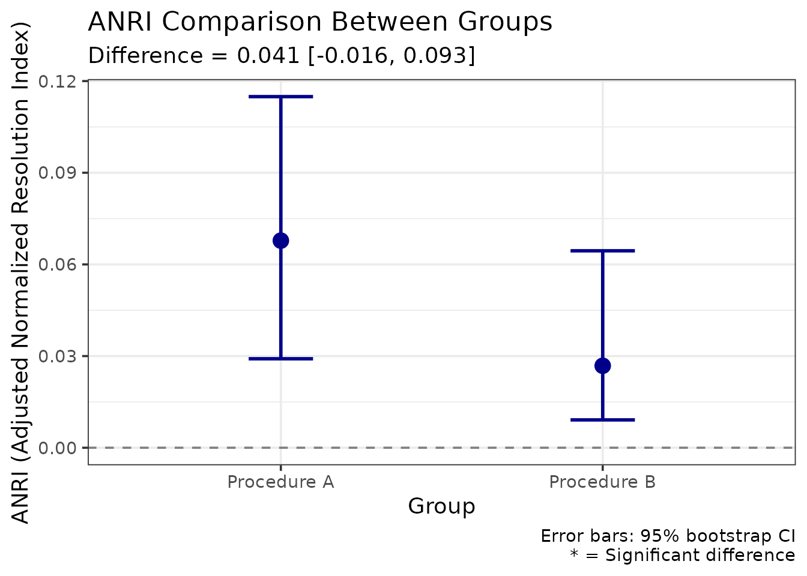

# Calibration and Decision Analysis

> **Acknowledgement.** Large language models supplied by Anthropic and
> OpenAI were used in preparing this vignette, to assist with checking
> code, testing the veracity of the approaches described, and on
> occasion editing the text. Responsibility for the content rests with
> the authors.

## Introduction

This vignette demonstrates five statistical methods for analyzing
eyewitness identification data in **r4lineups**:

1.  **Calibration Analysis** - Assessing confidence-accuracy
    correspondence
2.  **Bayesian Information-Gain Curves** - Evaluating diagnostic value
    of evidence
3.  **Expected Utility Analysis** - Decision-theoretic evaluation with
    cost/benefit tradeoffs
4.  **Deviation from Perfect Performance (DPP)** - ROC-based
    truncation-robust metric
5.  **ANRI** - Bias-corrected resolution index with bootstrap inference

These methods complement the traditional lineup fairness measures by
providing analyses of identification accuracy, confidence calibration,
and decision-making utility.

They answer different questions.

**Calibration analysis** asks whether a witness’s confidence *means*
what it appears to mean: when witnesses say they are 90% sure, are they
right 90% of the time? It yields a calibration curve and three summary
statistics, and it is the oldest of the five in eyewitness work (Juslin,
Olsson & Winman, 1996).

**Bayesian information-gain analysis** asks a different question: given
a particular identification response, how much should a rational
observer revise their belief that the suspect is guilty? This is the
framework of Wells, Yang and Smalarz (2015), and it makes explicit
something the other methods leave implicit — that the evidential value
of an identification depends on the prior probability of guilt, which is
a property of the investigation and not of the witness.

**Expected utility analysis** goes one step further and asks what a
policy *should* be. Given the costs of a wrongful identification and the
benefits of a correct one, at what confidence level should an
identification be acted upon? Lampinen, Smith and Wells (2019) set out
the framework and show that it can disagree with ROC-based conclusions
about which procedure is better.

**Deviation from perfect performance (DPP)** is a discriminability
measure, proposed by Smith, Lampinen, Wells, Smalarz and Mackovichova
(2019) as an alternative to partial area under the ROC curve. Their
argument is that pAUC does not track the diagnostic utility of a lineup,
and DPP does.

**ANRI** is a small-sample correction to the normalized resolution
index. NRI (Yaniv, Yates & Smith, 1991) is positively biased when the
number of confidence bins is large relative to sample size; ANRI removes
that bias so that resolution can be compared across studies and tested
formally.

## Data Format

All methods in this vignette require a dataframe with at least the
following columns:

- `target_present`: Logical. TRUE if the guilty suspect is in the lineup
- `identification`: Character. “suspect”, “filler”, or “reject”
- `confidence`: Numeric. Confidence rating (any scale)

We use the built-in `lineup_example` dataset throughout. It contains 700
target-present and 700 target-absent lineups of size 6.

``` r
library(r4lineups)
data(lineup_example)

head(lineup_example)
  target_present lineup_member suspect_pos identification confidence
1          FALSE             2           1         filler         40
2          FALSE             3           1         filler         50
3           TRUE             2           1         filler         40
4           TRUE             1           1        suspect         80
5           TRUE             1           1        suspect         60
6          FALSE             0           1         reject         20
```

### Why there is a `lineup_member` column

`lineup_example` records two further columns, for a reason that applies
to any lineup data you collect or simulate yourself.

`identification` collapses a witness’s decision into three categories.
That is what the analysis functions consume, but it is *not* what should
be recorded. The raw datum is **which lineup member the witness chose**
— `lineup_member`, with `0` for a rejection — together with the
suspect’s position, `suspect_pos`. The label is then derived:

``` r
head(classify_lineup_choices(
  lineup_example[, c("lineup_member", "suspect_pos")],
  k = 6
))
  lineup_member suspect_pos identification
1             2           1         filler
2             3           1         filler
3             2           1         filler
4             1           1        suspect
5             1           1        suspect
6             0           1         reject
```

This is important because **foils are not interchangeable**. They differ
in how plausible they are, and a foil that nobody ever chooses is not a
functioning alternative to the suspect at all — it is precisely what
makes a lineup unfair. Recording only “filler” throws that information
away. In `lineup_example` the five foils attract very different numbers
of choices:

``` r
lineup_table(
  lineup_example$lineup_member[lineup_example$lineup_member > 0],
  k = 6, suspect_pos = 1
)
Lineup choices (k = 6, N = 1132)

 pos:  1*    2    3    4   5   6
 cnt: 503  248  203  115  53  10

 * = nominated suspect
```

`lineup_example` is simulated, and it is simulated at the level of
individual foils: each is given its own mean memory strength rather than
being drawn from a common distribution. See
[`?simulate_lineup_data`](https://cgtza2.github.io/r4lineups/reference/simulate_lineup_data.md)
and its `foil_bias` argument if you want to generate data of your own on
the same basis.

## 1. Calibration Analysis

Calibration measures how well confidence judgments correspond to
accuracy. Perfect calibration means that when witnesses express X%
confidence, they are correct X% of the time.

### Basic Calibration

``` r

# Compute calibration with binned confidence
cal_result <- make_calibration(
  lineup_example,
  confidence_bins = c(0, 60, 80, 100),
  choosers_only = TRUE  # Analyze only suspect identifications
)
```


``` r

print(cal_result)

=== Lineup Calibration Analysis ===

Analysis type: Choosers only (suspect IDs)
Total N: 503 

Calibration Statistics:
  C (Calibration):         0.0727 
  O/U (Over/Under):        -0.2290 
  NRI (Resolution):        0.0453 

Overall Performance:
  Mean Accuracy:      0.825 
  Mean Confidence:    0.596 

Calibration Data by Bin:

[38;5;246m# A tibble: 3 × 7
[39m
  bin          n mean_confidence accuracy n_correct n_incorrect
  
[3m
[38;5;246m<chr>
[39m
[23m    
[3m
[38;5;246m<dbl>
[39m
[23m           
[3m
[38;5;246m<dbl>
[39m
[23m    
[3m
[38;5;246m<dbl>
[39m
[23m     
[3m
[38;5;246m<dbl>
[39m
[23m       
[3m
[38;5;246m<dbl>
[39m
[23m

[38;5;250m1
[39m [0,60]     305            42.6    0.764       233          72

[38;5;250m2
[39m (60,80]     94            74.0    0.872        82          12

[38;5;250m3
[39m (80,100]   104            96.5    0.962       100           4

[38;5;246m# ℹ 1 more variable: mean_confidence_prop <dbl>
[39m

Plot: save this object first, then extract it with x$plot
```

The output provides three key statistics:

- **C statistic**: Overall calibration quality (0 = perfect, higher =
  worse)
- **O/U (Over/Under confidence)**: Positive = overconfident, Negative =
  underconfident
- **NRI (Normalized Resolution Index)**: Ability to discriminate
  accuracy levels with confidence (higher = better)

### Interpreting the Calibration Plot

The calibration plot shows:

- **Diagonal line**: Perfect calibration
- **Points above diagonal**: Underconfident (accuracy exceeds
  confidence)
- **Points below diagonal**: Overconfident (confidence exceeds accuracy)
- **Point size**: Sample size in each bin

``` r

cal_result$plot
```



Accuracy rises steadily across the confidence bins, from about 76% in
the lowest to about 96% in the highest, so confidence here is genuinely
informative. The points sit *above* the diagonal, however, which means
these witnesses are **under**confident: they are more accurate than
their stated confidence implies. That is the direction the O/U statistic
reports.

The plot is an ordinary **ggplot2** object, so it can be modified and
saved in the usual way.
[`ggsave()`](https://ggplot2.tidyverse.org/reference/ggsave.html) picks
its output format from the file extension alone, so the same call writes
PNG, PDF, SVG or TIFF depending on what you ask for:

``` r

outfile <- file.path(tempdir(), "calibration_plot.png")
ggplot2::ggsave(outfile, cal_result$plot, width = 8, height = 6, dpi = 300)

# Change only the extension to change the format:
#   ggsave("calibration_plot.pdf", cal_result$plot)   # vector, for print
#   ggsave("calibration_plot.svg", cal_result$plot)   # vector, for the web
```

### Calibration by Condition

The question here is whether calibration differs between two
identification procedures. To answer it we need data from two
procedures, and `lineup_example` records only one, so we simulate them.

The comparison is only meaningful if the two conditions genuinely
differ. We give Procedure A the stronger memory evidence
(`d_prime = 1.8` against `1.1`), as might arise from better viewing
conditions or a better-constructed lineup, and give the two lineups
different foil quality as well. Note that both are seeded, so the
results below are reproducible rather than changing on every rebuild.

``` r

# Procedure A: stronger evidence, and foils that are reasonable alternatives
data_proc_a <- as.data.frame(simulate_lineup_data(
  n_tp = 400, n_ta = 400, d_prime = 1.8, c_criterion = 0.9,
  lineup_size = 6, conf_levels = 9,
  foil_bias = c(0.4, 0.2, 0.0, -0.3, -0.8), seed = 101
))

# Procedure B: weaker evidence, and one near-useless foil
data_proc_b <- as.data.frame(simulate_lineup_data(
  n_tp = 400, n_ta = 400, d_prime = 1.1, c_criterion = 0.9,
  lineup_size = 6, conf_levels = 9,
  foil_bias = c(0.5, 0.1, -0.2, -0.9, -2.0), seed = 102
))

# Put confidence on the same 20-100 scale used by lineup_example
conf_scale <- round(seq(20, 100, length.out = 9))
data_proc_a$confidence <- conf_scale[data_proc_a$confidence]
data_proc_b$confidence <- conf_scale[data_proc_b$confidence]

# Combine into one frame with a condition variable
procedures <- rbind(
  transform(data_proc_a, procedure = "Procedure A"),
  transform(data_proc_b, procedure = "Procedure B")
)
```

``` r

cal_by_cond <- make_calibration_by_condition(
  procedures,
  condition_vars = "procedure",
  confidence_bins = c(0, 60, 80, 100)
)

knitr::kable(
  cal_by_cond$condition_summary, digits = 3,
  caption = "Calibration statistics by procedure, simulated data (choosers only)."
)
```

| condition   |   n |     C |     OU |   NRI | overall_accuracy | overall_confidence |
|:------------|----:|------:|-------:|------:|-----------------:|-------------------:|
| Procedure A | 343 | 0.062 | -0.206 | 0.073 |            0.834 |              0.628 |
| Procedure B | 219 | 0.085 | -0.267 | 0.036 |            0.785 |              0.519 |

Calibration statistics by procedure, simulated data (choosers only).
{.table}

The per-bin detail for each procedure is in `cal_by_cond$by_condition`.
The object does not carry a plot; draw one with
[`make_calibration_by_condition_gg()`](https://cgtza2.github.io/r4lineups/reference/make_calibration_by_condition_gg.md):

``` r

make_calibration_by_condition_gg(cal_by_cond)
```



## 2. Bayesian Information-Gain Analysis

Bayesian analysis evaluates how much an identification response changes
our belief about guilt, quantified as information gain (reduction in
uncertainty). The framework is that of Wells, Yang and Smalarz (2015).

### The arithmetic, briefly

Let $`G`$ denote the event that the suspect is guilty and $`x`$ a
particular identification response — say, a suspect identification made
with confidence above 80. Bayes’ theorem gives the posterior probability
of guilt as

``` math
P(G \mid x) \;=\;
\frac{P(x \mid G)\,P(G)}{P(x \mid G)\,P(G) + P(x \mid \neg G)\,\bigl(1 - P(G)\bigr)}
```

The two conditional probabilities are estimated directly from the data:
$`P(x \mid G)`$ is the proportion of target-present witnesses who gave
response $`x`$, and $`P(x \mid \neg G)`$ the proportion of target-absent
witnesses who did. Their ratio is the **likelihood ratio**,

``` math
\mathrm{LR}(x) \;=\; \frac{P(x \mid G)}{P(x \mid \neg G)}
```

and it is the whole of what the identification contributes. An
$`\mathrm{LR}`$ of 1 means the response is uninformative; larger values
point towards guilt, smaller towards innocence.
[`make_bayes_curves()`](https://cgtza2.github.io/r4lineups/reference/make_bayes_curves.md)
returns these quantities in `$likelihoods`:

``` r

lik <- make_bayes_curves(
  lineup_example,
  response_categories = "confidence",
  confidence_bins = c(0, 60, 80, 100)
)$likelihoods

knitr::kable(
  transform(
    as.data.frame(lik)[, c("response", "p_x_given_guilty",
                           "p_x_given_innocent", "n_guilty", "n_innocent")],
    LR = round(lik$p_x_given_guilty / lik$p_x_given_innocent, 2)
  ),
  digits = 3, row.names = FALSE,
  caption = "Response likelihoods and likelihood ratios, lineup_example."
)
```

| response | p_x_given_guilty | p_x_given_innocent | n_guilty | n_innocent | LR |
|:---|---:|---:|---:|---:|---:|
| filler\_(60,80\] | 0.057 | 0.084 | 40 | 59 | 0.68 |
| filler\_(80,100\] | 0.019 | 0.043 | 13 | 30 | 0.43 |
| filler\_\[0,60\] | 0.236 | 0.460 | 165 | 322 | 0.51 |
| reject\_\[0,60\] | 0.096 | 0.287 | 67 | 201 | 0.33 |
| suspect\_(60,80\] | 0.117 | 0.017 | 82 | 12 | 6.83 |
| suspect\_(80,100\] | 0.143 | 0.006 | 100 | 4 | 25.00 |
| suspect\_\[0,60\] | 0.333 | 0.103 | 233 | 72 | 3.24 |

Response likelihoods and likelihood ratios, lineup_example. {.table
style="width:100%;"}

A high-confidence suspect identification carries a likelihood ratio of
roughly 25 here, while a rejection carries one of about 0.3 — that is,
it is evidence *against* guilt. Note also that the likelihood ratio, not
the posterior, is the portable quantity: it belongs to the
identification procedure, whereas the posterior additionally depends on
the prior, which belongs to the investigation.

One practical warning. If no target-absent witness ever produces a given
response, the estimated $`P(x \mid \neg G)`$ is zero, the likelihood
ratio is infinite, and the posterior curve is pinned at 1.0 for every
prior. That is almost always a sign of too few observations or too
narrow a bin rather than of perfectly diagnostic evidence, and
[`make_bayes_curves()`](https://cgtza2.github.io/r4lineups/reference/make_bayes_curves.md)
warns when it happens.

### Prior-Posterior Curves

``` r
# Compute Bayesian curves for simple responses
bayes_result <- make_bayes_curves(
  lineup_example,
  response_categories = "simple",  # "suspect", "filler", "reject"
  prior_grid = seq(0.01, 0.99, 0.01)
)

print(bayes_result)
$curves

[38;5;246m# A tibble: 297 × 4
[39m
   response prior posterior information_gain
   
[3m
[38;5;246m<chr>
[39m
[23m    
[3m
[38;5;246m<dbl>
[39m
[23m     
[3m
[38;5;246m<dbl>
[39m
[23m            
[3m
[38;5;246m<dbl>
[39m
[23m

[38;5;250m 1
[39m filler    0.01   0.005
[4m3
[24m
[4m3
[24m           0.032
[4m9
[24m

[38;5;250m 2
[39m filler    0.02   0.010
[4m7
[24m            0.056
[4m0
[24m

[38;5;250m 3
[39m filler    0.03   0.016
[4m1
[24m            0.075
[4m2
[24m

[38;5;250m 4
[39m filler    0.04   0.021
[4m6
[24m            0.091
[4m8
[24m

[38;5;250m 5
[39m filler    0.05   0.027
[4m2
[24m            0.106 

[38;5;250m 6
[39m filler    0.06   0.032
[4m7
[24m            0.119 

[38;5;250m 7
[39m filler    0.07   0.038
[4m4
[24m            0.131 

[38;5;250m 8
[39m filler    0.08   0.044
[4m1
[24m            0.141 

[38;5;250m 9
[39m filler    0.09   0.049
[4m8
[24m            0.151 

[38;5;250m10
[39m filler    0.1    0.055
[4m7
[24m            0.159 

[38;5;246m# ℹ 287 more rows
[39m

$likelihoods

[38;5;246m# A tibble: 3 × 5
[39m
  response p_x_given_guilty p_x_given_innocent n_guilty n_innocent
  
[3m
[38;5;246m<chr>
[39m
[23m               
[3m
[38;5;246m<dbl>
[39m
[23m              
[3m
[38;5;246m<dbl>
[39m
[23m    
[3m
[38;5;246m<int>
[39m
[23m      
[3m
[38;5;246m<dbl>
[39m
[23m

[38;5;250m1
[39m filler             0.311               0.587      218        411

[38;5;250m2
[39m reject             0.095
[4m7
[24m              0.287       67        201

[38;5;250m3
[39m suspect            0.593               0.126      415         88

$response_counts

[38;5;246m# A tibble: 3 × 3
[39m
  response n_guilty n_innocent
  
[3m
[38;5;246m<chr>
[39m
[23m       
[3m
[38;5;246m<int>
[39m
[23m      
[3m
[38;5;246m<dbl>
[39m
[23m

[38;5;250m1
[39m filler        218        411

[38;5;250m2
[39m reject         67        201

[38;5;250m3
[39m suspect       415         88

$n_guilty
[1] 700

$n_innocent
[1] 700

$response_categories
[1] "simple"

$lineup_size
[1] 6

$innocent_suspect_method
[1] "designated"

# Plot prior-posterior relationships
plot_bayes_prior_posterior(bayes_result)
```



The plot shows how each response type updates prior belief:

- **Lines above diagonal**: Evidence increases guilt belief (diagnostic
  of guilt)
- **Lines below diagonal**: Evidence decreases guilt belief (diagnostic
  of innocence)
- **Distance from the diagonal**: at a given prior, the further a curve
  lies from the diagonal, the larger the likelihood ratio of that
  response. Compare curves at the same prior, not by their local slopes.

The prior-posterior curve is due to Wells, Yang and Smalarz (2015), who
introduced it along with the base-rate effect-equivalency curve used
later in this vignette. The implementation here is written directly from
that paper.

**On the shape of these curves.** They are curved, and that curvature is
not an artefact of any smoothing: no loess or spline is fitted anywhere
in these plots. For a response with likelihood ratio $`L`$, the
posterior as a function of the prior $`p`$ is
``` math
q(p) = \frac{Lp}{1 + (L - 1)p}, \qquad
q''(p) = \frac{-2L(L - 1)}{[1 + (L - 1)p]^3}.
```
The curvature has one sign throughout: the curve is concave (bowed above
the diagonal) when $`L > 1`$, convex (bowed below it) when $`L < 1`$,
and the diagonal itself when $`L = 1`$. It is not S-shaped. What the
display shows is that the same response moves belief most, in absolute
terms, at middling priors, and very little when the prior is already
near 0 or near 1.

### Information Gain

Information gain quantifies uncertainty reduction, measured in bits: the
entropy of the prior minus the entropy of the posterior. Where the
posterior curve says *where belief ends up*, information gain says *how
much uncertainty was removed*:

``` r

plot_bayes_information_gain(bayes_result)
```



Interpretation:

- **Positive values**: the response moves belief towards certainty
  (towards 0 or 1), so uncertainty falls.
- **Negative values**: the response moves belief towards 50/50, so
  uncertainty rises. That is not a sign of misleading evidence: a
  suspect identification given a low prior raises the probability of
  guilt towards .5, which is the correct update and also the most
  uncertain state.
- **Where each curve peaks** depends on the direction of the evidence.
  Responses that point to guilt (suspect identifications) gain most at
  priors above .5, where they push belief towards 1; responses that
  point to innocence (rejections, filler identifications) gain most at
  priors below .5.

The curves bend sharply because binary entropy changes fastest near 0
and 1. That shape is a property of the measure, not of these data or of
any smoothing.

### Confidence-Based Bayesian Analysis

Analyze by confidence level:

``` r

bayes_conf <- make_bayes_curves(
  lineup_example,
  response_categories = "confidence",
  confidence_bins = c(0, 60, 80, 100)
)

# Get suspect responses only
suspect_responses <- grep("^suspect_", unique(bayes_conf$curves$response), value = TRUE)
plot_bayes_prior_posterior(bayes_conf, selected_responses = suspect_responses)
```



Splitting suspect identifications by confidence separates three quite
different kinds of evidence. The highest-confidence band sits well above
the others across the whole range of priors, which is the Bayesian
restatement of the calibration result found earlier: high-confidence
identifications from this procedure are worth considerably more than
low-confidence ones.

The three curves stay clearly apart and none is pinned to the top of the
plot. A curve that *is* pinned flat at 1.0 signals the zero-cell problem
described above, not evidence of unusual strength.

### Base-Rate Equivalency of Evidence (BREE)

The base-rate effect-equivalency curve, also from Wells, Yang and
Smalarz (2015), answers a question that comes up whenever two procedures
are compared and neither dominates: *how much better is one than the
other, expressed in units anyone can interpret?*

The idea is to express the difference as an exchange rate between base
rates. Suppose Procedure A, applied to a case with a 20% prior
probability of guilt, yields a certain posterior after a suspect
identification. We can then ask what prior Procedure B would need in
order to reach that same posterior. If B needs a 40% prior to get where
A got from 20%, then A is worth as much as a doubling of the base rate —
and a doubling of the base rate is something an investigator has an
intuition about, in a way that a difference in pAUC is not.

Plotting that correspondence for every prior gives the BREE curve.
[`plot_bree()`](https://cgtza2.github.io/r4lineups/reference/plot_bree.md)
draws the base-rate shift $`\Delta`$ = prior needed by B − prior used by
A, against A’s prior. The dashed horizontal line at $`\Delta = 0`$ is
the null result of no difference; positive $`\Delta`$ means B needs the
larger prior, so A’s suspect identification is the more diagnostic, and
the further the curve lies above zero, the larger A’s advantage.
(Plotting B’s prior directly against A’s would put the reference on the
diagonal instead, with A’s advantage above it.)

The two procedures are the ones simulated in the [Calibration by
Condition](#calibration-by-condition) section: `data_proc_a` and
`data_proc_b` are data frames of target-present and target-absent
identifications with confidence, one row per witness (not lineup
vectors). Procedure A has the stronger memory evidence (d′ = 1.8 against
1.1).

``` r

bree_result <- make_bree_curve(
  data_proc_a,
  data_proc_b,
  reference_response = "suspect"
)

plot_bree(bree_result)
```



The shift is positive throughout, from 0.003 to 0.079, so Procedure B
always needs a *higher* prior probability of guilt to reach the
posterior that A reaches — which is to say that a suspect identification
from Procedure A is worth more. At a prior of 0.2 for A, B needs 0.255.
The shift is largest, 0.079, near a prior of 0.46, and shrinks towards
both ends of the scale, where neither procedure’s evidence can move
belief much.

## 3. Expected Utility Analysis

The methods so far describe how good a procedure is. Expected utility
analysis asks what should be *done* about it, and it is the framework of
Lampinen, Smith and Wells (2019).

The motivating observation is that discriminability measures are silent
about consequences. An ROC curve treats a missed identification of a
guilty suspect and the identification of an innocent one as two kinds of
error, without saying how much worse one is than the other. But everyone
agrees they are not equally bad, and once that is admitted, the question
of which procedure is preferable cannot be settled without saying by how
much. Lampinen et al. show that ROC analysis and expected utility
analysis can rank the same two procedures differently — the dissociation
their title refers to — so the choice of framework is not a
technicality.

### Define Utility Matrix

The costs and benefits must be stated explicitly. That is often felt to
be the uncomfortable part of the exercise, but the values are being
assumed either way; utility analysis only makes them visible and open to
argument.

Four outcomes need a value, on any common scale:

``` r

utility_matrix <- c(
  tp =  1.0,   # Correct identification of a guilty suspect: a benefit
  fn = -0.5,   # Failing to identify a guilty suspect: a cost
  fp = -2.0,   # Identifying an innocent suspect: the most serious cost
  tn =  0.5    # Correctly declining to identify an innocent suspect: a benefit
)
```

The relative magnitudes carry the argument. Here a wrongful
identification is set at four times the cost of a missed one (`-2.0`
against `-0.5`), and twice the absolute value of a correct
identification’s benefit. That is a moral and legal judgement, not a
statistical one, and it is the natural place for disagreement. Someone
who set `fp = -10` would be expressing Blackstone’s ratio; the analysis
below would then recommend a considerably stricter confidence threshold.
Because the choice is this important, report the sensitivity of the
conclusion to it, which is what the base-rate section does for the other
key assumption.

### Compute Utility Curves

``` r
# Compute expected utility across confidence criteria
util_result <- make_utility_curves(
  lineup_example,
  base_rate = 0.5,  # Assume 50% guilty suspects
  utility_matrix = utility_matrix,
  lineup_size = 6
)

print(util_result)
$utility_data

[38;5;246m# A tibble: 10 × 7
[39m
   criterion strategy   hit_rate false_alarm_rate expected_utility n_ids_tp
       
[3m
[38;5;246m<dbl>
[39m
[23m 
[3m
[38;5;246m<chr>
[39m
[23m         
[3m
[38;5;246m<dbl>
[39m
[23m            
[3m
[38;5;246m<dbl>
[39m
[23m            
[3m
[38;5;246m<dbl>
[39m
[23m    
[3m
[38;5;246m<dbl>
[39m
[23m

[38;5;250m 1
[39m       100 threshold    0.097
[4m1
[24m          0                 0.072
[4m9
[24m       68

[38;5;250m 2
[39m        90 threshold    0.143           0.005
[4m7
[24m
[4m1
[24m           0.1         100

[38;5;250m 3
[39m        80 threshold    0.189           0.014
[4m3
[24m            0.124       132

[38;5;250m 4
[39m        70 threshold    0.26            0.022
[4m9
[24m            0.166       182

[38;5;250m 5
[39m        60 threshold    0.351           0.03              0.226       246

[38;5;250m 6
[39m        50 threshold    0.436           0.054
[4m3
[24m            0.259       305

[38;5;250m 7
[39m        40 threshold    0.507           0.077
[4m1
[24m            0.284       355

[38;5;250m 8
[39m        30 threshold    0.556           0.103             0.288       389

[38;5;250m 9
[39m        20 threshold    0.593           0.126             0.288       415

[38;5;250m10
[39m       101 reject_all   0               0                 0             0

[38;5;246m# ℹ 1 more variable: n_ids_ta <dbl>
[39m

$max_utility
$max_utility$expected_utility
       tp 
0.2882143 

$max_utility$criterion
[1] 30

$max_utility$strategy
[1] "threshold"

$max_utility$hit_rate
[1] 0.5557143

$max_utility$false_alarm_rate
[1] 0.1028571


$avg_utility
[1] 0.2008333

$utility_all_ids
    tp 
0.2875 

$base_rate
[1] 0.5

$utility_matrix
  tp   fn   fp   tn 
 1.0 -0.5 -2.0  0.5 

$n_target_present
[1] 700

$n_target_absent
[1] 700

$innocent_suspect_method
[1] "designated"

$criteria
[1] "confidence"

# Plot utility curves
plot_utility_curves(util_result)
```



The plot shows:

- **Expected utility** at each confidence threshold
- **Optimal threshold**: Maximum utility point
- **Comparison with “all identifications”** strategy

Reading it from right to left: a very strict threshold acts on almost
nothing, so little is gained and little is risked. Relaxing the
threshold admits identifications that are mostly correct, and utility
climbs. Past the optimum, each further relaxation admits more wrongful
identifications than correct ones, and because those carry four times
the weight, utility falls away again. The maximum is the criterion at
which the marginal identification is exactly worth acting on.

This is the shape Lampinen et al. (2019) describe. Note that the curve
is usually rather flat near its peak, which is reassuring for practice:
thresholds somewhat either side of the optimum lose very little, so the
recommendation does not depend on locating the maximum precisely.

### Compare Procedures

`max_utility` is a list rather than a single number: it reports the best
expected utility together with the criterion that achieves it, and the
hit and false-alarm rates at that criterion. Ask for the element you
want.

The optimum can be a confidence criterion or the decision to reject
every identification. `max_utility$strategy` says which, so a small
helper turns the result into a rule that can be stated:

``` r

utility_rule <- function(m) {
  if (m$strategy == "reject_all") "Act on no identification"
  else paste0("Act on confidence >= ", m$criterion)
}
```

``` r

# Compare the two procedures simulated in the Calibration by Condition section
util_proc_a <- make_utility_curves(data_proc_a, base_rate = 0.5,
                                   utility_matrix = utility_matrix)
util_proc_b <- make_utility_curves(data_proc_b, base_rate = 0.5,
                                   utility_matrix = utility_matrix)

knitr::kable(
  data.frame(
    Procedure = c("A (d' = 1.8)", "B (d' = 1.1)"),
    `Max expected utility` = round(c(util_proc_a$max_utility$expected_utility,
                                     util_proc_b$max_utility$expected_utility), 3),
    `Optimal rule` = c(utility_rule(util_proc_a$max_utility),
                       utility_rule(util_proc_b$max_utility)),
    check.names = FALSE
  ),
  caption = "Expected utility at the optimal confidence criterion, simulated data (200 target-present and 200 target-absent lineups per procedure)."
)
```

| Procedure    | Max expected utility | Optimal rule             |
|:-------------|---------------------:|:-------------------------|
| A (d’ = 1.8) |                0.367 | Act on confidence \>= 40 |
| B (d’ = 1.1) |                0.185 | Act on confidence \>= 30 |

Expected utility at the optimal confidence criterion, simulated data
(200 target-present and 200 target-absent lineups per procedure).
{.table}

The procedure with the stronger evidence supports both a higher expected
utility and a stricter criterion: it can afford to wait for
high-confidence identifications because it gets more of them.

### Sensitivity to Base Rate

Examine how utility depends on base rate:

``` r

# Test multiple base rates
base_rates <- c(0.2, 0.5, 0.8)

sensitivity <- do.call(rbind, lapply(base_rates, function(br) {
  util <- make_utility_curves(lineup_example, base_rate = br,
                              utility_matrix = utility_matrix,
                              lineup_size = 6)
  data.frame(
    `Base rate` = br,
    `Max expected utility` = round(util$max_utility$expected_utility, 3),
    `Optimal rule` = utility_rule(util$max_utility),
    check.names = FALSE
  )
}))

knitr::kable(
  sensitivity,
  row.names = FALSE,
  caption = "Sensitivity of expected utility to the assumed base rate, lineup_example data."
)
```

| Base rate | Max expected utility | Optimal rule             |
|----------:|---------------------:|:-------------------------|
|       0.2 |                0.345 | Act on confidence \>= 60 |
|       0.5 |                0.288 | Act on confidence \>= 30 |
|       0.8 |                0.349 | Act on confidence \>= 20 |

Sensitivity of expected utility to the assumed base rate, lineup_example
data. {.table}

Base rate is very important. When guilty suspects are rare, any given
identification is more likely to be a false one, so the optimal
criterion becomes stricter: here “act on confidence \>= 60” at a base
rate of 0.2, against “act on confidence \>= 20” at 0.8. The attainable
utility is not ordered by base rate in any simple way, because it also
depends on how the cost matrix values the outcomes that become more
common; here it is 0.345, 0.288 and 0.349 at the three base rates.
Compare utilities across procedures at the same base rate, not across
base rates.

## 4. Deviation from Perfect Performance (DPP)

DPP quantifies how far an ROC curve deviates from perfect performance,
and it is robust to ROC truncation — that is, to witnesses not using the
full confidence scale.

It was proposed by Smith, Lampinen, Wells, Smalarz and Mackovichova
(2019) as a replacement for partial area under the ROC curve, but it is
contested. Lineup ROC curves cannot be traced over their full range: the
observed false-alarm rate only extends as far as witnesses’ willingness
to choose takes it, and that endpoint differs between procedures. pAUC
handles this by integrating over a restricted region, but the choice of
region is then itself a problem. Take the region from the procedure with
the shorter curve and information from the other is discarded; take a
common region and the comparison is made somewhere neither procedure was
actually operating. Smith et al. argue that pAUC consequently fails to
track which procedure has greater diagnostic utility, and that DPP does.

DPP takes a different approach. Rather than integrating over a region,
it is computed at every operating point of the ROC, that is, at every
cumulative confidence threshold, and then averaged. At an operating
point $`c`$ (their Equation 2),

``` math
DPP(c) = 1 - \text{Culprit}(c) + \text{Innocent}(c),
```

where Culprit($`c`$) is the culprit (correct) identification rate and
Innocent($`c`$) the innocent-suspect identification rate at that
threshold. DPP($`c`$) is 0 for perfect performance (every culprit
identified and no innocent suspect), 1 for any point on the chance
diagonal, and 2 for the worst possible performance. When culprits are
present in half of all lineups and the two errors are equally costly,
DPP($`c`$) is one minus the expected utility at that threshold, so the
average DPP measures the average utility of the procedure across the
confidence levels witnesses actually use. Because every procedure is
evaluated at its own operating points, curves of different lengths
remain comparable.

This is an active disagreement rather than settled ground, and the pAUC
vignette takes up the other side of it.

### Basic DPP

``` r
dpp_result <- make_dpp(
  lineup_example,
  lineup_size = 6
)

dpp_result$dpp
[1] 0.7001587
dpp_result$dpp_by_point

[38;5;246m# A tibble: 9 × 4
[39m
  confidence culprit_rate innocent_rate   dpp
       
[3m
[38;5;246m<dbl>
[39m
[23m        
[3m
[38;5;246m<dbl>
[39m
[23m         
[3m
[38;5;246m<dbl>
[39m
[23m 
[3m
[38;5;246m<dbl>
[39m
[23m

[38;5;250m1
[39m        100       0.097
[4m1
[24m       0       0.903

[38;5;250m2
[39m         90       0.143        0.005
[4m7
[24m
[4m1
[24m 0.863

[38;5;250m3
[39m         80       0.189        0.014
[4m3
[24m  0.826

[38;5;250m4
[39m         70       0.26         0.022
[4m9
[24m  0.763

[38;5;250m5
[39m         60       0.351        0.03    0.679

[38;5;250m6
[39m         50       0.436        0.054
[4m3
[24m  0.619

[38;5;250m7
[39m         40       0.507        0.077
[4m1
[24m  0.57 

[38;5;250m8
[39m         30       0.556        0.103   0.547

[38;5;250m9
[39m         20       0.593        0.126   0.533

plot_dpp(dpp_result)
```



The table lists each operating point, from the strictest threshold to
the most lenient, which counts every identification. The plot shows
DPP($`c`$) at each of them, the average as a dashed line, and the chance
reference at 1. The circled point has the lowest DPP and so the highest
utility; it is the threshold at which acting on identifications would do
the most good under equal costs and a base rate of .5.

### Different costs and base rates

Smith et al.’s Equation 3 weights the two errors:

``` math
DPP_{\alpha\beta}(c) = \beta[1 - \text{Culprit}(c)] + \alpha(1 - \beta)\text{Innocent}(c),
```

where $`\alpha`$ is the cost of identifying an innocent suspect relative
to missing the culprit, and $`\beta`$ is the base rate of culprit
presence. With $`\alpha = 1`$ and $`\beta = .5`$ this is half of
Equation 2. Weighted values no longer range from 0 to 2, so they are
comparable only with other values computed with the same weights.

``` r
# An innocent-suspect identification three times as costly as a miss,
# with culprits present in 30% of lineups
make_dpp(lineup_example, alpha = 3, beta = 0.3)$dpp
[1] 0.296619
```

### Compare DPP Between Groups

The comparison is the usual use. Here the two simulated procedures from
earlier differ in the strength of the evidence they generate, so
Procedure A should show the smaller deviation. As Smith et al. did,
[`compare_dpp()`](https://cgtza2.github.io/r4lineups/reference/compare_dpp.md)
tests the difference with a nonparametric bootstrap, resampling
target-present and target-absent trials separately within each
procedure:

``` r
dpp_comparison <- compare_dpp(
  data_proc_a,
  data_proc_b,
  lineup_size = 6,
  n_bootstrap = 500,
  seed = 2026
)

dpp_comparison

=== DPP Comparison ===

Average DPP, procedure A:  0.6022 
Average DPP, procedure B:  0.8247 
Difference (A - B):        -0.2225  (negative = A better)
Bootstrap SE:              0.0268
95% percentile interval:  [-0.2797, -0.1726]  (500 resamples)

plot_dpp_comparison(dpp_comparison)
```



A negative difference favours Procedure A. The interval is a percentile
bootstrap interval for the difference in average DPP.

### When to Use DPP

Use DPP when:

- You have confidence-based ROC data
- ROC curves are truncated (witnesses may not use full scale)
- You want a single performance metric comparable across studies
- You need to compare procedures with different confidence distributions

## 5. ANRI: Adjusted Normalized Resolution Index

ANRI corrects NRI for small-sample bias, making it more appropriate for
hypothesis testing and group comparisons.

Resolution is the third of the properties confidence can have, alongside
calibration and over/underconfidence. A witness could be poorly
calibrated — systematically over- or underconfident — and yet have
excellent resolution, if their confidence still ranked correct
identifications above incorrect ones. Resolution is arguably the most
important property in practice, since a systematic bias can be corrected
for once known, whereas an inability to discriminate cannot.

NRI (Yaniv, Yates & Smith, 1991) measures this, but it is **positively
biased**: some apparent resolution arises from sampling noise alone.
Splitting a sample into more confidence bins gives noise more
opportunity to look like signal, so the bias grows with the number of
bins and shrinks with sample size. Two studies using different numbers
of bins therefore cannot have their NRIs compared directly. ANRI
estimates and removes that bias.

### Basic ANRI

``` r
# Compute ANRI
anri_result <- compute_anri(
  lineup_example,
  confidence_bins = c(0, 60, 80, 100)
)

print(anri_result)
$anri
[1] 0.04145948

$nri
[1] 0.04527077

$n_total
[1] 503

$n_bins
[1] 3

$calibration_data

[38;5;246m# A tibble: 3 × 7
[39m
  bin          n mean_confidence accuracy n_correct n_incorrect
  
[3m
[38;5;246m<chr>
[39m
[23m    
[3m
[38;5;246m<dbl>
[39m
[23m           
[3m
[38;5;246m<dbl>
[39m
[23m    
[3m
[38;5;246m<dbl>
[39m
[23m     
[3m
[38;5;246m<dbl>
[39m
[23m       
[3m
[38;5;246m<dbl>
[39m
[23m

[38;5;250m1
[39m [0,60]     305            42.6    0.764       233          72

[38;5;250m2
[39m (60,80]     94            74.0    0.872        82          12

[38;5;250m3
[39m (80,100]   104            96.5    0.962       100           4

[38;5;246m# ℹ 1 more variable: mean_confidence_prop <dbl>
[39m

$overall_accuracy
[1] 0.8250497

$overall_confidence
[1] 0.5960239

$choosers_only
[1] TRUE
```

ANRI is always ≤ NRI because it removes positive bias. The bias
correction is larger when:

- Sample size N is small
- Number of bins J is large
- The ratio J/N is high

### Bootstrap Confidence Intervals

A point estimate is not much use on its own, so the interval comes from
a bootstrap. `n_bootstrap = 100` keeps this vignette quick; use 2000 or
more for anything you intend to report.

``` r

anri_boot <- bootstrap_anri(
  lineup_example,
  confidence_bins = c(0, 60, 80, 100),
  n_bootstrap = 100,
  conf_level = 0.95,
  seed = 123
)

knitr::kable(
  data.frame(
    Statistic = c("NRI (uncorrected)", "ANRI (bias-corrected)"),
    Estimate  = round(c(anri_boot$nri, anri_boot$anri), 3),
    `95% CI`  = c("—", sprintf("[%.3f, %.3f]",
                               anri_boot$ci_lower, anri_boot$ci_upper)),
    check.names = FALSE
  ),
  row.names = FALSE,
  caption = "Resolution with bootstrap interval, lineup_example, 3 confidence bins."
)
```

| Statistic             | Estimate | 95% CI           |
|:----------------------|---------:|:-----------------|
| NRI (uncorrected)     |    0.045 | —                |
| ANRI (bias-corrected) |    0.041 | \[0.025, 0.068\] |

Resolution with bootstrap interval, lineup_example, 3 confidence bins.
{.table}

No interval is given for NRI because it would add nothing. ANRI is a
linear rescaling of NRI, $`ANRI = (N \cdot NRI - J + 1)/(N - J + 1)`$,
so with $`N =`$ 503 suspect identifications and $`J =`$ 3 bins the two
differ only by the bias correction (0.045 against 0.041 here). An
interval for NRI would be the ANRI interval shifted upward by that bias,
so it is ANRI and its interval that should be reported and compared.

### Compare Groups

The comparison uses the two simulated procedures, which differ in the
strength of the evidence they generate. Because they were simulated with
genuinely different parameters, any difference found here reflects that
design rather than chance group assignment.

``` r
anri_comparison <- compare_anri(
  procedures,
  group_var = "procedure",
  confidence_bins = c(0, 60, 80, 100),
  n_bootstrap = 100,
  seed = 456
)

print(anri_comparison)
$anri_group1
[1] 0.06778469

$anri_group2
[1] 0.02682759

$nri_group1
[1] 0.07322035

$nri_group2
[1] 0.03571501

$difference
[1] 0.04095711

$ci_lower
[1] -0.0162656

$ci_upper
[1] 0.09288628

$conf_level
[1] 0.95

$significant
 2.5% 
FALSE 

$group_names
[1] "Procedure A" "Procedure B"

$n_bootstrap
[1] 100

$n_bootstrap_requested
[1] 100

$n_failed
[1] 0

$bootstrap_results_group1
$bootstrap_results_group1$anri
[1] 0.06778469

$bootstrap_results_group1$nri
[1] 0.07322035

$bootstrap_results_group1$ci_lower
[1] 0.02912137

$bootstrap_results_group1$ci_upper
[1] 0.1149089

$bootstrap_results_group1$conf_level
[1] 0.95

$bootstrap_results_group1$n_bootstrap
[1] 100

$bootstrap_results_group1$n_bootstrap_requested
[1] 100

$bootstrap_results_group1$n_failed
[1] 0

$bootstrap_results_group1$n_total
[1] 343

$bootstrap_results_group1$n_bins
[1] 3

$bootstrap_results_group1$bootstrap_distribution
  [1] 0.06708598 0.06570604 0.08047661 0.04987933 0.07221240 0.06148205
  [7] 0.07212585 0.08571190 0.06816675 0.06999423 0.05916390 0.09510135
 [13] 0.03142914 0.04505713 0.05639861 0.09915104 0.03885619 0.07716533
 [19] 0.05518367 0.06160329 0.08011800 0.03582855 0.05369086 0.08262844
 [25] 0.11270127 0.09078520 0.11118346 0.06107025 0.11095935 0.03686786
 [31] 0.07824433 0.10365266 0.06466421 0.07758830 0.06246753 0.04141894
 [37] 0.08328425 0.08469806 0.08008407 0.06726736 0.02703340 0.06715568
 [43] 0.06081143 0.04384714 0.06404480 0.08060125 0.09375399 0.04073706
 [49] 0.05561147 0.06537103 0.08259529 0.07587945 0.06234151 0.11957211
 [55] 0.06314098 0.02570420 0.04332888 0.09238761 0.10012490 0.11869072
 [61] 0.05276179 0.09538591 0.07677354 0.04634813 0.08990006 0.05857359
 [67] 0.10507931 0.07623093 0.11105741 0.07602279 0.08272019 0.04113382
 [73] 0.08082205 0.05360715 0.09284835 0.01839824 0.03796410 0.07069711
 [79] 0.07777091 0.08588510 0.11690619 0.06030880 0.10590118 0.10782745
 [85] 0.06639759 0.06499843 0.07933454 0.06463416 0.09112998 0.06640864
 [91] 0.06755599 0.07182240 0.09123954 0.07012033 0.09326807 0.08488978
 [97] 0.08600358 0.07038152 0.06785717 0.03480324


$bootstrap_results_group2
$bootstrap_results_group2$anri
[1] 0.02682759

$bootstrap_results_group2$nri
[1] 0.03571501

$bootstrap_results_group2$ci_lower
[1] 0.009110349

$bootstrap_results_group2$ci_upper
[1] 0.06445527

$bootstrap_results_group2$conf_level
[1] 0.95

$bootstrap_results_group2$n_bootstrap
[1] 100

$bootstrap_results_group2$n_bootstrap_requested
[1] 100

$bootstrap_results_group2$n_failed
[1] 0

$bootstrap_results_group2$n_total
[1] 219

$bootstrap_results_group2$n_bins
[1] 3

$bootstrap_results_group2$bootstrap_distribution
  [1] 0.054817973 0.022421218 0.026550014 0.047942448 0.026436048 0.051313022
  [7] 0.026715655 0.035606414 0.049266532 0.033202453 0.065100176 0.019272279
 [13] 0.017972351 0.024914903 0.031759105 0.023415879 0.039935663 0.016485797
 [19] 0.028106056 0.026755049 0.042393733 0.014044901 0.047430438 0.025694351
 [25] 0.009603482 0.031974042 0.025750449 0.023649520 0.016634482 0.034929618
 [31] 0.044207564 0.042362668 0.025991477 0.033185154 0.037640835 0.026160620
 [37] 0.011972828 0.007036663 0.041360143 0.024607043 0.027630872 0.030317349
 [43] 0.032542761 0.019641566 0.022733987 0.010714669 0.031485628 0.021524720
 [49] 0.021008661 0.029182388 0.023620195 0.032096170 0.032127258 0.039164861
 [55] 0.022085988 0.045748433 0.022176174 0.023266895 0.034157548 0.023283074
 [61] 0.064850996 0.008664181 0.014826744 0.024504903 0.010977051 0.019082504
 [67] 0.013783056 0.023553399 0.032484769 0.026147752 0.022248487 0.030642495
 [73] 0.007978659 0.057524655 0.027271420 0.064017894 0.080392203 0.014551924
 [79] 0.051559618 0.026730444 0.026491746 0.023184755 0.035857128 0.028955733
 [85] 0.019554188 0.048800873 0.022485638 0.034746265 0.046738180 0.030777372
 [91] 0.026480496 0.025514253 0.037440071 0.038654235 0.034623890 0.033019727
 [97] 0.053811990 0.030239350 0.028706437 0.010009702


$difference_distribution
  [1]  0.0122680065  0.0432848222  0.0539265958  0.0019368818  0.0457763559
  [6]  0.0101690294  0.0454101932  0.0501054840  0.0189002169  0.0367917783
 [11] -0.0059362774  0.0758290756  0.0134567857  0.0201422261  0.0246395094
 [16]  0.0757351573 -0.0010794705  0.0606795334  0.0270776135  0.0348482420
 [21]  0.0377242712  0.0217836462  0.0062604171  0.0569340862  0.1030977881
 [26]  0.0588111547  0.0854330116  0.0374207301  0.0943248658  0.0019382433
 [31]  0.0340367627  0.0612899930  0.0386727321  0.0444031450  0.0248266917
 [36]  0.0152583218  0.0713114246  0.0776613940  0.0387239227  0.0426603164
 [41] -0.0005974759  0.0368383268  0.0282686652  0.0242055779  0.0413108181
 [46]  0.0698865853  0.0622683605  0.0192123438  0.0346028060  0.0361886426
 [51]  0.0589750985  0.0437832779  0.0302142505  0.0804072525  0.0410549946
 [56] -0.0200442308  0.0211527091  0.0691207197  0.0659673547  0.0954076458
 [61] -0.0120892085  0.0867217281  0.0619467959  0.0218432288  0.0789230117
 [66]  0.0394910885  0.0912962539  0.0526775336  0.0785726379  0.0498750399
 [71]  0.0604717015  0.0104913202  0.0728433901 -0.0039175017  0.0655769263
 [76] -0.0456196567 -0.0424281019  0.0561451813  0.0262112892  0.0591546516
 [81]  0.0904144437  0.0371240484  0.0700440502  0.0788717134  0.0468434025
 [86]  0.0161975531  0.0568489007  0.0298878990  0.0443917958  0.0356312668
 [91]  0.0410754920  0.0463081431  0.0537994645  0.0314660929  0.0586441834
 [96]  0.0518700487  0.0321915922  0.0401421675  0.0391507322  0.0247935330

plot_anri_comparison(anri_comparison)
```



The comparison provides:

- **Point estimates** for each group
- **Difference with CI**: Tests whether groups differ
- **Significance test**: CI excludes 0 = significant difference

The bootstrap difference distribution is available as
`plot_anri_difference_distribution(anri_comparison)` if you want to
inspect its shape. Inspect it when an interval looks surprising: a
heavily skewed or multimodal distribution is a sign the bins are too
thin somewhere.

### When to Use ANRI vs NRI

The considerations, rather than rules:

ANRI is the safer default whenever the bias it corrects could be
material — modest samples (say a few hundred or fewer), several
confidence bins, or any comparison across studies that binned confidence
differently. Because the bias grows with the bin-to-sample ratio, it is
exactly the studies most likely to be compared informally that are least
comparable on raw NRI. Formal tests should use ANRI, since testing a
biased estimate against zero tests the wrong thing.

NRI remains reasonable when the correction is negligible — large samples
with few bins, where ANRI and NRI will agree closely anyway — or when
the point is to compare with older published work that reported NRI. In
the analysis above the two differ by very little, which is what a sample
of this size should produce.

Reporting both, as the table above does, costs nothing and lets a reader
see the size of the correction for themselves.

## Integrating Multiple Methods

For a comprehensive analysis, combine these methods:

Each method answers a different question, so a full analysis runs
several. The five calls below use `lineup_example`; substitute your own
data frame.

``` r

bins <- c(0, 60, 80, 100)

# 1. Calibration: does confidence mean what it says?
cal <- make_calibration(lineup_example, confidence_bins = bins,
                        show_plot = FALSE)

# 2. DPP: average utility across operating points
dpp <- make_dpp(lineup_example, lineup_size = 6)

# 3. ANRI: resolution, with inference
anri <- bootstrap_anri(lineup_example, confidence_bins = bins,
                       n_bootstrap = 100, seed = 789)

# 4. Utility: what should be done about it?
util <- make_utility_curves(lineup_example, base_rate = 0.5,
                            utility_matrix = utility_matrix,
                            lineup_size = 6)

# 5. Bayesian: what is an identification worth as evidence?
bayes <- make_bayes_curves(lineup_example, response_categories = "confidence",
                           confidence_bins = bins)

knitr::kable(
  data.frame(
    Method   = c("Calibration (C)", "Over/underconfidence (O/U)",
                 "DPP", "ANRI", "Max expected utility"),
    Estimate = round(c(cal$C, cal$OU, dpp$dpp, anri$anri,
                       util$max_utility$expected_utility), 3)
  ),
  row.names = FALSE,
  caption = "Summary across all five methods, lineup_example."
)
```

| Method                     | Estimate |
|:---------------------------|---------:|
| Calibration (C)            |    0.073 |
| Over/underconfidence (O/U) |   -0.229 |
| DPP                        |    0.700 |
| ANRI                       |    0.041 |
| Max expected utility       |    0.288 |

Summary across all five methods, lineup_example. {.table}

## Reporting Results

### Example Write-Up

Every number below is computed from the objects created above rather
than typed in, so this passage cannot drift out of step with the
analysis it describes. The same practice suits a manuscript.

> We analysed identification performance using calibration analysis,
> deviation from perfect performance (DPP), and the adjusted normalized
> resolution index (ANRI) with bootstrap inference, using 1400 lineups
> of size 6 (700 target-present, 700 target-absent).
>
> Witnesses were well calibrated overall (C = 0.073), but systematically
> **underconfident** (O/U = -0.229): accuracy in the lowest confidence
> band was substantially higher than stated confidence implied. Average
> DPP was 0.7 (0 = perfect, 1 = chance), and the operating point of
> maximum utility was confidence of 20 or above (DPP = 0.533).
> Resolution, measured by ANRI, was 0.041 (95% CI \[0.021, 0.072\]),
> against an uncorrected NRI of 0.045.
>
> Expected utility analysis assumed a base rate of 50% and the cost
> matrix u(correct suspect ID) = 1, u(missed guilty suspect) = -0.5,
> u(innocent suspect ID) = -2, u(correct rejection) = 0.5; that is, a
> wrongful identification was weighted four times as heavily as a missed
> one. Under those assumptions the rule “act on confidence \>= 30”
> maximised expected utility (EU = 0.288).
>
> Bayesian analysis showed that high-confidence suspect identifications
> were the most informative response, with a likelihood ratio of 25
> (based on 100 guilty-suspect and 4 innocent-suspect identifications in
> that band).

Note the last parenthesis. The likelihood ratio there rests on very few
target-absent observations, and reporting the counts alongside the ratio
is what allows a reader to judge how much weight it will bear.

## References

Brewer, N., & Wells, G. L. (2006). The confidence-accuracy relationship
in eyewitness identification: Effects of lineup instructions, foil
similarity, and target-absent base rates. *Journal of Experimental
Psychology: Applied, 12*(1), 11-30.

Juslin, P., Olsson, N., & Winman, A. (1996). Calibration and
diagnosticity of confidence in eyewitness identification: Comments on
what can be inferred from the low confidence-accuracy correlation.
*Journal of Experimental Psychology: Learning, Memory, and Cognition,
22*(5), 1304-1316.

Lampinen, J. M., Smith, A. M., & Wells, G. L. (2019). Four utilities in
eyewitness identification practice: Dissociations between receiver
operating characteristic (ROC) analysis and expected utility analysis.
*Law and Human Behavior, 43*(1), 26-44.

Mickes, L. (2015). Receiver operating characteristic analysis and
confidence-accuracy characteristic analysis in investigations of system
variables and estimator variables that affect eyewitness memory.
*Journal of Applied Research in Memory and Cognition, 4*(2), 93-102.

Smith, A. M., Lampinen, J. M., Wells, G. L., Smalarz, L., &
Mackovichova, S. (2019). Deviation from perfect performance measures the
diagnostic utility of eyewitness lineups but partial area under the ROC
curve does not. *Journal of Applied Research in Memory and Cognition,
8*(1), 50-59. <https://doi.org/10.1016/j.jarmac.2018.09.003>

Wells, G. L., Yang, Y., & Smalarz, L. (2015). Eyewitness identification:
Bayesian information gain, base-rate effect-equivalency curves, and
reasonable suspicion. *Law and Human Behavior, 39*(2), 99-122.

Yaniv, I., Yates, J. F., & Smith, J. E. K. (1991). Measures of
discrimination skill in probabilistic judgment. *Psychological Bulletin,
110*(3), 611-617.

## Session Info

``` r
sessionInfo()
R version 4.6.2 (2026-10-29)
Platform: x86_64-pc-linux-gnu
Running under: Ubuntu 26.04.1 LTS

Matrix products: default
BLAS:   /usr/lib/x86_64-linux-gnu/openblas-pthread/libblas.so.3 
LAPACK: /usr/lib/x86_64-linux-gnu/openblas-pthread/libopenblasp-r0.3.32.so;  LAPACK version 3.12.0

locale:
 [1] LC_CTYPE=C.UTF-8       LC_NUMERIC=C           LC_TIME=C.UTF-8       
 [4] LC_COLLATE=C.UTF-8     LC_MONETARY=C.UTF-8    LC_MESSAGES=C.UTF-8   
 [7] LC_PAPER=C.UTF-8       LC_NAME=C              LC_ADDRESS=C          
[10] LC_TELEPHONE=C         LC_MEASUREMENT=C.UTF-8 LC_IDENTIFICATION=C   

time zone: UTC
tzcode source: system (glibc)

attached base packages:
[1] stats     graphics  grDevices utils     datasets  methods   base     

other attached packages:
[1] r4lineups_2.3.0

loaded via a namespace (and not attached):
 [1] Matrix_1.7-6       gtable_0.3.6       jsonlite_2.0.0     dplyr_1.2.1       
 [5] compiler_4.6.2     tidyselect_1.2.1   Rcpp_1.1.2         gridExtra_2.3.1   
 [9] jquerylib_0.1.4    png_0.1-9          systemfonts_1.3.2  scales_1.4.0      
[13] textshaping_1.0.5  boot_1.3-32        yaml_2.3.12        fastmap_1.2.0     
[17] lattice_0.23-1     reticulate_1.47.0  ggplot2_4.0.3      R6_2.6.1          
[21] labeling_0.4.3     generics_0.1.4     knitr_1.52         htmlwidgets_1.6.4 
[25] ggrepel_0.9.8      tibble_3.3.1       desc_1.4.3         bslib_0.12.0      
[29] pillar_1.11.1      RColorBrewer_1.1-3 rlang_1.3.0        utf8_1.2.6        
[33] cachem_1.1.0       xfun_0.62          fs_2.1.0           sass_0.4.10       
[37] S7_0.2.2           otel_0.2.0         cli_3.6.6          withr_3.0.3       
[41] pkgdown_2.2.1      magrittr_2.0.5     digest_0.6.39      grid_4.6.2        
[45] lifecycle_1.0.5    vctrs_0.7.3        evaluate_1.0.5     glue_1.8.1        
[49] farver_2.1.2       ragg_1.5.2         purrr_1.2.2        rmarkdown_2.32    
[53] tools_4.6.2        pkgconfig_2.0.3    htmltools_0.5.9   
```
