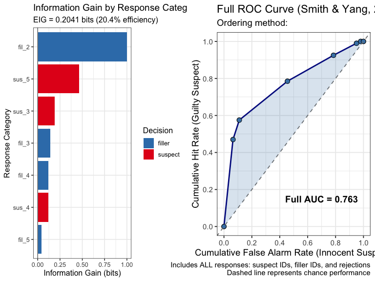

# Comparing Models for Eyewitness Identification Data

> **Acknowledgement.** Large language models supplied by Anthropic and
> OpenAI were used in preparing this vignette, to assist with checking
> code, testing the veracity of the approaches described, and on
> occasion editing the text. Responsibility for the content rests with
> the authors.

## Introduction

Eyewitness identification data can be analyzed using multiple
theoretical frameworks, each providing different information. This
vignette demonstrates how to use r4lineups’ model comparison framework
to fit and compare:

1.  **2-HT Model** (Winter et al., 2022): Multinomial Processing Tree
    model
2.  **EIG** (Starns et al., 2023): Expected Information Gain
3.  **Full ROC** (Smith & Yang, 2020): Receiver Operating Characteristic

The
[`compare_models()`](https://cgtza2.github.io/r4lineups/reference/compare_models.md)
function provides a unified interface for fitting all models and
generating comparison tables and visualizations.

## The Three Models

### 2-HT Model: Latent Cognitive Processes

The Two-High Threshold (2-HT) model is a multinomial processing tree
(MPT) that separates identification decisions into distinct latent
processes:

**Parameters:**

- **dP**: Detection of culprit presence (0-1)
- **dA**: Detection of culprit absence (0-1)
- **b**: Biased suspect selection (0-1)
- **g**: Guessing-based selection (0-1)

**Model equations** (target-present):

- P(suspect ID) = dP + (1-dP) × \[b + (1-b) × g × (1/L)\]
- P(filler ID) = (1-dP) × (1-b) × g × ((L-1)/L)
- P(reject) = (1-dP) × (1-b) × (1-g)

**Use when:**

- You want to understand underlying cognitive mechanisms
- Testing theories about detection vs. guessing
- Comparing conditions with different bias levels

### EIG: Information-Theoretic Measure

Expected Information Gain quantifies how much information witness
responses provide about guilt vs. innocence using Shannon entropy:

**Formula:** EIG = Σ p(x) × \[H(prior) - H(p(guilty\|x))\]

where x = response category (e.g., “suspect_high_confidence”)

**Interpretation:**

- EIG = 0: No information (responses don’t distinguish guilty/innocent)
- The maximum is the prior entropy, reached when every response resolves
  guilt completely. That is 1 bit only when the prior probability of
  guilt is .5; at a prior of .1 it is about .47 bits. Compare EIG values
  only at the same prior.
- Higher EIG = more diagnostic procedure

**Use when:**

- Evaluating overall diagnosticity of procedures
- Comparing different identification methods
- Assessing policy-relevant cutoffs

### Full ROC: Investigator Discriminability

Full ROC uses ALL witness responses (suspect IDs, filler IDs,
rejections) to compute a threshold-free measure of discriminability:

**Measure:**

- AUC (Area Under the Curve)
- Range: 0 to 1. A value of .5 is the no-discrimination reference, not a
  lower bound: with the a-priori ordering a procedure that does worse
  than chance gives an AUC below .5.

**Use when:**

- Measuring investigator discriminability
- Comparing system variables (lineup procedures)
- Need threshold-free performance measure

## Basic Model Comparison

### Loading Data

``` r

library(r4lineups)

lineup_data <- as.data.frame(simulate_lineup_data(
  n_tp        = 300,
  n_ta        = 300,
  d_prime     = 1.5,
  c_criterion = 0.9,   # see the note below: 0 would be far too liberal
  lineup_size = 6,
  conf_levels = 5,
  foil_bias   = c(0.4, 0.2, 0.0, -0.4, -1.0),
  seed        = 2024
))

head(lineup_data)
#>   participant_id target_present lineup_member suspect_pos identification
#> 1             64           TRUE             1           1        suspect
#> 2             89           TRUE             1           1        suspect
#> 3            573          FALSE             2           1         filler
#> 4            393          FALSE             0           1         reject
#> 5            188           TRUE             3           1         filler
#> 6            526          FALSE             3           1         filler
#>   confidence
#> 1          5
#> 2          3
#> 3          5
#> 4          1
#> 5          2
#> 6          5
```

The `c_criterion = 0.9` is not incidental: getting it wrong makes one of
the three models impossible to fit.

`c_criterion` is a threshold on the **maximum** of the lineup members’
memory strengths, not a textbook signal-detection criterion. The maximum
of six draws from a standard normal averages about 1.27, so a criterion
of 0 — the function default — is cleared by almost every lineup, and
produces a rejection rate near zero:

``` r

too_liberal <- as.data.frame(simulate_lineup_data(
  n_tp = 300, n_ta = 300, d_prime = 1.5, c_criterion = 0,
  lineup_size = 6, conf_levels = 5, seed = 2024
))

knitr::kable(
  data.frame(
    `c_criterion` = c(0, 0.9),
    `Rejection rate (%)` = round(100 * c(
      mean(too_liberal$identification == "reject"),
      mean(lineup_data$identification == "reject")
    ), 1),
    check.names = FALSE
  ),
  row.names = FALSE,
  caption = "Rejection rate under two decision criteria, simulated data (300 target-present and 300 target-absent lineups)."
)
```

| c_criterion | Rejection rate (%) |
|------------:|-------------------:|
|         0.0 |                0.2 |
|         0.9 |               20.5 |

Rejection rate under two decision criteria, simulated data (300
target-present and 300 target-absent lineups). {.table}

The 2-HT model’s detect-absence parameter `dA` is identified almost
entirely by rejections — it is the probability of correctly concluding
the culprit is absent. Here only one witness in 600 rejects, so the
likelihood carries almost no information about `dA` and the fit fails;
[`fit_winter_2ht()`](https://cgtza2.github.io/r4lineups/reference/fit_winter_2ht.md)
stops with a message naming that cause. A low rejection percentage is
not by itself fatal in a large sample; the information about `dA`
depends on the number of rejections.

### Comparing All Models

``` r

# Fit all three models
comparison <- compare_models(
  lineup_data,
  models = c("2ht", "eig", "fullroc"),
  lineup_size = 6,
  prior_guilt = 0.5
)

# View comparison table
print(comparison)
#> 
#> === Lineup Model Comparison ===
#> 
#> Models fit: 2ht, eig, fullroc 
#> Sample size: 600 
#> Lineup size: 6 
#> 
#> Comparison Table:
#>                          Model                   Measure     Value
#>     2-HT (Winter et al., 2022)            Log-likelihood -557.8100
#>     2-HT (Winter et al., 2022)                       AIC 1123.6200
#>     2-HT (Winter et al., 2022)                       BIC 1141.2100
#>     2-HT (Winter et al., 2022)   dP (detection presence)    0.4850
#>     2-HT (Winter et al., 2022)    dA (detection absence)    0.0490
#>      EIG (Starns et al., 2023) Expected Information Gain    0.1869
#>      EIG (Starns et al., 2023)    Information Efficiency   18.7000
#>      EIG (Starns et al., 2023)             Prior Entropy    1.0000
#>  Full ROC (Smith & Yang, 2020)                  Full AUC    0.7471
#>  Full ROC (Smith & Yang, 2020)          Operating Points   11.0000
#>  Full ROC (Smith & Yang, 2020)              Max Hit Rate    1.0000
#>               Interpretation
#>            Model fit quality
#>              Lower is better
#>              Lower is better
#>                       0 to 1
#>                       0 to 1
#>      Higher is better (bits)
#>          Percentage (0-100%)
#>          Maximum possible IG
#>       Higher is better (0-1)
#>  Number of decision criteria
#>             Cumulative (0-1)
#> 
#> Metrics describe different estimands and are not a single model-selection scale.
#> 
#> Access fitted models via: $fitted_models$<model_name>
#> Available models: 2ht, eig, fullroc
```

### Detailed Summary

``` r

# More detailed output
summary(comparison)
#> 
#> === Model Comparison Summary ===
#> 
#> Dataset:
#>   Total observations: 600 
#>   Target-present: 300 
#>   Target-absent: 300 
#>   Lineup size: 6 
#> 
#> Models fitted: 3 
#>    2ht, eig, fullroc 
#> 
#> --- 2-HT Model Summary ---
#>   Parameters: dP = 0.485 , dA = 0.049 , b = 0 , g = 0.754 
#>   AIC: 1123.62 
#>   BIC: 1141.21 
#> 
#> --- EIG Summary ---
#>   EIG: 0.1869 bits
#>   Information efficiency: 18.7 %
#>   Number of response categories: 11 
#> 
#> --- Full ROC Summary ---
#>   Full AUC: 0.7471 
#>   Operating points: 11 
#>   Ordering method: diagnosticity 
#> 
#> ---
#> Interpretation Guidance:
#>   - 2-HT: AIC/BIC are comparable only to other likelihood models fit to the same outcomes
#>   - EIG: Higher values = more informative procedure
#>   - Full ROC: Higher AUC = better investigator discriminability
#> 
#> Each model provides different information; consider reporting more than one.
```

### Visualizing Model Comparisons

``` r

# Side-by-side plots
plot(comparison, ncol = 3)
```



## Individual Model Access

### 2-HT Model Results

``` r

# Access 2-HT model
model_2ht <- comparison$fitted_models$`2ht`

knitr::kable(
  data.frame(Parameter = names(model_2ht$parameters),
             Estimate  = round(unname(model_2ht$parameters), 3),
             SE        = round(unname(model_2ht$se), 3)),
  row.names = FALSE,
  caption = "2-HT parameter estimates with standard errors, simulated data."
)
```

| Parameter | Estimate |  SE |
|:----------|---------:|----:|
| dP        |    0.485 |  NA |
| dA        |    0.049 |  NA |
| b         |    0.000 |  NA |
| g         |    0.754 |  NA |

2-HT parameter estimates with standard errors, simulated data. {.table}

``` r


cat("AIC:", round(model_2ht$aic, 2),
    " BIC:", round(model_2ht$bic, 2),
    " log-likelihood:", round(model_2ht$loglik, 2), "\n")
#> AIC: 1123.62  BIC: 1141.21  log-likelihood: -557.81
```

**Interpreting 2-HT parameters (when available):**

- **dP**: Probability of detecting guilty suspect
- **dA**: Probability of detecting the culprit’s absence
- **b**: Bias toward suspect
- **g**: Tendency to guess vs. reject

### EIG Results

``` r

# Access EIG model
model_eig <- comparison$fitted_models$eig

# View EIG value
cat("Expected Information Gain:", round(model_eig$eig, 4), "bits\n")
#> Expected Information Gain: 0.1869 bits
cat("Information Efficiency:",
    round(model_eig$eig / model_eig$prior_entropy * 100, 1), "%\n")
#> Information Efficiency: 18.7 %

# Most informative responses
cat("\nTop 5 most informative response categories:\n")
#> 
#> Top 5 most informative response categories:
print(head(model_eig$response_data[, c("response", "information_gain",
                                        "posterior_guilty")], 5))
#> # A tibble: 5 × 3
#>   response  information_gain posterior_guilty
#>   <chr>                <dbl>            <dbl>
#> 1 suspect_5            0.742            0.957
#> 2 suspect_3            0.525            0.898
#> 3 suspect_4            0.445            0.871
#> 4 suspect_2            0.278            0.8  
#> 5 suspect_1            0.119            0.7
```

**Interpreting EIG:**

- Total information provided: 0.187 bits
- Efficiency: 18.7% of maximum possible
- Most informative responses push posterior beliefs strongly toward
  guilt or innocence

### Full ROC Results

``` r

# Access Full ROC model
model_fullroc <- comparison$fitted_models$fullroc

# View AUC
cat("Full ROC AUC:", round(model_fullroc$auc, 4), "\n")
#> Full ROC AUC: 0.7471
cat("Operating Points:", model_fullroc$summary$n_operating_points, "\n")
#> Operating Points: 11

# View diagnosticity table (top 10 points)
cat("\nTop 10 most diagnostic evidence categories:\n")
#> 
#> Top 10 most diagnostic evidence categories:
print(head(model_fullroc$diagnosticity_table[, c("evidence_label",
                                                  "diagnosticity_ratio")], 10))
#>    evidence_label diagnosticity_ratio
#> 13      suspect_5          22.0000000
#> 7       suspect_3           8.8000000
#> 10      suspect_4           6.7500000
#> 4       suspect_2           4.0000000
#> 1       suspect_1           2.3333333
#> 14       filler_5           1.3333333
#> 11       filler_4           1.1111111
#> 8        filler_3           0.5312500
#> 5        filler_2           0.4920635
#> 2        filler_1           0.4666667
```

**Interpreting Full ROC:**

- AUC = 0.747: Investigator’s ability to discriminate
- Values closer to 1.0 indicate better discriminability
- All witness responses contribute to overall discriminability

## Method-Choice Guidance

These methods estimate different quantities; their displayed numbers are
not a common model-selection scale and the wrapper does not declare a
“best model.”

### When to Use Each Model

**Use 2-HT when:**

- Testing cognitive theories (detection, guessing, bias)
- Need to separate memory from response bias
- Comparing procedures that might differ in bias
- Want to understand latent psychological processes

**Use EIG when:**

- Evaluating overall diagnosticity
- Comparing identification procedures
- Need a single summary measure
- Want information-theoretic interpretation

**Use Full ROC when:**

- Need threshold-free discriminability measure
- Comparing system variables
- Want to use all available information
- Policy/practical decision-making focus

### Comparing Model Fits

The 2-HT fit reports AIC/BIC, but these values are comparative rather
than absolute. They can only be compared with alternative likelihood
models fitted to the same observations and outcome representation; they
cannot be compared with EIG or AUC. A single-condition 2-HT fit is
saturated: it has zero residual degrees of freedom, so it reproduces the
observed counts exactly and its absolute fit cannot be tested.

``` r

cat("2-HT Model Fit:\n")
#> 2-HT Model Fit:
cat("  AIC:", round(comparison$fitted_models$`2ht`$aic, 2), "\n")
#>   AIC: 1123.62
cat("  BIC:", round(comparison$fitted_models$`2ht`$bic, 2), "\n")
#>   BIC: 1141.21
cat("\nAIC and BIC compare likelihood-based models fitted to the same data.\n")
#> 
#> AIC and BIC compare likelihood-based models fitted to the same data.
cat("EIG and full-ROC AUC are not likelihoods, so they cannot be ranked\n")
#> EIG and full-ROC AUC are not likelihoods, so they cannot be ranked
cat("against the 2-HT model by information criteria.\n")
#> against the 2-HT model by information criteria.
```

## Advanced Usage

### Fitting Specific Models Only

``` r

# Fit only 2-HT and EIG (skip Full ROC)
comparison_subset <- compare_models(
  lineup_data,
  models = c("2ht", "eig"),
  lineup_size = 6,
  prior_guilt = 0.5
)

print(comparison_subset)
#> 
#> === Lineup Model Comparison ===
#> 
#> Models fit: 2ht, eig 
#> Sample size: 600 
#> Lineup size: 6 
#> 
#> Comparison Table:
#>                       Model                   Measure     Value
#>  2-HT (Winter et al., 2022)            Log-likelihood -557.8100
#>  2-HT (Winter et al., 2022)                       AIC 1123.6200
#>  2-HT (Winter et al., 2022)                       BIC 1141.2100
#>  2-HT (Winter et al., 2022)   dP (detection presence)    0.4850
#>  2-HT (Winter et al., 2022)    dA (detection absence)    0.0490
#>   EIG (Starns et al., 2023) Expected Information Gain    0.1869
#>   EIG (Starns et al., 2023)    Information Efficiency   18.7000
#>   EIG (Starns et al., 2023)             Prior Entropy    1.0000
#>           Interpretation
#>        Model fit quality
#>          Lower is better
#>          Lower is better
#>                   0 to 1
#>                   0 to 1
#>  Higher is better (bits)
#>      Percentage (0-100%)
#>      Maximum possible IG
#> 
#> Metrics describe different estimands and are not a single model-selection scale.
#> 
#> Access fitted models via: $fitted_models$<model_name>
#> Available models: 2ht, eig
```

### Using Confidence Bins

``` r

# Bin confidence for EIG and Full ROC
comparison_binned <- compare_models(
  lineup_data,
  models = c("eig", "fullroc"),
  lineup_size = 6,
  confidence_bins = c(0, 40, 70, 100)  # Low, medium, high
)

cat("Binned confidence results:\n")
#> Binned confidence results:
print(comparison_binned)
#> 
#> === Lineup Model Comparison ===
#> 
#> Models fit: eig, fullroc 
#> Sample size: 600 
#> Lineup size: 6 
#> 
#> Comparison Table:
#>                          Model                   Measure   Value
#>      EIG (Starns et al., 2023) Expected Information Gain  0.1693
#>      EIG (Starns et al., 2023)    Information Efficiency 16.9000
#>      EIG (Starns et al., 2023)             Prior Entropy  1.0000
#>  Full ROC (Smith & Yang, 2020)                  Full AUC  0.7274
#>  Full ROC (Smith & Yang, 2020)          Operating Points  3.0000
#>  Full ROC (Smith & Yang, 2020)              Max Hit Rate  1.0000
#>               Interpretation
#>      Higher is better (bits)
#>          Percentage (0-100%)
#>          Maximum possible IG
#>       Higher is better (0-1)
#>  Number of decision criteria
#>             Cumulative (0-1)
#> 
#> Metrics describe different estimands and are not a single model-selection scale.
#> 
#> Access fitted models via: $fitted_models$<model_name>
#> Available models: eig, fullroc
```

### Custom Prior for EIG

``` r

# Use different prior probability for EIG
comparison_prior <- compare_models(
  lineup_data,
  models = "eig",
  prior_guilt = 0.3  # Assume 30% base rate
)

cat("EIG with prior = 0.3:\n")
#> EIG with prior = 0.3:
print(comparison_prior$fitted_models$eig$eig)
#> [1] 0.1694035
```

## Simulated Data Example

### Comparing Models with Known Parameters

``` r

sim_data <- as.data.frame(simulate_lineup_data(
  n_tp = 300, n_ta = 300, d_prime = 1.5, c_criterion = 0.9,
  lineup_size = 6, conf_levels = 5,
  foil_bias = c(0.4, 0.2, 0.0, -0.4, -1.0), seed = 2026
))

sim_comparison <- compare_models(
  sim_data,
  models = c("2ht", "eig", "fullroc"),
  lineup_size = 6
)

print(sim_comparison)
#> 
#> === Lineup Model Comparison ===
#> 
#> Models fit: 2ht, eig, fullroc 
#> Sample size: 600 
#> Lineup size: 6 
#> 
#> Comparison Table:
#>                          Model                   Measure     Value
#>     2-HT (Winter et al., 2022)            Log-likelihood -559.1500
#>     2-HT (Winter et al., 2022)                       AIC 1126.3000
#>     2-HT (Winter et al., 2022)                       BIC 1143.8900
#>     2-HT (Winter et al., 2022)   dP (detection presence)    0.4950
#>     2-HT (Winter et al., 2022)    dA (detection absence)    0.0260
#>      EIG (Starns et al., 2023) Expected Information Gain    0.2264
#>      EIG (Starns et al., 2023)    Information Efficiency   22.6000
#>      EIG (Starns et al., 2023)             Prior Entropy    1.0000
#>  Full ROC (Smith & Yang, 2020)                  Full AUC    0.7858
#>  Full ROC (Smith & Yang, 2020)          Operating Points   11.0000
#>  Full ROC (Smith & Yang, 2020)              Max Hit Rate    1.0000
#>               Interpretation
#>            Model fit quality
#>              Lower is better
#>              Lower is better
#>                       0 to 1
#>                       0 to 1
#>      Higher is better (bits)
#>          Percentage (0-100%)
#>          Maximum possible IG
#>       Higher is better (0-1)
#>  Number of decision criteria
#>             Cumulative (0-1)
#> 
#> Metrics describe different estimands and are not a single model-selection scale.
#> 
#> Access fitted models via: $fitted_models$<model_name>
#> Available models: 2ht, eig, fullroc
```

### Sensitivity to the Generating d′

A single fit tells you little. A useful check is whether the 2-HT
parameters *move* as the generating d′ moves. The data come from a
signal detection (MAX) model, not from the 2-HT model, so there are no
true 2-HT parameter values to recover:

``` r

recovery <- do.call(rbind, lapply(c(0.5, 1.0, 1.5, 2.0, 2.5), function(dp) {
  d <- as.data.frame(simulate_lineup_data(
    n_tp = 400, n_ta = 400, d_prime = dp, c_criterion = 0.9,
    lineup_size = 6, conf_levels = 5,
    foil_bias = c(0.4, 0.2, 0.0, -0.4, -1.0), seed = 500 + round(10 * dp)
  ))
  fit <- fit_winter_2ht(d, lineup_size = 6,
                        target_present = "target_present",
                        identification = "identification")
  data.frame(`True d'` = dp,
             `Fitted dP` = round(fit$parameters[["dP"]], 3),
             `Fitted dA` = round(fit$parameters[["dA"]], 3),
             check.names = FALSE)
}))

knitr::kable(
  recovery, row.names = FALSE,
  caption = "2-HT detection parameters fitted to data simulated from a signal detection model at known d', 400 lineups per arm."
)
```

| True d’ | Fitted dP | Fitted dA |
|--------:|----------:|----------:|
|     0.5 |     0.113 |     0.038 |
|     1.0 |     0.313 |     0.140 |
|     1.5 |     0.522 |     0.169 |
|     2.0 |     0.677 |     0.124 |
|     2.5 |     0.806 |     0.214 |

2-HT detection parameters fitted to data simulated from a signal
detection model at known d’, 400 lineups per arm. {.table}

`dP` increases monotonically with the generating d′. That shows the
parameter is sensitive to memory strength. It is not parameter recovery:
`dP` is not on the same scale as d′, the generating model is not the
2-HT model, and the check says nothing about bias, interval coverage or
whether the process interpretation is correct. Recovery would need data
simulated from
[`fit_winter_2ht()`](https://cgtza2.github.io/r4lineups/reference/fit_winter_2ht.md)’s
own equations.

## Practical Examples

### Example 1: Evaluating a Lineup Procedure

Research question: How well does this lineup procedure discriminate
between guilty and innocent suspects?

``` r

# Fit all models to assess procedure
procedure_eval <- compare_models(
  lineup_data,
  models = c("2ht", "eig", "fullroc")
)

fm <- procedure_eval$fitted_models
knitr::kable(
  data.frame(
    Measure  = c("2-HT dP (SE)", "EIG, bits (share of prior entropy)",
                 "Full ROC AUC (diagnosticity ordering)"),
    Estimate = c(sprintf("%.3f (%.3f)", fm$`2ht`$parameters[["dP"]],
                         fm$`2ht`$se[["dP"]]),
                 sprintf("%.3f (%.0f%%)", fm$eig$eig,
                         100 * fm$eig$eig / fm$eig$prior_entropy),
                 sprintf("%.3f", fm$fullroc$auc))
  ),
  row.names = FALSE,
  caption = "Three summaries of the same simulated procedure, prior guilt .5."
)
```

| Measure                               | Estimate    |
|:--------------------------------------|:------------|
| 2-HT dP (SE)                          | 0.485 (NA)  |
| EIG, bits (share of prior entropy)    | 0.187 (19%) |
| Full ROC AUC (diagnosticity ordering) | 0.747       |

Three summaries of the same simulated procedure, prior guilt .5.
{.table}

The table reports estimates, not verdicts. No validated benchmarks exist
that would let a value of `dP`, EIG or AUC be called good or poor in
itself; the
[`vignette("fullroc_analysis")`](https://cgtza2.github.io/r4lineups/articles/fullroc_analysis.md)
makes the same point about AUC. These numbers are informative when
compared with another procedure or condition analysed the same way, with
their uncertainty.

### Example 2: Identifying Sources of Bias

Use 2-HT model to check for bias:

``` r

params <- comparison$fitted_models$`2ht`$parameters

model_2ht <- comparison$fitted_models$`2ht`
knitr::kable(
  data.frame(Parameter = "b (biased suspect selection)",
             Estimate = round(params[["b"]], 3),
             `95% Wald interval` = sprintf("[%.3f, %.3f]",
               max(0, params[["b"]] - 1.96 * model_2ht$se[["b"]]),
               min(1, params[["b"]] + 1.96 * model_2ht$se[["b"]])),
             check.names = FALSE),
  row.names = FALSE,
  caption = "2-HT bias parameter, simulated data (300 target-present and 300 target-absent lineups)."
)
```

| Parameter                    | Estimate | 95% Wald interval |
|:-----------------------------|---------:|:------------------|
| b (biased suspect selection) |        0 | \[NA, NA\]        |

2-HT bias parameter, simulated data (300 target-present and 300
target-absent lineups). {.table}

`b` is the probability that a witness who detects nothing picks the
suspect because the suspect stands out. An interval clearly above zero
is a reason to inspect the lineup; how large a `b` is acceptable is a
policy judgement that the model cannot make. Note that the interval is a
Wald interval clipped to \[0, 1\];
[`boot_winter_2ht()`](https://cgtza2.github.io/r4lineups/reference/boot_winter_2ht.md)
gives bootstrap intervals that respect the boundary.

### Example 3: Comparing Detection vs. Guessing

``` r

knitr::kable(
  data.frame(
    Parameter = c("dP (detect culprit present)",
                  "dA (detect culprit absent)",
                  "g (guessing-based selection)"),
    Estimate  = round(c(params[["dP"]], params[["dA"]], params[["g"]]), 3)
  ),
  row.names = FALSE,
  caption = "2-HT detection and guessing parameters, simulated data."
)
```

| Parameter                    | Estimate |
|:-----------------------------|---------:|
| dP (detect culprit present)  |    0.485 |
| dA (detect culprit absent)   |    0.049 |
| g (guessing-based selection) |    0.754 |

2-HT detection and guessing parameters, simulated data. {.table}

Detection and guessing are separately identified here, which is the
point of the model: an identification rate on its own cannot tell you
whether witnesses recognised the culprit or simply picked someone
plausible. Note that `dP` and `g` are probabilities of different events
and are not in competition — a procedure can have both high detection
and a high tendency to choose when detection fails.

## Formatted Comparison Tables

### Console Format

``` r

# Console-friendly table
table_console <- format_comparison_table(comparison, format = "console")
print(table_console)
#>                            Model                   Measure     Value
#> 1     2-HT (Winter et al., 2022)            Log-likelihood -557.8100
#> 2     2-HT (Winter et al., 2022)                       AIC 1123.6200
#> 3     2-HT (Winter et al., 2022)                       BIC 1141.2100
#> dP    2-HT (Winter et al., 2022)   dP (detection presence)    0.4850
#> dA    2-HT (Winter et al., 2022)    dA (detection absence)    0.0490
#> 11     EIG (Starns et al., 2023) Expected Information Gain    0.1869
#> 12     EIG (Starns et al., 2023)    Information Efficiency   18.7000
#> 13     EIG (Starns et al., 2023)             Prior Entropy    1.0000
#> 14 Full ROC (Smith & Yang, 2020)                  Full AUC    0.7471
#> 15 Full ROC (Smith & Yang, 2020)          Operating Points   11.0000
#> 16 Full ROC (Smith & Yang, 2020)              Max Hit Rate    1.0000
#>                 Interpretation
#> 1            Model fit quality
#> 2              Lower is better
#> 3              Lower is better
#> dP                      0 to 1
#> dA                      0 to 1
#> 11     Higher is better (bits)
#> 12         Percentage (0-100%)
#> 13         Maximum possible IG
#> 14      Higher is better (0-1)
#> 15 Number of decision criteria
#> 16            Cumulative (0-1)
```

### Markdown Format

``` r

table_md <- format_comparison_table(comparison, format = "markdown")

# One element per line, so sep = "\n" is required. Plain cat(table_md) joins
# the lines with spaces and the table collapses into a single paragraph.
cat(table_md, sep = "\n")
```

| Model | Measure | Value | Interpretation |
|:---|:---|---:|:---|
| 2-HT (Winter et al., 2022) | Log-likelihood | -557.8100 | Model fit quality |
| 2-HT (Winter et al., 2022) | AIC | 1123.6200 | Lower is better |
| 2-HT (Winter et al., 2022) | BIC | 1141.2100 | Lower is better |
| 2-HT (Winter et al., 2022) | dP (detection presence) | 0.4850 | 0 to 1 |
| 2-HT (Winter et al., 2022) | dA (detection absence) | 0.0490 | 0 to 1 |
| EIG (Starns et al., 2023) | Expected Information Gain | 0.1869 | Higher is better (bits) |
| EIG (Starns et al., 2023) | Information Efficiency | 18.7000 | Percentage (0-100%) |
| EIG (Starns et al., 2023) | Prior Entropy | 1.0000 | Maximum possible IG |
| Full ROC (Smith & Yang, 2020) | Full AUC | 0.7471 | Higher is better (0-1) |
| Full ROC (Smith & Yang, 2020) | Operating Points | 11.0000 | Number of decision criteria |
| Full ROC (Smith & Yang, 2020) | Max Hit Rate | 1.0000 | Cumulative (0-1) |

## Interpretation Guidelines

This vignette deliberately gives no poor/moderate/good bands for the
2-HT parameters, EIG or AUC. No study has calibrated such bands, and
cut-offs of that kind would read as findings when they are conventions.
Interpret each estimate on its own scale, with its uncertainty and its
assumptions:

- **2-HT parameters** are probabilities of latent states. Compare them
  across conditions, ideally with parameters constrained across
  conditions so that the differences can be tested.
- **EIG** runs from 0 to the prior entropy, which depends on
  `prior_guilt` (1 bit only at .5). Compare procedures at the same
  prior.
- **Full-ROC AUC** lies between 0 and 1, with .5 the no-discrimination
  reference. The default diagnosticity ordering is optimistically biased
  (see Technical Details), so compare procedures with the a-priori
  ordering.

## Common Pitfalls

### 1. Insufficient Sample Size

``` r

# Small sample may lead to unreliable estimates
small_data <- simulate_lineup_data(n_tp = 30, n_ta = 30, d_prime = 1.5, conf_levels = 5)

small_comparison <- compare_models(
  small_data,
  models = c("2ht", "eig"),
  show_warnings = FALSE
)

cat("Warning: Small samples (n=60) may produce unstable parameter estimates\n")
#> Warning: Small samples (n=60) may produce unstable parameter estimates
cat("Recommend: n ≥ 100 per condition for reliable model fitting\n")
#> Recommend: n ≥ 100 per condition for reliable model fitting
```

### 2. Model Convergence Issues

If 2-HT model fails to converge:

- Check data quality (sufficient variability)
- Try different starting parameters
- Ensure adequate sample size
- Consider data preprocessing

### 3. Comparing Non-Comparable Measures

``` r

cat("Important: Don't directly compare across models!\n\n")
#> Important: Don't directly compare across models!
cat("✗ Wrong: 'dP = 0.6 is better than EIG = 0.4'\n")
#> ✗ Wrong: 'dP = 0.6 is better than EIG = 0.4'
cat("  → These are different scales and constructs\n\n")
#>   → These are different scales and constructs
cat("✓ Right: 'dP rose from 0.45 to 0.60 between conditions, and EIG\n")
#> ✓ Right: 'dP rose from 0.45 to 0.60 between conditions, and EIG
cat("          (prior .5) rose from 0.30 to 0.40 bits'\n")
#>           (prior .5) rose from 0.30 to 0.40 bits'
cat("  → Compare each measure with itself across conditions\n")
#>   → Compare each measure with itself across conditions
```

## Best Practices

### 1. Fit Multiple Models

Don’t rely on a single model: each answers a different question, as set
out in [The Three Models](#the-three-models) above. The 2-HT model
separates detection from guessing and bias, EIG summarises how much the
responses tell an investigator about guilt, and the full ROC measures
investigator discriminability.

``` r

# Always fit at least 2-3 models
comprehensive <- compare_models(
  lineup_data,
  models = c("2ht", "eig", "fullroc")
)

cat("Fitting multiple models provides:\n")
#> Fitting multiple models provides:
cat("  • Process-level understanding (2-HT)\n")
#>   • Process-level understanding (2-HT)
cat("  • Overall diagnosticity (EIG)\n")
#>   • Overall diagnosticity (EIG)
cat("  • Threshold-free performance (Full ROC)\n")
#>   • Threshold-free performance (Full ROC)
```

### 2. Report All Model Results

When publishing, consider reporting results from all fitted models:

``` r

cat("In your paper, report:\n")
#> In your paper, report:
cat("  • 2-HT: Parameters with SE, AIC/BIC, convergence\n")
#>   • 2-HT: Parameters with SE, AIC/BIC, convergence
cat("  • EIG: Value in bits, efficiency percentage\n")
#>   • EIG: Value in bits, efficiency percentage
cat("  • Full ROC: AUC, number of operating points\n")
#>   • Full ROC: AUC, number of operating points
cat("  • What each model's estimates say about the procedure\n")
#>   • What each model's estimates say about the procedure
```

### 3. Check Model Assumptions

``` r

summary(comparison$fitted_models$`2ht`)
#> 
#> Winter et al. (2022) Two-High Threshold MPT Model
#> ==================================================
#> 
#> Sample size:
#>   Target-present: 300
#>   Target-absent:  300
#>   Total:          600
#>   Lineup size:    6
#> 
#> Parameter Estimates:
#>                       Estimate SE Lower_95 Upper_95
#> dP (culprit presence)   0.4853 NA       NA       NA
#> dA (culprit absence)    0.0494 NA       NA       NA
#> b  (biased selection)   0.0000 NA       NA       NA
#> g  (guessing)           0.7539 NA       NA       NA
#> 
#> 
#> Model Fit:
#>   Log-likelihood: -557.81
#>   AIC: 1123.62
#>   BIC: 1141.21
#> 
#> Observed vs. Expected Counts:
#> 
#> Target-Present Lineups:
#>            Observed Expected      Residual
#> Suspect ID      165      165  1.001150e-06
#> Filler ID        97       97 -6.398027e-07
#> Reject           38       38 -3.613474e-07
#> 
#> Target-Absent Lineups:
#>            Observed Expected      Residual
#> Suspect ID       33     35.8 -2.833333e+00
#> Filler ID       182    179.2  2.833334e+00
#> Reject           85     85.0 -3.352462e-07
#> 
#> Model identification:
#>   Saturated (just-identified): 4 parameters, 4 data df, 0 residual df.
#>   Absolute fit is not testable from a single condition (the model reproduces the
#>   data by construction); use multiple conditions or constraints to test fit.
#>   Residual obs-vs-expected discrepancy = 0.2688 (~= 0 confirms convergence).
```

The summary’s identification note is the part to read. With one
target-present and one target-absent condition the 2-HT model has zero
residual degrees of freedom, so it reproduces the counts exactly and
there is no goodness-of-fit test to read. Convergence, identifiability
(enough rejections to estimate `dA`) and fit are separate questions. Fit
can be tested only with several conditions and parameters constrained
across them, as in Winter et al. (2022).

## Technical Details

### What each model estimates, and on what scale

The three models are **not** three estimates of one quantity, and cannot
be ranked against each other directly.

| Model | Estimand | Scale | Inference available |
|----|----|----|----|
| 2-HT | Latent probabilities of detection, bias and guessing | Four probabilities in \[0, 1\] | Standard errors from the observed information matrix; bootstrap intervals via [`boot_winter_2ht()`](https://cgtza2.github.io/r4lineups/reference/boot_winter_2ht.md). No fit test for a single condition (zero residual df) |
| EIG | Expected reduction in uncertainty about guilt | Bits, 0 to the prior entropy | None in this package. Tuttle, Starns and Cohen (2025) give 95% credible intervals for EIG from a Bayesian multinomial model of the response proportions; adding this is planned |
| Full ROC | Investigator discriminability | AUC in \[0, 1\], .5 = no discrimination | None in this package; see the note on ordering bias below |

### 2-HT estimation

The model is a multinomial processing tree. Response probabilities are
as given in the introduction, and the parameters are estimated by
maximum likelihood over the six observed cell counts (three responses by
two lineup types). The target-present and target-absent totals are
fixed, so the data have 2 × (3 − 1) = 4 degrees of freedom, the same as
the number of parameters: a single-condition fit is saturated, with zero
residual degrees of freedom (Winter et al., 2022, Figure 1). The
standard errors measure how sharply the data pin each parameter down. At
the best-fitting values, the log-likelihood falls away steeply in some
directions and gently in others; that curvature, the *Hessian* matrix of
second derivatives, is computed numerically, and its inverse gives the
sampling variances of the estimates. A flat likelihood (little
curvature) means a large standard error. Winter et al. (2022) describe
the model and its estimation in full.

**Identifiability.** The detect-absence parameter `dA` is identified
almost entirely by rejections. If very few witnesses reject, the
likelihood is close to flat in `dA` and the optimiser fails.
[`fit_winter_2ht()`](https://cgtza2.github.io/r4lineups/reference/fit_winter_2ht.md)
checks for this and reports it as such, rather than failing with a
message about non-finite differences.

### EIG

Expected information gain is computed over the observed response
categories with the prior supplied by `prior_guilt`. Because it is an
expectation over a set of categories estimated from the data, it
inherits the binning issue discussed in
[`vignette("calibration_decision_analysis")`](https://cgtza2.github.io/r4lineups/articles/calibration_decision_analysis.md),
and it has no standard error here.

### Full ROC

Computed as described in
[`vignette("fullroc_analysis")`](https://cgtza2.github.io/r4lineups/articles/fullroc_analysis.md).
The default ordering by sample diagnosticity ratio is **optimistically
biased**, because the ordering is estimated from the same data used to
compute the area; on data with no signal at all it returns AUC near 0.65
at 100 lineups per arm.
[`compare_models()`](https://cgtza2.github.io/r4lineups/reference/compare_models.md)
uses the default ordering, so treat the AUC it reports as an upper bound
rather than an estimate, and refit with `order = "apriori"` for anything
inferential.

### Assumptions common to all three

1.  Each witness contributes one response, so the response categories
    partition the sample.
2.  Target-present and target-absent lineups are independent samples.
3.  All lineup members other than the suspect are functioning foils.
    Where some members are implausible alternatives, the effective
    lineup size is smaller than the nominal `lineup_size` passed here,
    and all three models will be misspecified in the same direction. A
    member nobody chose in the sample is not necessarily such a foil: in
    a fair six-person lineup, a given member receives no choices from
    ten witnesses with probability (5/6)^10 ≈ .16. Fitzgerald, Tredoux
    and Juncu (2023) discuss correcting error-rate estimates for unequal
    foil choices by using effective rather than nominal size; passing an
    effective size to these models is planned for a future version.

## Summary

**Key Functions:**

- [`compare_models()`](https://cgtza2.github.io/r4lineups/reference/compare_models.md):
  Fit multiple models
- [`print.model_comparison()`](https://cgtza2.github.io/r4lineups/reference/print.model_comparison.md):
  View comparison table
- [`summary.model_comparison()`](https://cgtza2.github.io/r4lineups/reference/summary.model_comparison.md):
  Detailed results
- [`plot.model_comparison()`](https://cgtza2.github.io/r4lineups/reference/plot.model_comparison.md):
  Visualizations
- [`format_comparison_table()`](https://cgtza2.github.io/r4lineups/reference/format_comparison_table.md):
  Publication tables

**When to Use Each Model:**

- **2-HT**: Understanding cognitive processes
- **EIG**: Overall diagnosticity assessment
- **Full ROC**: Threshold-free discriminability

**Best Practices:**

- Fit multiple models for comprehensive analysis
- Report all model results
- Check convergence and identifiability; test fit only across
  constrained conditions
- Use adequate sample sizes (n ≥ 100 per condition)
- Interpret each model’s estimates on their own scale

## References

Fitzgerald, R. J., Tredoux, C. G., & Juncu, S. (2023). Estimation of
eyewitness error rates in fair and biased lineups. *Law and Human
Behavior, 47*(4), 463-483.

Smith, A. M., Yang, Y., & Wells, G. L. (2020). Distinguishing between
investigator discriminability and eyewitness discriminability: A method
for creating full receiver operating characteristic curves of lineup
identification performance. *Perspectives on Psychological Science,
15*(3), 589-607.

Starns, J. J., Cohen, A. L., & Rotello, C. M. (2023). A complete method
for assessing the effectiveness of eyewitness identification procedures:
Expected information gain. *Psychological Review, 130*(3), 677–719.
<https://doi.org/10.1037/rev0000332>

Tuttle, M. D., Starns, J. J., & Cohen, A. L. (2025). Protecting the
innocent in eyewitness identification: An analysis of simultaneous and
ranking lineups. *Journal of Memory and Language, 140*, 104581.
<https://doi.org/10.1016/j.jml.2024.104581>

Winter, K., Menne, N. M., Bell, R., & Buchner, A. (2022). Experimental
validation of a multinomial processing tree model for analyzing
eyewitness identification decisions. *Scientific Reports, 12*, 15571.

## Further Reading

- See
  [`?compare_models`](https://cgtza2.github.io/r4lineups/reference/compare_models.md)
  for complete parameter documentation
- See vignette(“simulation_power_analysis”) for data simulation
- See vignette(“pauc_statistical_comparison”) for statistical comparison
  of conditions
