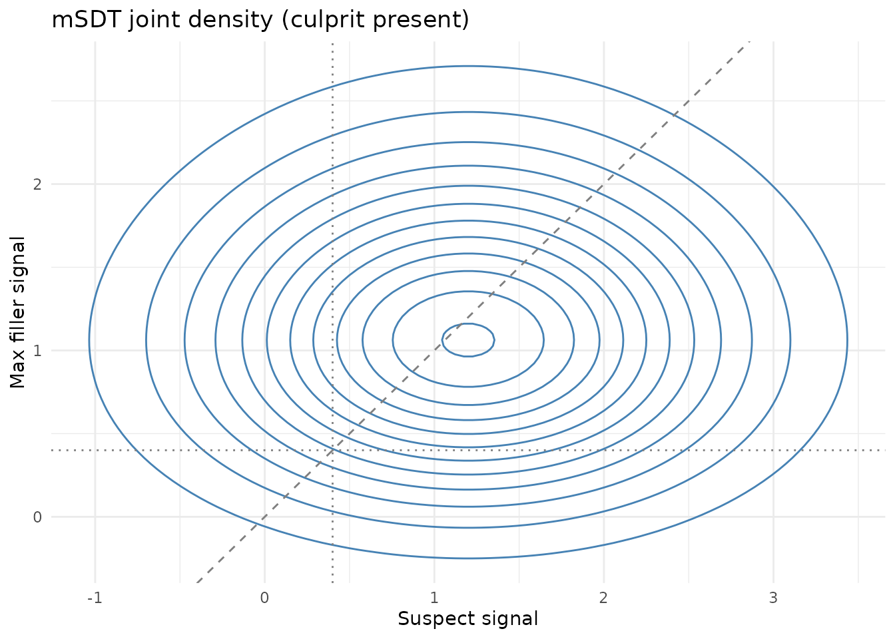
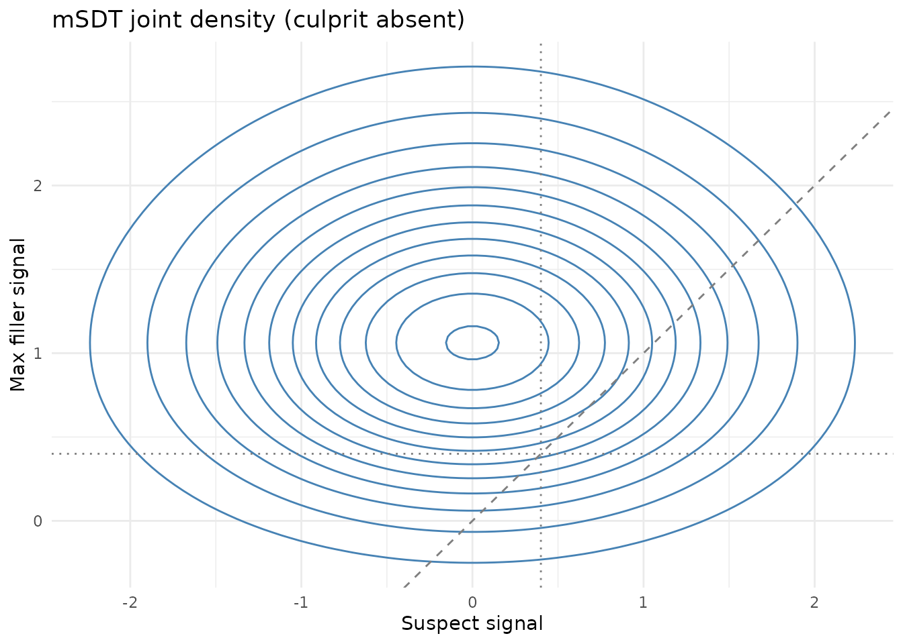

# mSDT: Multi-Item Signal Detection Theory

> **Acknowledgement.** Large language models supplied by Anthropic and
> OpenAI were used in preparing this vignette, to assist with checking
> code, testing the veracity of the approaches described, and on
> occasion editing the text. Responsibility for the content rests with
> the authors.

## Overview

This vignette introduces core utilities for the **multi-item signal
detection theory (mSDT)** model of Yang, Burke and Healy (2025),
covering the components that are mathematically well defined under equal
variance and independent filler signals.

``` r

library(r4lineups)
```

### What mSDT offers over ordinary SDT

Signal detection theory was built for a **binary** decision: one item is
presented, the observer says “old” or “new”, and sensitivity is the
separation between two distributions. It works because there is exactly
one signal to evaluate against one criterion.

A lineup is not that. The witness sees **m items at once** and has three
kinds of response available: identify the suspect, identify a filler, or
reject the lineup. Classical SDT has no natural place for the filler
identification — it is neither a hit nor a correct rejection — and the
usual workarounds either discard filler choices or fold them into an
error rate, which throws away the most diagnostic information the lineup
produces.

mSDT accommodates them by changing what is modelled. Instead of one
signal, it models the **joint distribution of the suspect’s signal and
the strongest filler’s signal**. Every response then follows from a
single decision rule: if the largest signal in the lineup fails to reach
the criterion the witness rejects; otherwise they choose whichever
member produced it. Suspect identifications, filler identifications and
rejections all fall out of the same model, which is what classical SDT
cannot do.

If signal detection theory itself is unfamiliar, the “Signal Detection
Theory, briefly” section of
[`vignette("simulation_power_analysis")`](https://cgtza2.github.io/r4lineups/articles/simulation_power_analysis.md)
sets out discriminability and criterion without assuming background, and
[`vignette("sdt_glm_analysis")`](https://cgtza2.github.io/r4lineups/articles/sdt_glm_analysis.md)
shows how the binary case relates to ordinary regression.

The model is set out in full in Yang, Burke and Healy (2025), which is
open access — see the References below.

Key components implemented here:

- The **max filler distribution** for $`m - 1`$ independent standard
  normal fillers
- **Parameter estimation** from rejection rates in culprit-absent and
  culprit-present lineups (equivalently, target-absent and
  target-present)
- **Joint distribution visualisation** (suspect signal against max
  filler signal)

### Joint distributions, and whether fillers are independent

A **univariate** distribution describes one quantity — how likely the
suspect’s signal is to take each value. A **joint** distribution
describes two or more together, including how they move with one
another.

The distinction matters here because the witness’s decision is not about
the suspect’s signal in isolation. It is about whether the suspect’s
signal is the largest *and* clears the criterion. That is inherently a
question about two quantities at once, so a joint distribution is the
natural object.

The models implemented here assume the filler signals are
**independent** of one another. That assumption is convenient — it is
what makes the max-filler distribution a simple power of the normal CDF
— but it is not obviously true. Fillers in a real lineup are chosen to
match a description, so they resemble each other. A witness whose memory
happens to align with that description may find *all* of them somewhat
familiar, and one whose memory does not may find none of them familiar.
That is precisely what correlation means.

The consequence is not small. Under independence the largest of five
standard normal fillers has an expected value of about 1.17. If the
fillers are strongly correlated the shared component dominates and the
*maximum* is much less extreme — around 0.37 at a correlation of 0.9,
roughly a third of the independent value. Treating correlated fillers as
independent therefore **overstates how often a filler out-competes the
suspect**, and so understates the suspect’s exposure. The
[implementation plan](#planned-extensions) below treats this as the
first extension worth building.

## Max filler distribution

Because the witness responds to whichever member feels strongest, the
quantity that decides the outcome is not any particular filler’s signal
but the **largest** of them. So the distribution needed is that of the
maximum of $`m-1`$ filler signals.

Under independence it has a simple closed form. The maximum is below
$`x`$ exactly when every filler is below $`x`$, so

``` math
P(\max < x) = \Phi(x)^{m-1}
```

and the density follows by differentiating. This is the whole reason the
independence assumption is attractive.

``` r

dmax_filler(0, lineup_size = 6)   # density at 0
#> [1] 0.1246695
pmax_filler(0, lineup_size = 6)   # P(max filler < 0) = 0.5^5
#> [1] 0.03125
qmax_filler(0.5, lineup_size = 6) # median of the max filler signal
#> [1] 1.128998
```

Note that `pmax_filler(0, lineup_size = 6)` is 0.03125, which is
$`0.5^5`$: with five fillers, all five must fall below zero.

The practical point is that the max filler distribution is **shifted
well to the right** of the distribution of any single filler. Each
filler is centred at 0, but the largest of five is centred near 1.17. A
culprit with $`d' = 1`$ is therefore competing against a typical
best-filler signal *higher than its own mean* — which is why lineup
identification is hard, and why lineup size matters so much.

### Moments

A **moment** is a summary number describing the shape of a distribution.
The three used here are the familiar ones under formal names: the first
moment is the **mean**, which says where the distribution sits; the
second central moment is the **variance**, which says how spread out it
is; and the third standardised moment is the **skewness**, which says
how asymmetric it is — zero for a symmetric distribution, positive when
the right tail is longer.

They matter here because the max filler distribution is **not normal**,
even though every filler individually is. Taking a maximum shifts the
distribution right, compresses its spread, and makes it asymmetric. The
moments quantify exactly that, and they are computed numerically because
no simple closed form exists.

``` r

moments <- max_filler_moments(6)

knitr::kable(
  data.frame(
    Moment = c("Mean", "Variance", "Skewness"),
    Value  = round(c(moments$mean, moments$var, moments$skewness), 4),
    Reading = c("Centre: well above the 0 of any single filler",
                "Spread: narrower than a single filler's variance of 1",
                "Asymmetry: positive, so a longer right tail")
  ),
  row.names = FALSE,
  caption = "Moments of the maximum of five independent standard normal filler signals (lineup size 6). Analytic quantities, not computed from data."
)
```

| Moment   |  Value | Reading                                               |
|:---------|-------:|:------------------------------------------------------|
| Mean     | 1.1630 | Centre: well above the 0 of any single filler         |
| Variance | 0.4475 | Spread: narrower than a single filler’s variance of 1 |
| Skewness | 0.3026 | Asymmetry: positive, so a longer right tail           |

Moments of the maximum of five independent standard normal filler
signals (lineup size 6). Analytic quantities, not computed from data.
{.table}

## Estimating mSDT parameters from rejection rates

Let

- $`\Pr(\mathrm{REJ}\mid I)`$ be the rejection rate in culprit-absent
  lineups
- $`\Pr(\mathrm{REJ}\mid G)`$ be the rejection rate in culprit-present
  lineups

Then (Yang et al., 2025):

``` math
\Pr(\mathrm{REJ}\mid I) = \Phi(\gamma)^m, \qquad
\Pr(\mathrm{REJ}\mid G) = \Phi(\gamma - d')\,\Phi(\gamma)^{m-1}
```

### Why rejection rates in particular

Because they are the one outcome with a clean algebraic form, and
between them they identify both parameters.

A rejection occurs only when **every** signal in the lineup falls below
the criterion. In a culprit-absent lineup all $`m`$ members are fillers,
so the rejection rate is $`\Phi(\gamma)^m`$ — and note what is absent
from that expression: $`d'`$. The culprit-absent rejection rate depends
on the criterion alone, so it pins $`\gamma`$ down by itself.

In a culprit-present lineup the culprit must fall below the criterion
*and* so must the $`m-1`$ fillers, giving
$`\Phi(\gamma - d')\Phi(\gamma)^{m-1}`$. With $`\gamma`$ already known
from the first equation, the gap between the two rejection rates fixes
$`d'`$.

Two equations, two unknowns, solved in closed form — no optimiser, no
starting values, no convergence to check. That is the appeal.

### What the helper does

[`estimate_msdt_params()`](https://cgtza2.github.io/r4lineups/reference/estimate_msdt_params.md)
is a convenience function that performs that algebra for you: it inverts
the first equation for $`\gamma`$, substitutes into the second, and
inverts for $`d'`$. The two steps are also available separately as
[`msdt_gamma_from_rej()`](https://cgtza2.github.io/r4lineups/reference/estimate_msdt_params.md)
and
[`msdt_dprime_from_rej()`](https://cgtza2.github.io/r4lineups/reference/estimate_msdt_params.md).

``` r

params <- estimate_msdt_params(pr_rej_I = 0.25, pr_rej_G = 0.15,
                               lineup_size = 6)
params
#> $gamma
#> [1] 0.8193286
#> 
#> $dprime
#> [1] 0.8789708
```

``` r

# The estimate reproduces the input rejection rate exactly, as it must
pnorm(params$gamma)^6
#> [1] 0.25
```

### What this estimator gives up

The closed form comes at a price, and it is worth stating plainly.

[`estimate_msdt_params()`](https://cgtza2.github.io/r4lineups/reference/estimate_msdt_params.md)
uses **only the two rejection rates**. It never looks at whether the
witnesses who *did* choose picked the suspect or a filler. Since a
suspect identification and a filler identification carry very different
evidential weight, that is a great deal of information to leave on the
table — arguably the most informative part of the data.

The estimator is also **exactly identified**: two numbers in, two
parameters out, with nothing left over. There is no residual, so there
is no goodness-of-fit test. The model cannot be found to fit badly,
because it will always reproduce the two rates it was given exactly.

Use it when the rejection rates are all you have, or as a quick starting
point. Where the full response breakdown exists, prefer:

| Function | Uses | Gives you |
|----|----|----|
| [`estimate_msdt_params()`](https://cgtza2.github.io/r4lineups/reference/estimate_msdt_params.md) | Two rejection rates | $`\gamma`$ and $`d'`$, closed form, no fit statistic |
| [`fit_max_sdt()`](https://cgtza2.github.io/r4lineups/reference/fit_max_sdt.md) | All suspect/filler/reject counts | $`d'`$ and criterion, plus a chi-square goodness-of-fit and bootstrap intervals |
| [`fit_winter_2ht()`](https://cgtza2.github.io/r4lineups/reference/fit_winter_2ht.md) | All suspect/filler/reject counts | A different process account, separating detection from guessing and bias |

[`fit_max_sdt()`](https://cgtza2.github.io/r4lineups/reference/fit_max_sdt.md)
fits the same MAX decision rule as here, on the compound decision
structure described by Duncan (2006), by minimising Pearson chi-square
rather than maximising a likelihood. See
[`vignette("model_comparison")`](https://cgtza2.github.io/r4lineups/articles/model_comparison.md)
for the 2-HT alternative.

## Joint distribution plots

These show the decision space directly: the suspect’s signal on one
axis, the strongest filler’s signal on the other. The MAX rule carves
that plane into three regions — reject, identify the suspect, identify a
filler — and the contours show where the probability mass falls in each.

``` r

plot_msdt_joint(dprime = 1.2, gamma = 0.4, lineup_size = 6,
                lineup_type = "culprit_present")
```



``` r

plot_msdt_joint(dprime = 1.2, gamma = 0.4, lineup_size = 6,
                lineup_type = "culprit_absent")
```



**These plots use no dataset.** They are analytic densities drawn from
the parameters supplied in the call — here $`d' = 1.2`$,
$`\gamma = 0.4`$ and a six-person lineup — not summaries of observed
data. Comparing the two makes the model’s logic visible: in the
culprit-absent plot the mass sits symmetrically about the diagonal,
since the suspect is just another filler; in the culprit-present plot it
is displaced by $`d'`$ towards the suspect axis.

## Planned extensions

The functions here implement the **core** mSDT assumptions: equal
variance and independent filler signals. Yang et al. (2025) discuss
extensions that are not yet implemented. Rather than leave that as a
bare caveat, here is what each would take.

### 1. Correlated filler signals

**Why it matters.** As noted above, fillers matched to a common
description are unlikely to be independent, and the error runs in an
unsafe direction: assuming independence overstates the competition the
suspect faces.

**How to implement it.** Equicorrelated fillers admit a one-factor
representation. Writing $`\rho`$ for the common correlation,

``` math
f_i = \sqrt{\rho}\,Z + \sqrt{1-\rho}\,e_i
```

with $`Z`$ and the $`e_i`$ independent standard normals. Conditional on
$`Z`$ the fillers *are* independent, so the existing power-of-$`\Phi`$
result applies inside an expectation over $`Z`$:

``` math
P(\max < x) = \int \phi(z)\,
\Phi\!\left(\frac{x - \sqrt{\rho}\,z}{\sqrt{1-\rho}}\right)^{m-1} dz
```

a one-dimensional integral, evaluable with
[`stats::integrate()`](https://rdrr.io/r/stats/integrate.html). This
extends
[`dmax_filler()`](https://cgtza2.github.io/r4lineups/reference/dmax_filler.md)
and friends by a single `rho` argument defaulting to 0, which reduces
exactly to the current behaviour.

**Effort:** small. **Risk:** low — the formula is checkable against
simulation, and $`\rho = 0`$ must reproduce the existing functions.

### 2. Unequal variances

**Why it matters.** The empirical evidence in recognition memory
generally favours a culprit distribution with larger variance than the
filler distribution, and assuming equality distorts $`d'`$.

**The obstacle is identifiability, not arithmetic.** With a culprit
signal $`N(d', \sigma^2)`$ the rejection rates become

``` math
\Pr(\mathrm{REJ}\mid I) = \Phi(\gamma)^m, \qquad
\Pr(\mathrm{REJ}\mid G) = \Phi\!\left(\frac{\gamma - d'}{\sigma}\right)\Phi(\gamma)^{m-1}
```

which is **two equations in three unknowns**. $`\sigma`$ is simply not
identified from rejection rates, so
[`estimate_msdt_params()`](https://cgtza2.github.io/r4lineups/reference/estimate_msdt_params.md)
cannot be extended to cover it. The extension belongs in
[`fit_max_sdt()`](https://cgtza2.github.io/r4lineups/reference/fit_max_sdt.md),
which uses the full response breakdown, or requires confidence data and
the z-ROC slope
([`fit_sdt_roc()`](https://cgtza2.github.io/r4lineups/reference/fit_sdt_roc.md)).

**Effort:** moderate. **Risk:** higher — the third parameter must be
shown to be recoverable before the option is offered, which means a
simulation study sweeping $`\sigma`$ and sample size and checking
recovery, on the model of the identifiability concerns raised in
[`vignette("lineup_memory_models")`](https://cgtza2.github.io/r4lineups/articles/lineup_memory_models.md).

### 3. Order of work

Correlated fillers first: it is self-contained, verifiable against
simulation, and backwards compatible. Unequal variance second, and only
after a recovery study establishes that the parameter can be estimated
at realistic sample sizes. Shipping an option that returns an
unidentified parameter would be worse than not shipping it.

## Technical Details

### What is computed

| Function | Quantity | Form |
|----|----|----|
| [`dmax_filler()`](https://cgtza2.github.io/r4lineups/reference/dmax_filler.md) | Density of the max of $`m-1`$ fillers | $`(m-1)\phi(x)\Phi(x)^{m-2}`$ |
| [`pmax_filler()`](https://cgtza2.github.io/r4lineups/reference/dmax_filler.md) | CDF | $`\Phi(x)^{m-1}`$ |
| [`qmax_filler()`](https://cgtza2.github.io/r4lineups/reference/dmax_filler.md) | Quantile | $`\Phi^{-1}(p^{1/(m-1)})`$ |
| [`max_filler_moments()`](https://cgtza2.github.io/r4lineups/reference/max_filler_moments.md) | Mean, variance, skewness | Numerical integration |
| [`estimate_msdt_params()`](https://cgtza2.github.io/r4lineups/reference/estimate_msdt_params.md) | $`\gamma`$, $`d'`$ | Closed form from the two rejection rates |

### Assumptions

1.  Filler signals are independent and identically distributed
    $`N(0, 1)`$. See the planned extension above for the correlated
    case.
2.  The culprit signal is $`N(d', 1)`$ — equal variance.
3.  A single criterion $`\gamma`$ is applied to the largest signal, with
    no confidence criteria.
4.  Lineups are simultaneous and fair, so `lineup_size` counts
    **functioning** alternatives. A lineup with null foils has a smaller
    effective size than its nominal size, and since $`m`$ enters the
    equations directly, both $`\gamma`$ and $`d'`$ will be biased. Check
    [`lineup_table()`](https://cgtza2.github.io/r4lineups/reference/lineup_table.md)
    first.
5.  [`estimate_msdt_params()`](https://cgtza2.github.io/r4lineups/reference/estimate_msdt_params.md)
    is exactly identified and therefore untestable — no residual, no
    goodness-of-fit.

## References

Duncan, M. (2006). *A signal detection model of compound decision tasks*
(Technical Note DRDC TR 2006-256). Defence R&D Canada, Toronto.

Wixted, J. T., Vul, E., Mickes, L., & Wilson, B. M. (2018). Models of
lineup memory. *Cognitive Psychology, 105*, 81-114.

Yang, Y., Burke, J. L., & Healy, J. (2025). A multi-item signal
detection theory model for eyewitness identification. *Cognitive
Research: Principles and Implications, 10*, 54.

## Further Reading

- [`?dmax_filler`](https://cgtza2.github.io/r4lineups/reference/dmax_filler.md),
  [`?estimate_msdt_params`](https://cgtza2.github.io/r4lineups/reference/estimate_msdt_params.md),
  [`?plot_msdt_joint`](https://cgtza2.github.io/r4lineups/reference/plot_msdt_joint.md),
  [`?fit_max_sdt`](https://cgtza2.github.io/r4lineups/reference/fit_max_sdt.md)
- [`vignette("simulation_power_analysis")`](https://cgtza2.github.io/r4lineups/articles/simulation_power_analysis.md)
  for signal detection theory from the beginning
- [`vignette("model_comparison")`](https://cgtza2.github.io/r4lineups/articles/model_comparison.md)
  and
  [`vignette("lineup_memory_models")`](https://cgtza2.github.io/r4lineups/articles/lineup_memory_models.md)
  for the models that use the full response breakdown
