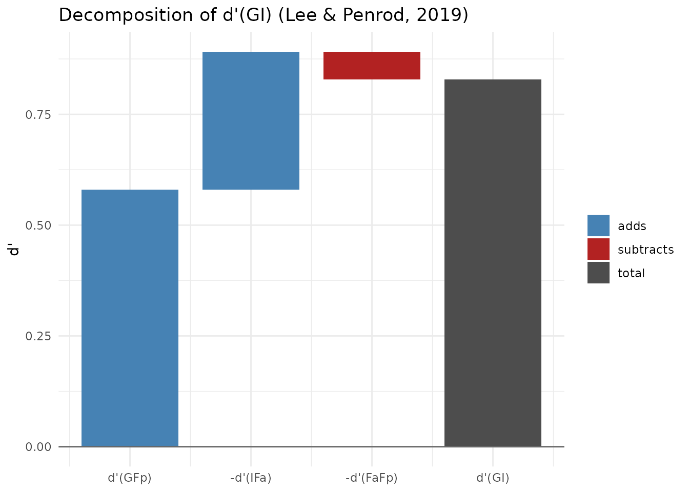
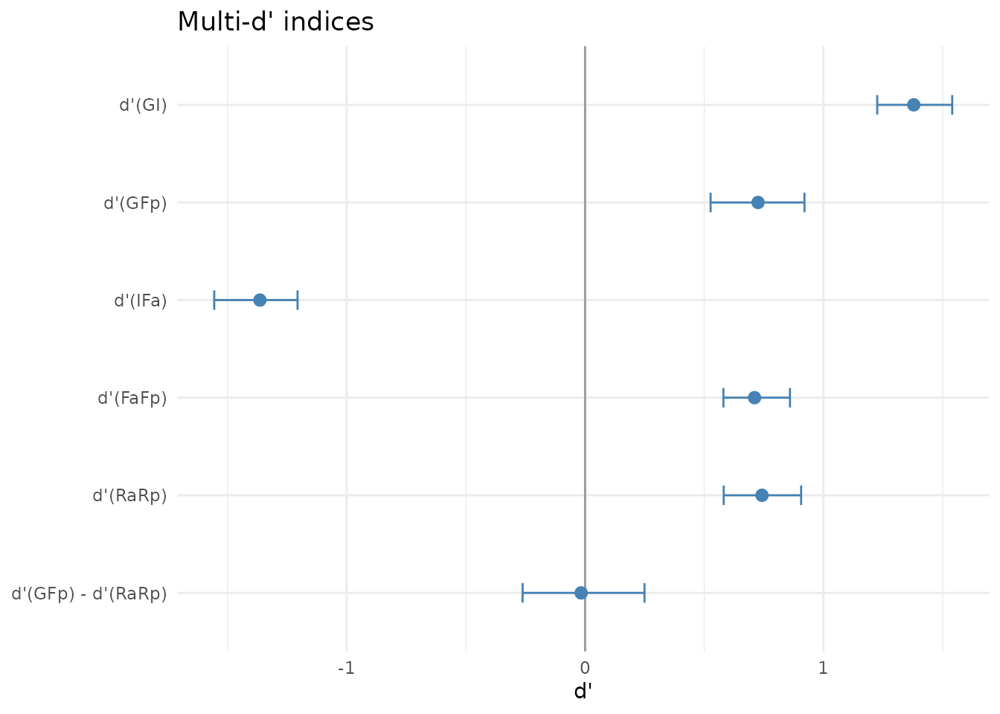
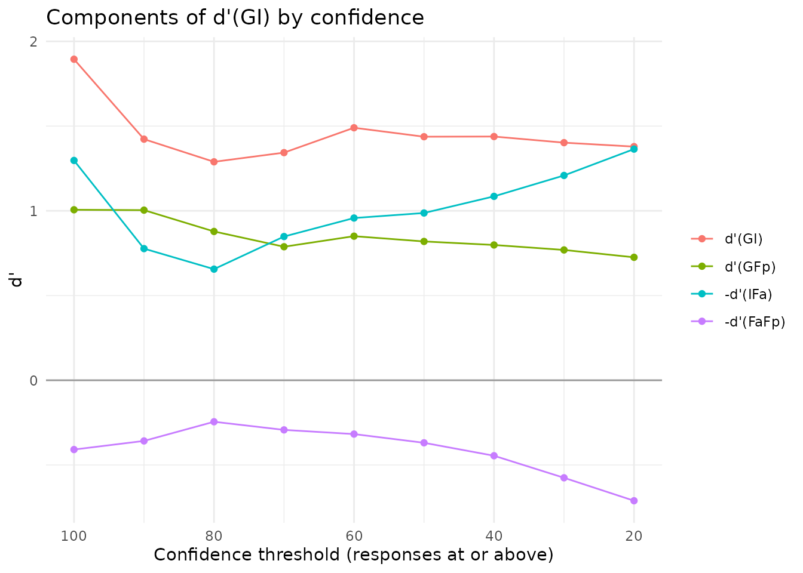

# Multi-d': Lee and Penrod's Signal Detection Framework for Lineups

> **Acknowledgement.** Large language models supplied by Anthropic and
> OpenAI were used in preparing this vignette, to assist with checking
> code, testing the veracity of the approaches described, and on
> occasion editing the text. Responsibility for the content rests with
> the authors.

## Overview

Signal detection analyses of eyewitness identification usually reduce a
lineup to a 2 x 2 table. Guilty-suspect identifications are hits,
innocent-suspect identifications are false alarms, and filler
identifications are pooled with rejections as “negative” responses. Lee
and Penrod (2019) argue that this discards the information carried by
filler choices. Their **Multi-d’ model** keeps the full 2 x 3 table
(suspect ID, filler ID, rejection) for target-present (TP) and
target-absent (TA) lineups, and computes several empirical d’ values
from it.

``` r

library(r4lineups)
```

## The indices

Write G, Fp and Rp for the guilty-suspect, filler and rejection rates in
TP lineups, and I, Fa and Ra for the innocent-suspect, filler and
rejection rates in TA lineups. Each index is a difference between two
z-transformed rates.

| Index | Formula | Interpretation |
|----|----|----|
| d’(GI) | z(G) − z(I) | Guilty versus innocent suspect (the usual empirical d’) |
| d’(GFp) | z(G) − z(Fp) | Guilty suspect versus TP fillers |
| d’(IFa) | z(I) − z(Fa) | Innocent suspect versus TA fillers: TA lineup bias |
| d’(FaFp) | z(Fa) − z(Fp) | Greater appeal of TA than TP fillers |
| d’(RaRp) | z(Ra) − z(Rp) | Detection of culprit presence versus absence |
| d’(GFp) − d’(RaRp) |  | TP lineup bias, net of memory strength |

The three filler indices combine to give d’(GI):

``` math
d'(GI) = d'(GFp) - d'(IFa) - d'(FaFp).
```

The filler terms cancel, so this holds for any data set. It is an
accounting identity, not an empirical finding, and its value lies in
showing *where* a given d’(GI) comes from. A lineup procedure can reach
the same d’(GI) because witnesses separate the culprit well from the
fillers, or because they rarely single out an innocent suspect.

## A published example

Lee and Penrod’s Table 4 applies the model to the lineup data in Steblay
et al.’s (2003) meta-analysis. The rates can be entered as counts per
100 lineups, and `correction = "none"` reproduces the published values.

``` r

md <- make_multid(counts = c(G = 45, Fp = 24, Rp = 31, I = 17, Fa = 26, Ra = 57),
                  correction = "none")
md
#> Multi-d' model (Lee & Penrod, 2019)
#>   TP lineups: 100   TA lineups: 100   Lineup size: 6
#>   Innocent suspect: designated   Filler rate: total   Correction: none
#> 
#> Response rates:
#>    G   Fp   Rp    I   Fa   Ra 
#> 0.45 0.24 0.31 0.17 0.26 0.57 
#> 
#>                                        description estimate
#>                 d'(GI): guilty vs innocent suspect     0.83
#>              d'(GFp): guilty suspect vs TP fillers     0.58
#>  d'(IFa): innocent suspect vs TA fillers (TA bias)    -0.31
#>                   d'(FaFp): TA vs TP filler appeal     0.06
#>              d'(RaRp): culprit presence vs absence     0.67
#>                 d'(GFp) - d'(RaRp): TP lineup bias    -0.09
#> 
#> Decomposition: d'(GI) = d'(GFp) - d'(IFa) - d'(FaFp): 0.83 = 0.58 - (-0.31) - (0.06)
#> Fair-lineup reference for d'(IFa): -1.10 (observed minus reference: 0.79)
```

The published values are d’(GI) = 0.83, d’(GFp) = 0.58, d’(IFa) = −0.31,
d’(FaFp) = 0.06 and d’(RaRp) = 0.67. The decomposition plot shows how
the components add up to d’(GI).

``` r

plot(md)
```



## Interpreting d’(IFa) as lineup bias

Lee and Penrod use the **total** filler identification rate, so d’(IFa)
compares the innocent suspect with all the fillers taken together.
Consequently, a perfectly fair lineup does not give d’(IFa) = 0. If
witnesses who choose spread their choices evenly over six members, the
innocent suspect receives one sixth of the choices and the fillers five
sixths, and d’(IFa) is z(1/6) − z(5/6) ≈ −1.93 when nobody rejects. The
value also changes with the rejection rate.
[`make_multid()`](https://cgtza2.github.io/r4lineups/reference/make_multid.md)
therefore reports `fair_reference`, the d’(IFa) a perfectly fair lineup
would give at the observed TA rejection rate, together with
`ifa_vs_fair`, the observed d’(IFa) minus that reference. Positive
values of `ifa_vs_fair` mean that the innocent suspect draws more than a
fair share of choices. These two quantities are not part of Lee and
Penrod’s model; we provide them as an aid to interpretation.

The alternative, `filler_rate = "per_filler"`, divides each filler rate
by the number of fillers, so that the filler indices refer to an average
single filler and a fair lineup gives d’(IFa) close to 0.

``` r

md$indices[md$indices$index %in% c("IFa", "fair_reference", "ifa_vs_fair"),
           c("index", "estimate")]
#>            index   estimate
#> 3            IFa -0.3108198
#> 8 fair_reference -1.1005728
#> 9    ifa_vs_fair  0.7897529
make_multid(counts = c(G = 45, Fp = 24, Rp = 31, I = 17, Fa = 26, Ra = 57),
            filler_rate = "per_filler", correction = "none")$indices[3, ]
#>   index                                       description  estimate
#> 3   IFa d'(IFa): innocent suspect vs TA fillers (TA bias) 0.6715981
```

When the TA lineups have no designated innocent suspect, the
innocent-suspect rate is estimated as the TA filler rate divided by the
nominal lineup size, as in
[`make_fullroc()`](https://cgtza2.github.io/r4lineups/reference/make_fullroc.md).
Lee and Penrod call this the “average-filler” practice. It assumes the
TA lineup to be fair, so in that case d’(IFa) carries no information
about bias and moves only with the rejection rate.

## Trial-level data, bootstrap intervals and confidence

With trial-level data,
[`make_multid()`](https://cgtza2.github.io/r4lineups/reference/make_multid.md)
takes the same `target_present` and `identification` columns as the
other confidence-based functions in the package. Bootstrap percentile
intervals are obtained by resampling within the TP and TA arms. With
`by_confidence = TRUE`, the indices are also computed cumulatively: at
each threshold, only responses made with at least that confidence are
counted, over the full number of lineups in each arm, as in Lee and
Penrod’s Table 9.

``` r

data(lineup_example)
md2 <- make_multid(lineup_example, by_confidence = TRUE,
                   n_bootstrap = 500, seed = 2026)
summary(md2)
#> Multi-d' model (Lee & Penrod, 2019)
#>   TP lineups: 700   TA lineups: 700   Lineup size: 6
#>   Innocent suspect: designated   Filler rate: total   Correction: loglinear
#> 
#> Response rates:
#>     G    Fp    Rp     I    Fa    Ra 
#> 0.593 0.312 0.096 0.126 0.587 0.287 
#> 
#>                                        description estimate    se ci_lower
#>                 d'(GI): guilty vs innocent suspect    1.379 0.079    1.226
#>              d'(GFp): guilty suspect vs TP fillers    0.726 0.096    0.526
#>  d'(IFa): innocent suspect vs TA fillers (TA bias)   -1.364 0.092   -1.556
#>                   d'(FaFp): TA vs TP filler appeal    0.711 0.072    0.580
#>              d'(RaRp): culprit presence vs absence    0.742 0.085    0.582
#>                 d'(GFp) - d'(RaRp): TP lineup bias   -0.017 0.128   -0.262
#>  ci_upper
#>     1.540
#>     0.920
#>    -1.206
#>     0.859
#>     0.906
#>     0.249
#> 
#> Decomposition: d'(GI) = d'(GFp) - d'(IFa) - d'(FaFp): 1.379 = 0.726 - (-1.364) - (0.711)
#> Fair-lineup reference for d'(IFa): -1.419 (observed minus reference: 0.054)
#> 
#> All indices:
#>           index estimate    se ci_lower ci_upper
#>              GI    1.379 0.079    1.226    1.540
#>             GFp    0.726 0.096    0.526    0.920
#>             IFa   -1.364 0.092   -1.556   -1.206
#>            FaFp    0.711 0.072    0.580    0.859
#>            RaRp    0.742 0.085    0.582    0.906
#>         tp_bias   -0.017 0.128   -0.262    0.249
#>       siphoning    2.090 0.136    1.827    2.382
#>  fair_reference   -1.419 0.022   -1.467   -1.379
#>     ifa_vs_fair    0.054 0.089   -0.129    0.214
#>               c    0.455 0.038    0.380    0.535
#>              dr    4.695 0.507    3.864    5.897
#> 
#> Cumulative indices by confidence (responses at or above threshold):
#>  threshold     G    Fp    Rp     I    Fa    Ra    GI   GFp    IFa  FaFp  RaRp
#>        100 0.098 0.011 0.001 0.001 0.029 0.001 1.895 1.006 -1.297 0.409 0.000
#>         90 0.143 0.019 0.001 0.006 0.044 0.001 1.423 1.004 -0.777 0.358 0.000
#>         80 0.189 0.039 0.001 0.015 0.065 0.001 1.289 0.878 -0.656 0.245 0.000
#>         70 0.260 0.076 0.001 0.024 0.128 0.001 1.343 0.788 -0.848 0.293 0.000
#>         60 0.352 0.109 0.001 0.031 0.180 0.001 1.490 0.850 -0.957 0.318 0.000
#>         50 0.436 0.163 0.001 0.055 0.270 0.001 1.437 0.819 -0.987 0.369 0.000
#>         40 0.507 0.218 0.001 0.078 0.369 0.001 1.438 0.798 -1.085 0.445 0.000
#>         30 0.556 0.265 0.001 0.103 0.479 0.001 1.402 0.769 -1.209 0.575 0.000
#>         20 0.593 0.312 0.096 0.126 0.587 0.287 1.379 0.726 -1.364 0.711 0.742
#>      c      dr
#>  2.242 137.000
#>  1.777  22.333
#>  1.526  12.619
#>  1.314  11.061
#>  1.126  11.465
#>  0.880   7.935
#>  0.701   6.523
#>  0.561   5.372
#>  0.455   4.695
```

``` r

plot(md2, type = "indices")
```



Lee and Penrod report that d’(GI) is fairly stable across confidence
thresholds while its components change. High-confidence witnesses earn
their d’(GI) mainly by distinguishing the culprit from the fillers;
low-confidence witnesses earn much of theirs because their choices
spread over the fillers and so seldom land on the innocent suspect.

``` r

plot(md2, type = "confidence")
```



In `lineup_example`, rejections were recorded only at the lowest
confidence level, so d’(RaRp) is uninformative above that threshold.

## Comparing two conditions

[`compare_multid()`](https://cgtza2.github.io/r4lineups/reference/compare_multid.md)
gives the difference between two conditions on each index, with
bootstrap standard errors, intervals and p-values when both analyses
were bootstrapped. Lee and Penrod’s Table 3 reports simultaneous and
sequential lineups from Steblay, Dysart and Wells (2011); here the rates
are entered as counts per 100 lineups.

``` r

sim <- make_multid(counts = c(G = 52, Fp = 25, Rp = 24, I = 28, Fa = 26, Ra = 46),
                   n_bootstrap = 500, seed = 1)
sqn <- make_multid(counts = c(G = 44, Fp = 19, Rp = 39, I = 15, Fa = 17, Ra = 68),
                   n_bootstrap = 500, seed = 2)
compare_multid(sim, sqn, labels = c("simultaneous", "sequential"))
#> Multi-d' comparison: simultaneous minus sequential
#> 
#>        index simultaneous sequential difference    se ci_lower ci_upper p_value
#>           GI        0.613      0.850     -0.237 0.278   -0.789    0.298   0.393
#>          GFp        0.711      0.709      0.002 0.319   -0.697    0.583   0.995
#>          IFa        0.060     -0.080      0.140 0.337   -0.494    0.804   0.678
#>         FaFp        0.038     -0.061      0.099 0.282   -0.499    0.633   0.724
#>         RaRp        0.606      0.759     -0.153 0.258   -0.652    0.369   0.553
#>      tp_bias        0.105     -0.050      0.155 0.392   -0.654    0.855   0.693
#>    siphoning        0.652      0.790     -0.138 0.466   -1.082    0.797   0.768
#>  ifa_vs_fair        1.274      0.912      0.362 0.347   -0.296    1.048   0.296
```

Because these are rates per 100, the intervals reflect samples of 100
lineups per arm, not the much larger samples of the meta-analysis. With
real data, the counts should be the observed frequencies.

## Cautions

The Multi-d’ indices are *resultant* measures: they require the
responses of real witnesses to TP and TA lineups. They can describe or
compare lineups after an experiment, but, unlike mock-witness measures
such as
[`esize_T()`](https://cgtza2.github.io/r4lineups/reference/esize_T.md)
or
[`func_size()`](https://cgtza2.github.io/r4lineups/reference/func_size.md),
they cannot be used to vet a lineup before it is shown to a witness.
Lee, Mansour and Penrod (2024) found that only resultant measures,
including the Multi-d’ bias indices, reliably predicted eyewitness
performance across 40 lineup sets, while mock-witness measures,
perceptual ratings and face-recognition algorithms did not.

Each index is an equal-variance d’ computed from a single pair of rates.
Lee and Penrod present the model as a descriptive framework, a “series
of thought experiments”, and do not claim that the indices estimate
underlying memory parameters. Models fitted to the full response
distribution, such as
[`fit_max_sdt()`](https://cgtza2.github.io/r4lineups/reference/fit_max_sdt.md)
or
[`fit_winter_2ht()`](https://cgtza2.github.io/r4lineups/reference/fit_winter_2ht.md),
serve that purpose. Finally, the indices are sensitive to how extreme
rates are handled. The default log-linear correction keeps them finite
when a cell is empty, but it moves them slightly away from values
computed from raw proportions.

## References

Lee, J., Mansour, J. K., & Penrod, S. D. (2022). Validity of
mock-witness measures for assessing lineup fairness. *Psychology, Crime
& Law*. <https://doi.org/10.1080/1068316X.2021.1905811>

Lee, J., Mansour, J. K., & Penrod, S. D. (2024). How to measure lineup
fairness: Concurrent and predictive validity of lineup-fairness
measures. *Psychology, Crime & Law*.
<https://doi.org/10.1080/1068316X.2024.2307358>

Lee, J., & Penrod, S. D. (2019). New signal detection theory-based
framework for eyewitness performance in lineups. *Law and Human
Behavior*. <https://doi.org/10.1037/lhb0000343>

Steblay, N., Dysart, J., Fulero, S., & Lindsay, R. C. L. (2003).
Eyewitness accuracy rates in police showup and lineup presentations: A
meta-analytic comparison. *Law and Human Behavior, 27*, 523-540.

Steblay, N. K., Dysart, J. E., & Wells, G. L. (2011). Seventy-two tests
of the sequential lineup superiority effect: A meta-analysis and policy
discussion. *Psychology, Public Policy, and Law, 17*, 99-139.

## Further Reading

- [`?make_multid`](https://cgtza2.github.io/r4lineups/reference/make_multid.md),
  [`?compare_multid`](https://cgtza2.github.io/r4lineups/reference/compare_multid.md),
  [`?plot.multid`](https://cgtza2.github.io/r4lineups/reference/plot.multid.md)
- [`vignette("sdt_summary_comparisons")`](https://cgtza2.github.io/r4lineups/articles/sdt_summary_comparisons.md)
  for d’ and criterion from 2 x 2 counts
- [`vignette("msdt_model")`](https://cgtza2.github.io/r4lineups/articles/msdt_model.md)
  and
  [`vignette("lineup_memory_models")`](https://cgtza2.github.io/r4lineups/articles/lineup_memory_models.md)
  for process models of the full response breakdown
