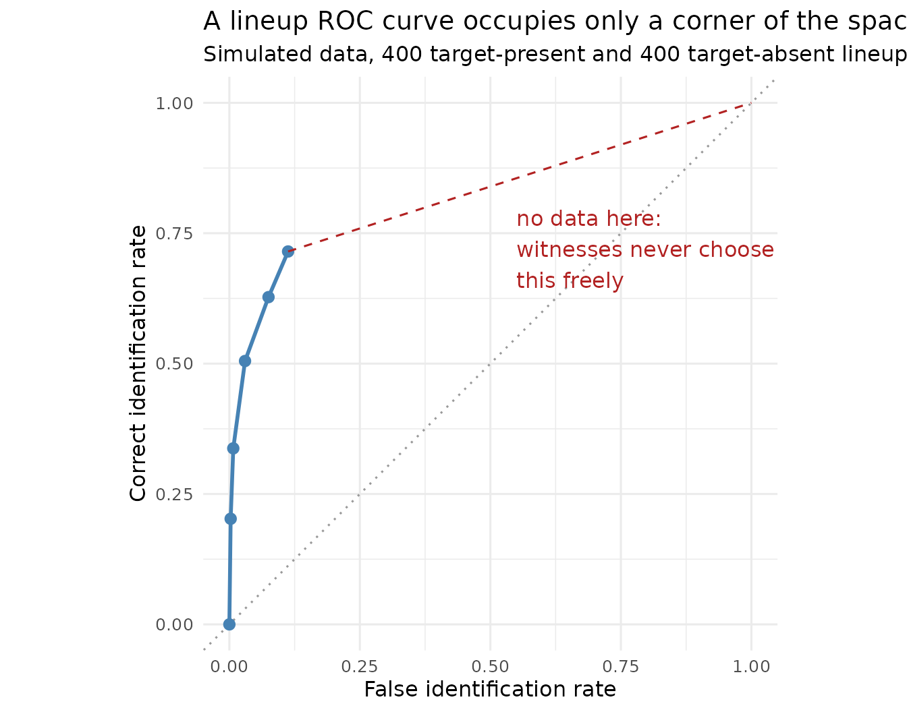
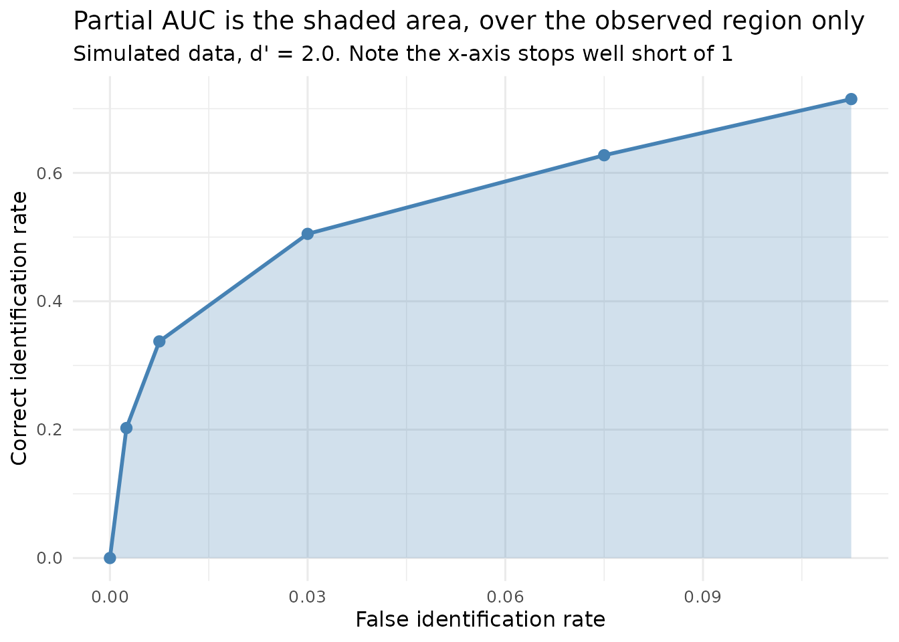
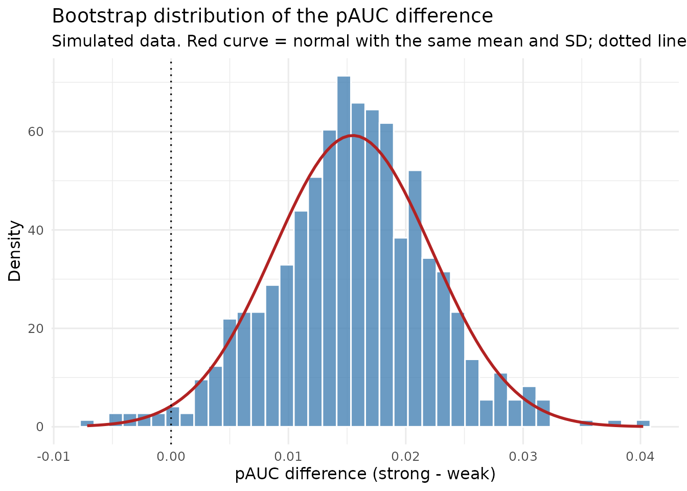
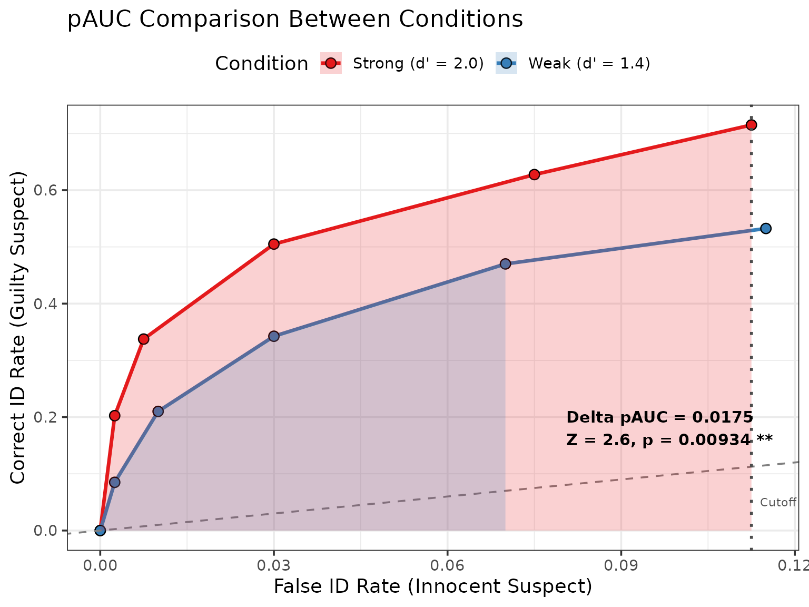

# Statistical Comparison of ROC Curves (pAUC Analysis)

> **Acknowledgement.** Large language models supplied by Anthropic and
> OpenAI were used in preparing this vignette, to assist with checking
> code, testing the veracity of the approaches described, and on
> occasion editing the text. Responsibility for the content rests with
> the authors.

``` r

library(r4lineups)
library(ggplot2)
```

## Introduction

Eyewitness researchers frequently need to decide whether one
identification procedure is better than another: whether simultaneous
lineups beat sequential ones, whether a longer retention interval hurts,
whether lineup size matters.

Since about 2012 the dominant way of answering such questions has been
to compare **ROC curves**, and usually to reduce each curve to a single
number — the **partial area under it (pAUC)** — and test whether the two
numbers differ. This vignette shows how to do that with
[`compare_pauc()`](https://cgtza2.github.io/r4lineups/reference/compare_pauc.md).
It also explains what the curves and the areas mean, and why the
approach is contested.

## What is an ROC curve?

Consider a lineup procedure and a set of witnesses, some viewing lineups
containing the culprit (target-present) and some viewing lineups
containing an innocent suspect instead (target-absent). Two things can
happen that we care about:

- a **correct identification**: a witness picks the suspect from a
  target-present lineup
- a **false identification**: a witness picks the (innocent) suspect
  from a target-absent lineup

Any procedure can be made to produce more correct identifications simply
by encouraging witnesses to choose more freely — but that also produces
more false identifications. The two rates move together, which is
exactly why comparing procedures on identification rate alone is
uninformative.

The ROC curve addresses this by plotting one against the other as we
vary how demanding we are about accepting an identification. In
eyewitness work the lever is **confidence**: count only identifications
made with the highest confidence, and both rates are low; progressively
admit lower-confidence identifications and both rates rise. Each
confidence threshold gives one point, and joining them gives the curve.

``` r

set.seed(2026)

strong <- as.data.frame(simulate_lineup_data(
  n_tp = 400, n_ta = 400, d_prime = 2.0, c_criterion = 0.9,
  lineup_size = 6, conf_levels = 5,
  foil_bias = c(0.4, 0.2, 0.0, -0.4, -1.0), seed = 1
))

roc_points <- make_rocdata(strong, lineup_size = 6)$roc_data

knitr::kable(
  roc_points[, c("confidence", "n_correct_ids", "n_false_ids",
                 "correct_id_rate", "false_id_rate")],
  digits = 4, row.names = FALSE,
  caption = "ROC points for one simulated condition (400 target-present and 400 target-absent lineups, d' = 2.0). Each row is a confidence threshold: rows lower down admit less confident identifications."
)
```

| confidence | n_correct_ids | n_false_ids | correct_id_rate | false_id_rate |
|-----------:|--------------:|------------:|----------------:|--------------:|
|          0 |             0 |           0 |          0.0000 |        0.0000 |
|          5 |            81 |           1 |          0.2025 |        0.0025 |
|          4 |           135 |           3 |          0.3375 |        0.0075 |
|          3 |           202 |          12 |          0.5050 |        0.0300 |
|          2 |           251 |          30 |          0.6275 |        0.0750 |
|          1 |           286 |          45 |          0.7150 |        0.1125 |

ROC points for one simulated condition (400 target-present and 400
target-absent lineups, d’ = 2.0). Each row is a confidence threshold:
rows lower down admit less confident identifications. {.table}

Reading down the table: taking only identifications at the highest
confidence gives a correct identification rate of about 0.2 against a
false identification rate of about 0.002. Admitting every identification
regardless of confidence raises the correct rate to about 0.72 but the
false rate to about 0.11.

A curve that bows further towards the top-left corner — more correct
identifications for the same number of false ones — indicates a better
procedure.

## Discriminability and criterion

The ROC curve exists to separate two things that identification rates
confound.

**Discriminability** is the witness’s ability to tell the culprit apart
from innocent lineup members. It is a property of memory and of the
viewing conditions, and it is what the *shape and position* of the ROC
curve reflect. A procedure that genuinely improves memory moves the
whole curve outward.

**Criterion** is how willing a witness is to identify anyone at all. A
cautious witness identifies rarely; a willing one identifies often.
Changing the criterion moves you *along* a curve without changing which
curve you are on.

The distinction matters because a procedure can change identification
rates without improving anything. If sequential lineups simply make
witnesses more cautious, they will produce fewer false identifications
*and* fewer correct ones, and a comparison of raw rates will make them
look better or worse depending on which rate the reader happens to
weight. The ROC curve answers the question that survives a criterion
shift: at the same false identification rate, which procedure gets more
correct identifications?

This is the argument Wixted and Mickes (2012) made in urging the field
to abandon the diagnosticity ratio in favour of ROC analysis, and it is
why ROC analysis became standard.

## Why lineup ROCs are hard

A textbook ROC curve runs from (0,0) to (1,1). Lineup ROC curves do not,
and this is the source of most of the difficulty.

``` r

roc_df <- roc_points[order(roc_points$false_id_rate), ]

ggplot(roc_df, aes(x = false_id_rate, y = correct_id_rate)) +
  geom_abline(slope = 1, intercept = 0, linetype = "dotted", colour = "grey60") +
  geom_line(linewidth = 1, colour = "steelblue") +
  geom_point(size = 2.5, colour = "steelblue") +
  annotate("segment",
           x = max(roc_df$false_id_rate), xend = 1,
           y = max(roc_df$correct_id_rate), yend = 1,
           linetype = "dashed", colour = "firebrick") +
  annotate("text", x = 0.55, y = 0.72, colour = "firebrick", hjust = 0,
           label = "no data here:\nwitnesses never choose\nthis freely") +
  coord_equal(xlim = c(0, 1), ylim = c(0, 1)) +
  labs(
    x = "False identification rate",
    y = "Correct identification rate",
    title = "A lineup ROC curve occupies only a corner of the space",
    subtitle = "Simulated data, 400 target-present and 400 target-absent lineups, d' = 2.0"
  ) +
  theme_minimal(base_size = 12)
```



The curve stops at a false identification rate of about 0.11. It stops
there because that is what happens when *every* identification is
counted, however hesitant. There is no way to push further to the right:
doing so would require witnesses to identify someone more often than
they are willing to, and the experiment provides no lever for that.

Two consequences follow, and both matter:

1.  **The full area under the curve cannot be computed** without
    inventing the part of the curve that was never observed. Anything
    that extrapolates to (1,1) — the dashed red line above — is making
    up data.
2.  **Different procedures stop at different places.** A procedure that
    makes witnesses more willing to choose produces a longer curve. The
    curves being compared therefore cover different intervals.

## From AUC to pAUC

The standard response is to give up on the full area and compute the
area only over the region that was actually observed: the **partial**
AUC.

``` r

cutoff <- max(roc_df$false_id_rate)
shade <- rbind(
  data.frame(false_id_rate = 0, correct_id_rate = 0),
  roc_df[, c("false_id_rate", "correct_id_rate")],
  data.frame(false_id_rate = cutoff, correct_id_rate = 0)
)

ggplot(roc_df, aes(x = false_id_rate, y = correct_id_rate)) +
  geom_polygon(data = shade, fill = "steelblue", alpha = 0.25) +
  geom_line(linewidth = 1, colour = "steelblue") +
  geom_point(size = 2.5, colour = "steelblue") +
  labs(
    x = "False identification rate",
    y = "Correct identification rate",
    title = "Partial AUC is the shaded area, over the observed region only",
    subtitle = "Simulated data, d' = 2.0. Note the x-axis stops well short of 1"
  ) +
  theme_minimal(base_size = 12)
```



Partial AUC is defended on four grounds, which are worth separating
because they are not equally strong:

1.  **It is computable.** Unlike full AUC, it requires no extrapolation
    into territory the data never reached. This is the serious argument.
2.  **Policy relevance.** Very high false identification rates are not
    operating points any justice system would accept, so the region
    omitted is arguably the region nobody cares about.
3.  **Stability.** Estimates over the well-populated region are less
    variable than estimates that depend on the sparse tail.
4.  **Comparability.** If two curves are integrated over the same
    region, the comparison is at least like-for-like.

Point 4 carries a condition that is easy to violate, and the next
section is about what happens when it is.

## Critical commentary: pAUC is contested

It would be misleading to present pAUC as settled method. It is not, and
the objections are substantive.

### The region problem

Partial AUC requires a region, and with two curves of different lengths
there is no choice of region that is obviously right.

- Integrate each curve to *its own* endpoint and the two areas cover
  different intervals. A larger area may then reflect nothing but a
  longer curve.
- Integrate both to the *shorter* curve’s endpoint and information from
  the longer curve is discarded — including, potentially, the region
  where the procedures differ most.
- Integrate both to some fixed conventional value (0.10, say) and you
  may be comparing them somewhere neither actually operated.

This is not hypothetical.
[`compare_pauc()`](https://cgtza2.github.io/r4lineups/reference/compare_pauc.md)
defaults to the largest region both curves attain, which is the second
option above, and it says so when the two differ:

``` r

weak <- as.data.frame(simulate_lineup_data(
  n_tp = 400, n_ta = 400, d_prime = 1.4, c_criterion = 0.9,
  lineup_size = 6, conf_levels = 5,
  foil_bias = c(0.4, 0.2, 0.0, -0.4, -1.0), seed = 2
))

reach_strong <- max(make_rocdata(strong, lineup_size = 6)$roc_data$false_id_rate)
reach_weak   <- max(make_rocdata(weak,   lineup_size = 6)$roc_data$false_id_rate)

knitr::kable(
  data.frame(
    Condition = c("Strong (d' = 2.0)", "Weak (d' = 1.4)"),
    `Maximum false-ID rate reached` = round(c(reach_strong, reach_weak), 4),
    check.names = FALSE
  ),
  row.names = FALSE,
  caption = "The two simulated conditions stop at different points, so there is no single region both fully cover."
)
```

| Condition         | Maximum false-ID rate reached |
|:------------------|------------------------------:|
| Strong (d’ = 2.0) |                        0.1125 |
| Weak (d’ = 1.4)   |                        0.1150 |

The two simulated conditions stop at different points, so there is no
single region both fully cover. {.table}

Earlier versions of this package defaulted to the *larger* of the two
maxima, which silently integrated each curve only as far as its own data
went — so the two areas covered different intervals and the comparison
was biased against whichever curve stopped sooner. That default has been
corrected.

### The deeper objection

Smith, Lampinen, Wells, Smalarz and Mackovichova (2019) go further and
argue that pAUC does not measure what researchers want it to measure.
Their claim is that pAUC fails to track the **diagnostic utility** of a
lineup — the thing that actually matters for deciding which procedure a
police force should adopt — and that neither choice of region repairs
this. They propose *deviation from perfect performance* (DPP) instead,
which is implemented in this package and covered in
[`vignette("calibration_decision_analysis")`](https://cgtza2.github.io/r4lineups/articles/calibration_decision_analysis.md).

### What the curve leaves out

A further criticism concerns what enters the analysis at all. The ROC
curve above is built from **suspect identifications only**. A witness
who identifies a foil has made an error that the analysis largely sets
aside, and a witness who rejects the lineup contributes nothing to
either axis.

Yet foil identifications are informative: they say something about how
well the lineup was constructed, and a procedure that converts suspect
identifications into foil identifications has genuinely protected an
innocent suspect. Lineup rejections are informative too. The full ROC
approach, which uses every response, is one answer to this; see
[`vignette("fullroc_analysis")`](https://cgtza2.github.io/r4lineups/articles/fullroc_analysis.md).

The point is not that pAUC should be abandoned, but that a single number
computed over a contested region from a subset of the responses is
carrying more weight in this literature than it can comfortably bear.
Reporting it alongside DPP, and alongside the full response
distribution, is a more defensible practice than reporting it alone.

### Key articles

| Reference | Contribution |
|----|----|
| Wixted & Mickes (2012) | The case for ROC analysis, and against the diagnosticity ratio, in eyewitness research |
| Gronlund, Wixted & Mickes (2014) | Accessible account of applying ROC analysis to identification procedures |
| Smith et al. (2019) | The case *against* pAUC: it does not track diagnostic utility. Proposes DPP |
| Mickes et al. (2024) | pyWitness, the reference implementation this package’s ROC code was checked against |

## The statistical framework

### What the test actually is

[`compare_pauc()`](https://cgtza2.github.io/r4lineups/reference/compare_pauc.md)
computes

``` math
Z = \frac{\widehat{pAUC}_1 - \widehat{pAUC}_2}{\widehat{SE}(\widehat{pAUC}_1 - \widehat{pAUC}_2)}
```

and refers $`Z`$ to a standard normal distribution.

It is worth being precise about what kind of test this is, because it is
easy to assume it is something it is not. **It is a Wald test**: an
estimate divided by an estimate of its own standard error. It is *not* a
comparison of two standard normal deviates, and it is not a test on
transformed proportions. The normal reference distribution comes from
the asymptotic normality of the estimator, not from any assumption that
the underlying data are normal.

The standard error in the denominator is obtained by **bootstrap**: the
witnesses in each condition are resampled with replacement, the whole
ROC and its partial area are recomputed for each resample, and the
standard deviation of the resulting differences is taken as
$`\widehat{SE}`$.

### Why bootstrap the standard error?

Because no usable closed-form expression exists. The partial area is a
non-linear functional of a step function estimated from two correlated
sets of counts, computed over a region that is itself determined by the
data. Deriving its sampling variance analytically is not practical;
resampling estimates it directly and makes no distributional assumption
in doing so.

### Is normality reasonable?

The Wald test assumes the *difference in pAUC* is approximately normally
distributed. That is checkable, and worth checking rather than assuming:

``` r

comparison <- compare_pauc(
  strong, weak,
  lineup_size = 6,
  label1 = "Strong (d' = 2.0)",
  label2 = "Weak (d' = 1.4)",
  n_bootstrap = 600,
  seed = 123
)

boot_diff <- comparison$bootstrap_results$diff_boot

knitr::kable(
  data.frame(
    Quantity = c("Mean", "SD", "Skewness", "Excess kurtosis",
                 "Shapiro-Wilk p"),
    Value = c(
      round(mean(boot_diff), 5),
      round(sd(boot_diff), 5),
      round(mean((boot_diff - mean(boot_diff))^3) / sd(boot_diff)^3, 3),
      round(mean((boot_diff - mean(boot_diff))^4) / sd(boot_diff)^4 - 3, 3),
      signif(shapiro.test(boot_diff)$p.value, 3)
    )
  ),
  row.names = FALSE,
  caption = "Shape of the bootstrap distribution of the pAUC difference, simulated data (600 bootstrap resamples)."
)
```

| Quantity        |    Value |
|:----------------|---------:|
| Mean            |  0.01548 |
| SD              |  0.00674 |
| Skewness        | -0.04900 |
| Excess kurtosis |  0.54300 |
| Shapiro-Wilk p  |  0.08470 |

Shape of the bootstrap distribution of the pAUC difference, simulated
data (600 bootstrap resamples). {.table}

``` r

ggplot(data.frame(diff = boot_diff), aes(x = diff)) +
  geom_histogram(aes(y = after_stat(density)), bins = 40,
                 fill = "steelblue", colour = "white", alpha = 0.8) +
  stat_function(fun = dnorm,
                args = list(mean = mean(boot_diff), sd = sd(boot_diff)),
                colour = "firebrick", linewidth = 1) +
  geom_vline(xintercept = 0, linetype = "dotted") +
  labs(
    x = "pAUC difference (strong - weak)",
    y = "Density",
    title = "Bootstrap distribution of the pAUC difference",
    subtitle = "Simulated data. Red curve = normal with the same mean and SD; dotted line = no difference"
  ) +
  theme_minimal(base_size = 12)
```



Typically the distribution is close to normal but not exactly so — mild
skew is common, because pAUC is bounded and the region is
data-determined. With several hundred resamples a formal normality test
will often reject even when the departure is too small to matter. The
practical question is not whether normality holds exactly but whether it
holds well enough that the interval is about right, and that is best
answered by comparing the two intervals directly:

``` r

knitr::kable(
  data.frame(
    Method = c("Wald (normal approximation)", "Bootstrap percentile"),
    Lower = round(c(comparison$ci_diff[["lower"]],
                    unname(quantile(boot_diff, 0.025))), 5),
    Upper = round(c(comparison$ci_diff[["upper"]],
                    unname(quantile(boot_diff, 0.975))), 5)
  ),
  row.names = FALSE,
  caption = "95% confidence intervals for the pAUC difference by two methods, simulated data."
)
```

| Method                      |   Lower |   Upper |
|:----------------------------|--------:|--------:|
| Wald (normal approximation) | 0.00431 | 0.03073 |
| Bootstrap percentile        | 0.00230 | 0.02886 |

95% confidence intervals for the pAUC difference by two methods,
simulated data. {.table}

When the two agree closely, as here, the normal approximation is doing
no harm. When they diverge, prefer the percentile interval: it inherits
whatever shape the bootstrap distribution actually has, rather than
imposing symmetry on it.

## A worked comparison

``` r

print(comparison)
#> 
#> === pAUC Comparison Analysis ===
#> 
#> Conditions:
#>   Strong (d' = 2.0): pAUC = 0.0617 (SE = 0.0051)
#>   Weak (d' = 1.4): pAUC = 0.0442 (SE = 0.0041)
#> 
#> Difference: 0.0175
#>   95% CI: [0.0043, 0.0307]
#> 
#> Statistical Test:
#>   Z = 2.599
#>   p-value = 0.009337
#> 
#> Interpretation: Strong (d' = 2.0) has higher discriminability than Weak (d' = 1.4) (**)
#> 
#> Max false ID rate cutoff: 0.1125
#> Bootstrap samples: 600
#> 
#> Note: *** p<0.001, ** p<0.01, * p<0.05, ns = not significant
```

``` r

plot(comparison, show_cutoff = TRUE, show_test_results = TRUE)
```



``` r

summary(comparison)
#> 
#> === pAUC Comparison Summary ===
#> 
#> Condition 1: Strong (d' = 2.0) 
#>   Sample size: 800 
#>   Target-present: 400 
#>   Target-absent: 400 
#>   pAUC: 0.0617 
#>   SE(pAUC): 0.0051 
#>   95% CI: [0.0518, 0.0717]
#> 
#> Condition 2: Weak (d' = 1.4) 
#>   Sample size: 800 
#>   Target-present: 400 
#>   Target-absent: 400 
#>   pAUC: 0.0442 
#>   SE(pAUC): 0.0041 
#>   95% CI: [0.0361, 0.0523]
#> 
#> Difference (Strong (d' = 2.0) - Weak (d' = 1.4)):
#>   Estimate: 0.0175 
#>   SE(diff): 0.0067 
#>   95% CI: [0.0043, 0.0307]
#>   Z-score: 2.599 
#>   p-value: 0.009337 
#> 
#> Effect size (d): 3.781 
#> 
#> Analysis Details:
#>   Max false ID rate cutoff: 0.1125 
#>   Bootstrap samples: 600 
#>   Confidence level:95%
```

### Specifying the region explicitly

The default region is the largest both curves reach. A policy-relevant
cutoff can be imposed instead, provided it is one both curves actually
attain:

``` r

comparison_10 <- compare_pauc(
  strong, weak,
  lineup_size = 6,
  max_false_id_rate = 0.10,
  label1 = "Strong", label2 = "Weak",
  n_bootstrap = 300,
  seed = 456
)

knitr::kable(
  data.frame(
    Region = c(sprintf("Default (to %.3f)", comparison$max_false_id_rate),
               "Policy cutoff (to 0.100)"),
    `pAUC difference` = round(c(comparison$pauc_diff,
                                comparison_10$pauc_diff), 5),
    `p-value` = signif(c(comparison$p_value, comparison_10$p_value), 3),
    check.names = FALSE
  ),
  row.names = FALSE,
  caption = "The same two conditions compared over two different regions, simulated data."
)
```

| Region                   | pAUC difference | p-value |
|:-------------------------|----------------:|--------:|
| Default (to 0.113)       |         0.01752 | 0.00934 |
| Policy cutoff (to 0.100) |         0.01527 | 0.00216 |

The same two conditions compared over two different regions, simulated
data. {.table}

The estimates differ because they are areas over different intervals.
This is not an inconsistency to be resolved but the region problem in
miniature: **the region is part of the estimand**, and reporting a pAUC
without stating the region it covers is incomplete.

### How many bootstrap resamples?

The bootstrap standard error is itself an estimate, and too few
resamples make it unstable. For exploratory work a few hundred is
adequate; anything intended for publication should use 2000 or more.
This vignette uses small numbers so that it builds quickly.

## Multiple comparisons

Comparing three or more conditions pairwise inflates the family-wise
error rate in the usual way:

``` r

medium <- as.data.frame(simulate_lineup_data(
  n_tp = 400, n_ta = 400, d_prime = 1.7, c_criterion = 0.9,
  lineup_size = 6, conf_levels = 5,
  foil_bias = c(0.4, 0.2, 0.0, -0.4, -1.0), seed = 3
))

pairs <- list(
  `Strong vs Medium` = list(strong, medium),
  `Strong vs Weak`   = list(strong, weak),
  `Medium vs Weak`   = list(medium, weak)
)

results <- do.call(rbind, lapply(names(pairs), function(nm) {
  cmp <- compare_pauc(pairs[[nm]][[1]], pairs[[nm]][[2]],
                      lineup_size = 6, n_bootstrap = 200, seed = 41)
  data.frame(Comparison = nm,
             `pAUC difference` = round(cmp$pauc_diff, 5),
             Z = round(cmp$z_score, 3),
             p = signif(cmp$p_value, 4),
             check.names = FALSE)
}))

results$`p (Bonferroni)` <- signif(p.adjust(results$p, method = "bonferroni"), 4)

knitr::kable(
  results, row.names = FALSE,
  caption = "Pairwise pAUC comparisons with Bonferroni adjustment, simulated data (400 target-present and 400 target-absent lineups per condition)."
)
```

| Comparison       | pAUC difference |     Z |        p | p (Bonferroni) |
|:-----------------|----------------:|------:|---------:|---------------:|
| Strong vs Medium |         0.00335 | 0.598 | 0.549800 |        1.00000 |
| Strong vs Weak   |         0.01752 | 2.717 | 0.006586 |        0.01976 |
| Medium vs Weak   |         0.01192 | 2.192 | 0.028360 |        0.08508 |

Pairwise pAUC comparisons with Bonferroni adjustment, simulated data
(400 target-present and 400 target-absent lineups per condition).
{.table}

Bonferroni is the most conservative option and the easiest to defend;
Holm is uniformly more powerful and equally easy to justify
(`p.adjust(method = "holm")`). Better still, where the design allows it,
is to nominate one primary comparison in advance and treat the rest as
exploratory.

## Power

Planning a study that will compare pAUC needs a power analysis, which
[`simulate_power_analysis()`](https://cgtza2.github.io/r4lineups/reference/simulate_power_analysis.md)
provides — it uses
[`compare_pauc()`](https://cgtza2.github.io/r4lineups/reference/compare_pauc.md)
internally as its test. See
[`vignette("simulation_power_analysis")`](https://cgtza2.github.io/r4lineups/articles/simulation_power_analysis.md).

## Technical Details

### How pAUC is computed

The ROC points are the cumulative correct- and false-identification
rates at each confidence threshold $`c`$:

``` math
\text{CID}(c) = \frac{\#\{\text{suspect IDs in target-present lineups with confidence} \ge c\}}{N_{\text{target-present}}}
```

``` math
\text{FID}(c) = \frac{\#\{\text{suspect IDs in target-absent lineups with confidence} \ge c\}}{N_{\text{target-absent}}}
```

Where target-absent lineups contain no designated innocent suspect, foil
identifications divided by lineup size are used to estimate the false
identification rate instead.

The partial area over $`[0, f_{\max}]`$ is computed by the trapezoidal
rule over the observed points:

``` math
\widehat{pAUC} = \sum_{i=2}^{k} \bigl(\text{FID}_i - \text{FID}_{i-1}\bigr) \cdot \frac{\text{CID}_i + \text{CID}_{i-1}}{2}
```

If $`f_{\max}`$ falls between two observed points, the curve is linearly
interpolated to that point. If $`f_{\max}`$ lies beyond the last
observed point, **no extrapolation is performed** — the sum simply stops
at the data, which is why supplying a cutoff beyond a curve’s reach
produces a warning rather than a number.

### How the standard error is obtained

For each of $`B`$ bootstrap resamples, witnesses within each condition
are resampled with replacement, preserving the target-present and
target-absent sample sizes; the ROC and its partial area are recomputed;
and the difference is recorded. Then

``` math
\widehat{SE}(\widehat{pAUC}_1 - \widehat{pAUC}_2) = \operatorname{sd}\bigl(\{\widehat{pAUC}_1^{(b)} - \widehat{pAUC}_2^{(b)}\}_{b=1}^{B}\bigr)
```

The two conditions are resampled **independently**, which is correct for
a between-subjects design and gives
$`\widehat{SE}^2 \approx \widehat{SE}_1^2 + \widehat{SE}_2^2`$. It would
be *wrong* for a within-subjects design in which the same witnesses
contribute to both conditions, because the two areas would then be
correlated and the independent resampling would overstate the standard
error. This package provides no within-subjects version.

### Assumptions

1.  The two conditions are independent samples of witnesses.
2.  The difference in pAUC is approximately normally distributed —
    checkable, as above, and avoidable by using the percentile interval.
3.  The region of integration is one both curves attain.
4.  Witnesses are independent of one another. If witnesses viewed
    multiple lineups, or lineups were constructed from a small pool of
    faces, this is violated and the standard error will be too small.

### Effect size

[`summary()`](https://rdrr.io/r/base/summary.html) reports a
standardised effect size formed by dividing the pAUC difference by a
pooled bootstrap standard deviation. It is a useful relative summary,
but it should not be read against Cohen’s conventions for $`d`$: those
were calibrated for standardised mean differences between raw
observations, not for a difference between two areas scaled by a
resampling standard deviation, and the two are not on comparable
footings.

## Summary

1.  ROC analysis separates discriminability from criterion, which is why
    it displaced the diagnosticity ratio.
2.  Lineup ROC curves are truncated — they occupy a corner of the ROC
    space — which is why the *partial* area is used.
3.  The region of integration is part of the estimand. Always report it.
4.  The test is a Wald test with a bootstrap standard error. Check the
    bootstrap distribution; prefer the percentile interval if it is
    skewed.
5.  pAUC is contested. Smith et al. (2019) argue it does not track
    diagnostic utility, and the analysis discards foil identifications
    and rejections. Report it alongside DPP and the full response
    distribution rather than alone.

## References

Gronlund, S. D., Wixted, J. T., & Mickes, L. (2014). Evaluating
eyewitness identification procedures using receiver operating
characteristic analysis. *Current Directions in Psychological Science,
23*(1), 3-10.

Mickes, L., Seale-Carlisle, T. M., Chen, X., & Boogert, S. (2024).
pyWitness 1.0: A python eyewitness identification analysis toolkit.
*Behavior Research Methods, 56*, 1533-1550.

Smith, A. M., Lampinen, J. M., Wells, G. L., Smalarz, L., &
Mackovichova, S. (2019). Deviation from perfect performance measures the
diagnostic utility of eyewitness lineups but partial area under the ROC
curve does not. *Journal of Applied Research in Memory and Cognition,
8*(1), 50-59.

Wixted, J. T., & Mickes, L. (2012). The field of eyewitness memory
should abandon probative value and embrace receiver operating
characteristic analysis. *Perspectives on Psychological Science, 7*(3),
275-278.

## Further Reading

- [`?compare_pauc`](https://cgtza2.github.io/r4lineups/reference/compare_pauc.md)
  for complete parameter documentation
- [`vignette("fullroc_analysis")`](https://cgtza2.github.io/r4lineups/articles/fullroc_analysis.md)
  for ROC analysis using every response
- [`vignette("calibration_decision_analysis")`](https://cgtza2.github.io/r4lineups/articles/calibration_decision_analysis.md)
  for DPP, the proposed alternative
- [`vignette("simulation_power_analysis")`](https://cgtza2.github.io/r4lineups/articles/simulation_power_analysis.md)
  for planning a study of this kind
