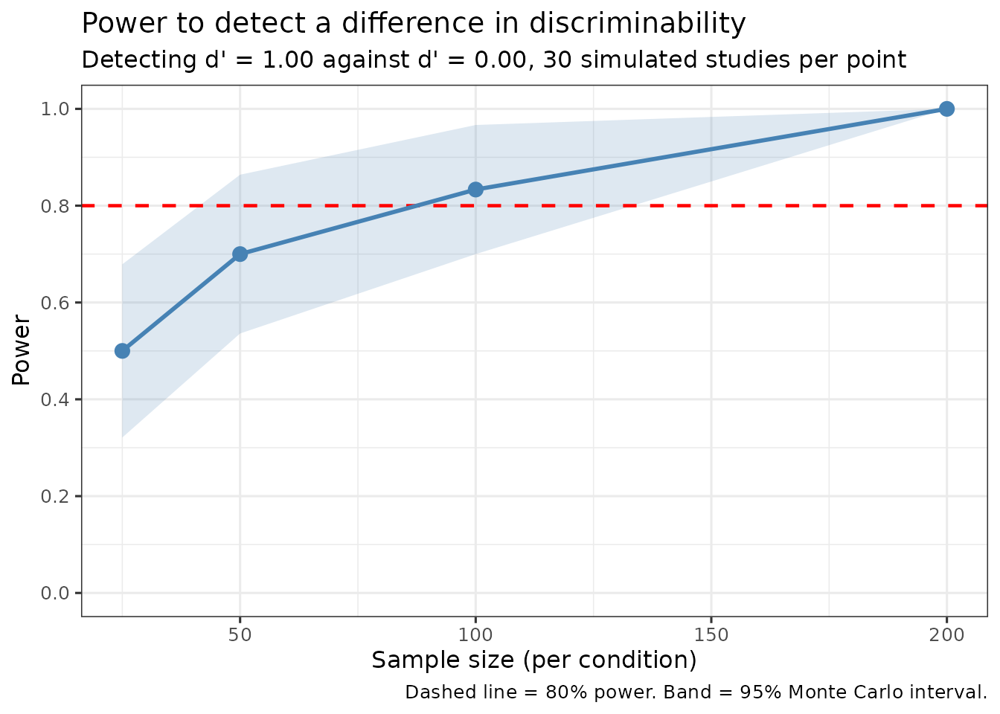
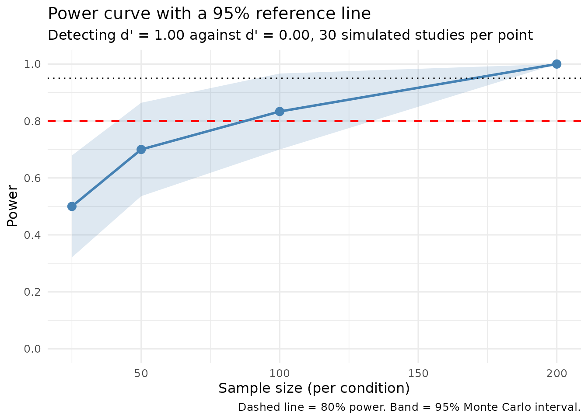
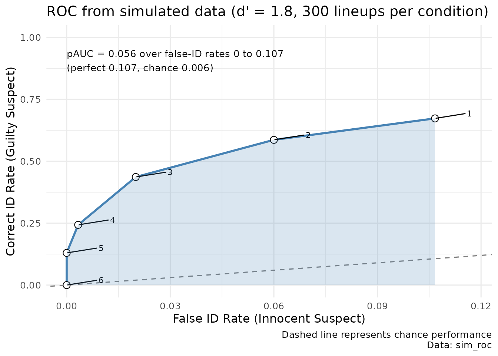
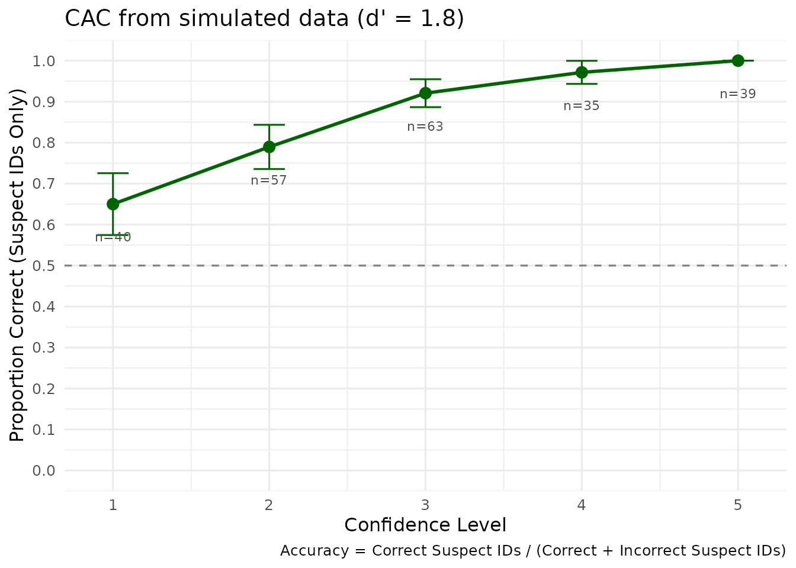

# Data Simulation and Power Analysis for Lineup Studies

> **Acknowledgement.** Large language models supplied by Anthropic and
> OpenAI were used in preparing this vignette, to assist with checking
> code, testing the veracity of the approaches described, and on
> occasion editing the text. Responsibility for the content rests with
> the authors.

## Introduction

Simulation is useful in lineup research for four rather different
purposes, and they make different demands on the simulation.

- **Planning a study.** How many participants are needed to detect the
  effect you expect? This is power analysis, and it needs a hypothesis
  to test.
- **Validating a method.** If you generate data with known parameters,
  does your analysis recover them? This needs data whose true values you
  control.
- **Exploring designs.** What happens to identification rates if the
  lineup has eight members instead of six? This needs only descriptive
  comparison.
- **Teaching.** Showing what a criterion shift does to a lineup is
  easier with simulated data than with a real experiment.

``` r

library(r4lineups)
```

## Signal Detection Theory, briefly

Signal detection theory (SDT) is the framework the simulator uses. Its
assumptions are as follows.

The idea is that a witness viewing a lineup member experiences some
degree of **memory strength** — a sense of familiarity or match to their
memory of the culprit. This is treated as a continuous quantity rather
than a yes/no judgement. Lineup members who are in fact the culprit tend
to generate more strength than innocent members, but the distributions
overlap: an unfamiliar face can occasionally feel very familiar, and a
genuine culprit can occasionally feel unremarkable.

Two quantities describe this:

- **d′ (discriminability)** is the separation between the two
  distributions, measured in standard deviations. It captures how good
  the witness’s memory is. Guilty suspects are drawn from Normal(d′, 1);
  foils and innocent suspects from Normal(0, 1).
- **The criterion** is how much strength the witness requires before
  they are willing to identify anybody at all. It captures willingness
  to choose, which is a separate question from memory quality — a
  witness with excellent memory may still be reluctant to commit.

Keeping these separate is the central contribution of SDT to this area.
Two procedures can produce identical identification rates for quite
different reasons: one may improve memory, the other merely make
witnesses more willing to choose. Only the first is a genuine
improvement.

### Decision rules

A lineup differs from a simple recognition test because the witness sees
several faces and must decide among them. How the several memory
strengths are combined into one decision is an open theoretical
question, and the simulator implements four answers to it, following
Wixted, Vul, Mickes and Wilson (2018):

| Rule | The witness … |
|----|----|
| `"max"` | picks the member with the highest strength, and identifies if it clears the criterion. The independent-observations model, and the default. |
| `"best_rest"` | compares the best member against the average of the others, so a face only stands out if it stands out *relative to the lineup*. |
| `"ensemble"` | compares the best member against the average of the whole lineup. A rescaling of `"best_rest"`; the two are the same model with correspondingly rescaled criteria. |
| `"integration"` | sums strength across all members. |

These are equal-variance, independent-signal versions of those models.

**You are not obliged to adopt one of these models to plan a lineup
study.** They are how this simulator generates data, so if you use it
for power analysis you are assuming one of them holds. That assumption
is no different in kind from assuming a normal distribution when using a
conventional power calculator. If you have pilot data, checking that the
simulated identification rates resemble it is a reasonable guard against
the assumption doing damage.

**Attribution.** The decision rules follow Wixted et al. (2018). The
`"max"`, `"best_rest"` and `"ensemble"` implementations were written
with reference to the Python package **pyWitness** (Mickes et al.,
2024), and adapted into R here; the parameter recovery in
[`fit_winter_2ht()`](https://cgtza2.github.io/r4lineups/reference/fit_winter_2ht.md)
is checked against it. See
[`vignette("lineup_memory_models")`](https://cgtza2.github.io/r4lineups/articles/lineup_memory_models.md)
for the pyWitness bridge itself.

### The criterion, in plainer terms

`c_criterion` is the strength a lineup member must reach before the
witness will identify anyone. Raise it and witnesses reject more often;
lower it and they choose more often.

It is important to make a point of clarification here. In textbook SDT,
a criterion of 0 is “neutral”. **That is not true here**, because the
criterion applies to the *maximum* of several members’ strengths, not to
a single item. The maximum of six draws from Normal(0, 1) averages about
1.27, so a criterion of 0 is passed by nearly every lineup:

``` r

criteria <- c(0, 0.5, 1.0, 1.27, 1.5, 2.0)

rejection_rates <- vapply(criteria, function(cc) {
  d <- simulate_lineup_data(n_tp = 800, n_ta = 800, d_prime = 1.5,
                            c_criterion = cc, lineup_size = 6,
                            conf_levels = 5, seed = 11)
  100 * mean(d$identification[!d$target_present] == "reject")
}, numeric(1))

knitr::kable(
  data.frame(`c_criterion` = criteria,
             `TA rejection rate (%)` = round(rejection_rates, 1),
             check.names = FALSE),
  row.names = FALSE,
  caption = "Rejection rate in target-absent lineups as the criterion varies, simulated data (800 lineups of size 6 per point, d' = 1.5)."
)
```

| c_criterion | TA rejection rate (%) |
|------------:|----------------------:|
|        0.00 |                   1.8 |
|        0.50 |                  10.5 |
|        1.00 |                  34.6 |
|        1.27 |                  52.4 |
|        1.50 |                  66.1 |
|        2.00 |                  87.2 |

Rejection rate in target-absent lineups as the criterion varies,
simulated data (800 lineups of size 6 per point, d’ = 1.5). {.table}

A criterion of 0 rejects almost nothing. The neutral value, where
target-absent lineups are rejected half the time, is the **median** of
the maximum of six standard normal draws. In a fair target-absent lineup
every member’s strength is Normal(0, 1), so the maximum is below $`x`$
with probability $`\Phi(x)^6`$, and the median is
$`\Phi^{-1}(0.5^{1/6}) \approx`$ 1.231. The mean of the maximum, about
1.27, is close but not the same: used as the criterion it gives a
rejection rate of about 52.2%.

That value therefore **depends on lineup size**, which is why no fixed
table of “liberal / neutral / conservative” values can be given:

``` r

sizes <- c(4, 6, 8, 10, 12)

knitr::kable(
  data.frame(`Lineup size` = sizes,
             `Neutral criterion` = round(qnorm(0.5^(1 / sizes)), 3),
             check.names = FALSE),
  row.names = FALSE,
  caption = "Criterion giving 50% target-absent rejections in a fair lineup: the median of the maximum of k standard normal draws."
)
```

| Lineup size | Neutral criterion |
|------------:|------------------:|
|           4 |             0.998 |
|           6 |             1.231 |
|           8 |             1.385 |
|          10 |             1.499 |
|          12 |             1.588 |

Criterion giving 50% target-absent rejections in a fair lineup: the
median of the maximum of k standard normal draws. {.table}

The same formula gives any other target rejection rate $`r`$:
$`\Phi^{-1}(r^{1/k})`$. It assumes a fair lineup with `foil_bias` at its
default, so treat it as a starting point when foils are unequal.

A practical approach is to choose the criterion by the rejection rate it
produces, rather than by its nominal value: simulate, look at the
rejection rate, and adjust until it resembles the studies you are
drawing on.

## Basic Data Simulation

``` r

sim_data <- simulate_lineup_data(
  n_tp        = 200,   # 200 target-present lineups
  n_ta        = 200,   # 200 target-absent lineups
  d_prime     = 1.5,   # moderate discriminability
  c_criterion = 1.0,   # moderately conservative for a 6-person lineup
  lineup_size = 6,
  conf_levels = 5,
  seed        = 2026
)

head(as.data.frame(sim_data))
#>   participant_id target_present lineup_member suspect_pos identification
#> 1              4           TRUE             6           1         filler
#> 2            220          FALSE             0           1         reject
#> 3            285          FALSE             2           1         filler
#> 4            362          FALSE             3           1         filler
#> 5            298          FALSE             3           1         filler
#> 6             44           TRUE             1           1        suspect
#>   confidence
#> 1          1
#> 2          1
#> 3          3
#> 4          1
#> 5          2
#> 6          1
```

The output records which lineup member was chosen, not merely whether
the choice happened to fall on the suspect:

- `lineup_member`: the position chosen, with `0` for a rejection
- `suspect_pos`: the suspect’s position
- `identification`: `"suspect"`, `"filler"` or `"reject"`, **derived**
  from the two columns above by
  [`classify_lineup_choices()`](https://cgtza2.github.io/r4lineups/reference/classify_lineup_choices.md)

This is important because foils are not interchangeable. By default the
simulator draws every foil from the same distribution, which makes them
statistically equivalent even though they are simulated separately. Real
lineups are not like that: some foils are plausible alternatives to the
suspect and others are barely considered. Use `foil_bias` to give each
foil its own mean strength:

``` r

uneven <- simulate_lineup_data(
  n_tp = 400, n_ta = 400, d_prime = 1.5, c_criterion = 1.0,
  lineup_size = 6, conf_levels = 5,
  # Foil 2 is a strong alternative; foil 6 is nearly a null foil
  foil_bias = c(0.5, 0.25, 0.0, -0.4, -1.2),
  seed = 2026
)

lineup_table(uneven$lineup_member[uneven$lineup_member > 0],
             k = 6, suspect_pos = 1)
#> Lineup choices (k = 6, N = 616)
#> 
#>  pos:  1*    2   3   4   5  6
#>  cnt: 259  148  99  74  31  5
#> 
#>  * = nominated suspect
```

A lineup like this is unfair in a way that the collapsed `"filler"`
label cannot express: a witness who rejects the suspect has far fewer
real alternatives than the nominal size of six suggests. Simulating with
`foil_bias` is the way to ask what that does to any measure you care
about.

## Power Analysis

### What the function does

Power is the probability that a study of a given size detects an effect
that is really there. Estimating it by simulation means: specify the
effect, generate many studies of that size, run the analysis you intend
to use, and count how often it reaches significance.

That last step needs a **hypothesis test**, which is why
[`simulate_power_analysis()`](https://cgtza2.github.io/r4lineups/reference/simulate_power_analysis.md)
requires two conditions. `d_prime` is the condition of interest and
`d_prime_null` is what it is being compared against. The default
`d_prime_null = 0` asks how often a study of this size could show that
the procedure discriminates better than chance; setting it to a non-zero
value asks the more usual question of how often two working procedures
could be told apart.

Each simulated study is tested with
[`compare_pauc()`](https://cgtza2.github.io/r4lineups/reference/compare_pauc.md),
a bootstrap comparison of partial area under the ROC curve, and power is
the proportion of studies whose p-value falls below `alpha`.

### A worked power analysis

The question: how many witnesses are needed to show that a procedure
with d′ = 1.0 discriminates better than chance?

Be clear about the unit first. A `sample_size` of n simulates n
target-present **and** n target-absent witnesses in each of the two
conditions being compared, so 2n witnesses per condition and 4n in all;
the `n_total` column gives the total.

``` r

power_result <- simulate_power_analysis(
  sample_sizes  = c(25, 50, 100, 200),
  d_prime       = 1.0,
  d_prime_null  = 0,
  n_simulations = 30,   # small, so this vignette builds quickly
  n_bootstrap   = 60,   # likewise
  conf_levels   = 5,
  alpha         = 0.05,
  seed          = 2026,
  verbose       = FALSE
)

knitr::kable(
  setNames(as.data.frame(power_result)[, c("sample_size", "n_total", "power",
                                           "power_se", "mean_effect")],
           c("TP (= TA) per condition", "Total witnesses", "Power",
             "Power SE", "Mean effect")),
  digits = 3, row.names = FALSE,
  caption = "Power to detect d' = 1.0 against chance, 30 simulated studies per sample size."
)
```

| TP (= TA) per condition | Total witnesses | Power | Power SE | Mean effect |
|------------------------:|----------------:|------:|---------:|------------:|
|                      25 |             100 | 0.367 |    0.088 |       0.033 |
|                      50 |             200 | 0.733 |    0.081 |       0.026 |
|                     100 |             400 | 0.833 |    0.068 |       0.026 |
|                     200 |             800 | 1.000 |    0.000 |       0.032 |

Power to detect d’ = 1.0 against chance, 30 simulated studies per sample
size. {.table style="width:100%;"}

Two things to read off. Power rises with sample size, crossing 80%
between 50 and 100 target-present (and as many target-absent) witnesses
per condition, that is between 200 and 400 witnesses in the whole
simulated experiment. With only 30 simulations per point the crossing is
itself uncertain (see the standard errors). And `mean_effect` — the
average observed difference in pAUC — stays roughly constant across
sample sizes, which is a check: sample size does not change the size of
an effect, only how precisely it is measured, and `sd_effect` duly
shrinks.

### Plotting, and adjusting the plot

[`plot()`](https://rdrr.io/r/graphics/plot.default.html) returns an
ordinary **ggplot2** object, so it can be modified like any other:

``` r

p <- plot(power_result)
```



``` r

library(ggplot2)

p +
  geom_hline(yintercept = 0.95, linetype = "dotted") +
  labs(title = "Power curve with a 95% reference line") +
  theme_minimal(base_size = 12)
```



The shaded band is the Monte Carlo interval — the uncertainty in the
power estimate arising from having run only 30 simulations. It is wide
here, and deliberately so: with 30 simulations the standard error of an
estimated power near 0.5 is about 0.09, so apparent dips between
adjacent points may be nothing but noise. **If a power curve looks
ragged, the usual remedy is more simulations, not a different
interpretation.** For planning a real study, 500 to 1000 simulations per
sample size is a more reasonable setting, at proportionately greater
cost.

## Method Check: Sensitivity to d′

A different use of simulation: generate data with a known d′, fit a
model, and check that the model’s parameters move as they should. Here
the 2-high-threshold model of Winter et al. is fitted to data simulated
across a range of d′. The data come from a signal detection (MAX) model,
so there are no true 2-HT parameter values; this checks sensitivity, not
recovery.

``` r

true_dprimes <- c(0.5, 1.0, 1.5, 2.0, 2.5, 3.0)

recovery <- do.call(rbind, lapply(true_dprimes, function(dp) {
  dat <- as.data.frame(simulate_lineup_data(
    n_tp = 500, n_ta = 500, d_prime = dp, c_criterion = 1.0,
    lineup_size = 6, conf_levels = 5, seed = 321
  ))
  fit <- fit_winter_2ht(dat, lineup_size = 6,
                        target_present = "target_present",
                        identification = "identification")
  data.frame(`True d'` = dp,
             dP = round(fit$parameters[["dP"]], 3),
             dA = round(fit$parameters[["dA"]], 3),
             check.names = FALSE)
}))

knitr::kable(
  recovery, row.names = FALSE,
  caption = "2-HT detection parameters fitted to data simulated from a signal detection model at known d', 500 lineups per condition."
)
```

| True d’ |    dP |    dA |
|--------:|------:|------:|
|     0.5 | 0.112 | 0.007 |
|     1.0 | 0.280 | 0.034 |
|     1.5 | 0.485 | 0.066 |
|     2.0 | 0.664 | 0.148 |
|     2.5 | 0.804 | 0.202 |
|     3.0 | 0.917 | 0.177 |

2-HT detection parameters fitted to data simulated from a signal
detection model at known d’, 500 lineups per condition. {.table}

The detection parameter `dP` increases monotonically with the d′ used to
generate the data, from about 0.11 to about 0.92. That shows `dP` is
sensitive to memory strength. It does not validate the 2-HT model: `dP`
is not on the same scale as d′, the generating model is a different
model, and the exercise says nothing about bias, interval coverage or
the process interpretation. Parameter recovery in the strict sense would
simulate from the 2-HT equations themselves and check that the known
parameters come back.

The model fits without difficulty on data of this kind. If a fit does
fail, resist the temptation to wrap it in
[`tryCatch()`](https://rdrr.io/r/base/conditions.html) and report “did
not converge”, because that will also swallow genuine errors such as a
mis-specified column name, and you will spend a long time looking for a
convergence problem that is not there.

## Comparing Experimental Designs

Simulation can also answer descriptive questions about design. Here:
what does lineup size do to identification rates, holding memory and
willingness to choose constant?

The comparison is only interpretable if the criterion is adjusted for
size. As shown earlier, a fixed criterion becomes progressively more
liberal as the lineup grows, so comparing sizes at a single criterion
confounds the two things we are trying to separate. We therefore set
each criterion to the expected maximum for its lineup size.

``` r

sizes <- c(4, 6, 8, 10, 12)

design <- do.call(rbind, lapply(sizes, function(k) {
  # Criterion matched to lineup size, so willingness to choose is held constant
  crit <- mean(replicate(5000, max(stats::rnorm(k))))
  d <- as.data.frame(simulate_lineup_data(
    n_tp = 500, n_ta = 500, d_prime = 1.5, c_criterion = crit,
    lineup_size = k, conf_levels = 5, seed = 77
  ))
  tp <- d[d$target_present, ]; ta <- d[!d$target_present, ]
  data.frame(
    `Lineup size`          = k,
    `Criterion used`       = round(crit, 2),
    `Correct ID rate (%)`  = round(100 * mean(tp$identification == "suspect"), 1),
    `False ID rate (%)`    = round(100 * mean(ta$identification == "suspect"), 1),
    check.names = FALSE
  )
}))

knitr::kable(
  design, row.names = FALSE,
  caption = "Identification rates by lineup size at a size-matched criterion, simulated data (500 target-present and 500 target-absent lineups per size, d' = 1.5)."
)
```

| Lineup size | Criterion used | Correct ID rate (%) | False ID rate (%) |
|------------:|---------------:|--------------------:|------------------:|
|           4 |           1.01 |                62.2 |               9.8 |
|           6 |           1.26 |                49.2 |               9.0 |
|           8 |           1.41 |                47.8 |               6.8 |
|          10 |           1.54 |                39.8 |               3.2 |
|          12 |           1.64 |                38.0 |               4.2 |

Identification rates by lineup size at a size-matched criterion,
simulated data (500 target-present and 500 target-absent lineups per
size, d’ = 1.5). {.table}

The false identification rate falls as the lineup grows, which is the
protective effect a larger lineup is meant to provide: an innocent
suspect is one of more alternatives, so mistaken choices are spread more
thinly. The correct identification rate is far more stable, since it
depends on the culprit standing out rather than on how many foils
surround them. This is the trade-off that motivates the differing lineup
sizes used in practice — six is common in North American research, while
police forces in the United Kingdom typically use nine foils plus the
suspect, and some jurisdictions use twelve members or more.

Note that this simulation assumes every foil is equally plausible.
Adding `foil_bias` would show the protection eroding, because a lineup
of twelve in which eight are never chosen offers the protection of a
much smaller one. That is the effective-size problem, and it is treated
in the main vignette.

## Integration with r4lineups Analyses

Simulated data works with the analysis functions directly. Running them
on data whose true parameters you know is also the cheapest way to check
that an analysis behaves as you expect before you point it at real data.

``` r

sim_roc <- simulate_lineup_data(
  n_tp = 300, n_ta = 300, d_prime = 1.8,
  c_criterion = 1.0, conf_levels = 5, seed = 5
)
```

### ROC Analysis

``` r

roc_result <- make_roc(sim_roc, lineup_size = 6, show_plot = FALSE)
print(roc_result)
#> 
#> === Lineup ROC Analysis ===
#> 
#> Partial AUC: 0.056 
#> Target-present trials (N): 300 
#> Target-absent trials (N): 300 
#> Lineup size: 6 
#> Confidence levels: 5 
#> 
#> ROC Data:
#> # A tibble: 6 × 5
#>   confidence correct_id_rate false_id_rate n_correct_ids n_false_ids
#>        <dbl>           <dbl>         <dbl>         <dbl>       <dbl>
#> 1          6           0           0                   0           0
#> 2          5           0.13        0                  39           0
#> 3          4           0.243       0.00333            73           1
#> 4          3           0.437       0.02              131           6
#> 5          2           0.587       0.06              176          18
#> 6          1           0.673       0.107             202          32
#> 
#> Plot: use plot(x), or save the object and extract x$plot
```

[`make_roc()`](https://cgtza2.github.io/r4lineups/reference/make_roc.md)
returns an object with a
[`plot()`](https://rdrr.io/r/graphics/plot.default.html) method, which
yields a ggplot object you can extend like any other:

``` r

plot(roc_result) +
  labs(title = "ROC from simulated data (d' = 1.8, 300 lineups per condition)") +
  theme_minimal(base_size = 12)
```



### CAC Analysis

The confidence-accuracy characteristic plots accuracy against
confidence, for suspect identifications only.

``` r

cac_result <- make_cac(sim_roc, show_plot = FALSE)
print(cac_result)
#> 
#> === Lineup CAC Analysis ===
#> 
#> Overall Accuracy: 0.863 
#> Total Suspect IDs: 234 
#> Lineup size: 6 
#> 
#> CAC Data:
#> # A tibble: 5 × 6
#>   confidence n_correct n_incorrect n_total accuracy     se
#>   <chr>          <int>       <int>   <int>    <dbl>  <dbl>
#> 1 1                 26          14      40    0.65  0.0754
#> 2 2                 45          12      57    0.789 0.0540
#> 3 3                 58           5      63    0.921 0.0341
#> 4 4                 34           1      35    0.971 0.0282
#> 5 5                 39           0      39    1     0     
#> 
#> Plot: use plot(x), or save the object and extract x$plot
```

``` r

plot(cac_result) +
  labs(title = "CAC from simulated data (d' = 1.8)") +
  theme_minimal(base_size = 12)
```



Accuracy rises across the confidence bins, from about 65% at the lowest
to 100% at the highest. It should: the data were generated by a model in
which confidence is a monotone function of memory strength, and memory
strength is what drives accuracy. Confirming that the CAC recovers the
relationship the simulator put in is a useful check that both are
behaving.

### RAC Analysis

The response-time analogue requires `include_response_time = TRUE`,
which generates times from a simple model in which stronger evidence
yields faster responses, with substantial noise added.

``` r

sim_rac <- simulate_lineup_data(
  n_tp = 1000, n_ta = 1000, d_prime = 1.5, c_criterion = 1.0,
  conf_levels = 5, include_response_time = TRUE, seed = 6
)

# Bins must match the data. These simulated times run from roughly 2.5 to 9.5
# seconds, so bins extending to 20 seconds would leave the upper ones empty.
round(quantile(sim_rac$response_time, c(0, 0.25, 0.5, 0.75, 1), na.rm = TRUE))
#>    0%   25%   50%   75%  100% 
#>  1628  5279  6100  6906 11167

rac_result <- make_rac(sim_rac, time_bins = c(0, 4500, 5500, 6500, Inf),
                       show_plot = FALSE)
print(rac_result)
#> 
#> === Lineup RAC Analysis ===
#> 
#> Overall Accuracy: 0.832 
#> Total Suspect IDs: 710 
#> Lineup size: 6 
#> 
#> RAC Data:
#> # A tibble: 4 × 7
#>   response_time mean_time n_correct n_incorrect n_total accuracy     se
#>   <chr>             <dbl>     <int>       <int>   <int>    <dbl>  <dbl>
#> 1 [0,4500]          3957.        82           9      91    0.901 0.0313
#> 2 (4500,5500]       5032.       177          38     215    0.823 0.0260
#> 3 (5500,6500]       5961.       185          43     228    0.811 0.0259
#> 4 (6500,Inf]        7131.       147          29     176    0.835 0.0280
#> 
#> Plot: save this object first, then extract it with x$plot
```

The fastest responders are the most accurate, at about 90% against
roughly 82% for everyone else, after which the relationship flattens.
That is a weaker and less orderly pattern than the CAC above, because
the simulator’s response-time model is deliberately simple, and the
noise it adds is of comparable size to the systematic component. Do not
read this as evidence about response times in real witnesses — it
demonstrates the mechanics of the analysis, not a substantive finding.

Choosing bins is the part that needs care. Bins fixed in advance without
reference to the data will often be empty at one end, and an accuracy
estimated from one or two observations will dominate the plot while
meaning nothing. Inspecting the quantiles first, as above, is the
simplest guard.

### Full ROC Analysis

Where
[`make_roc()`](https://cgtza2.github.io/r4lineups/reference/make_roc.md)
uses suspect identifications,
[`make_fullroc()`](https://cgtza2.github.io/r4lineups/reference/make_fullroc.md)
uses every response, including foil identifications and rejections.

``` r

fullroc_result <- make_fullroc(sim_roc, lineup_size = 6, show_plot = FALSE)
print(fullroc_result)
#> 
#> === Full Lineup ROC Analysis (Smith & Yang, 2020) ===
#> 
#> Full AUC: 0.83 
#> Target-present trials (N): 300 
#> Target-absent trials (N): 300 
#> Lineup size: 6 
#> Ordering method: diagnosticity 
#> Operating points: 11 
#> 
#> ROC Data (first 10 points):
#>    cumulative_hit_rate cumulative_false_alarm_rate evidence_label
#> 1            0.0000000                 0.000000000         origin
#> 2            0.1300000                 0.000000000      suspect_5
#> 3            0.2433333                 0.003333333      suspect_4
#> 4            0.4366667                 0.020000000      suspect_3
#> 5            0.5866667                 0.060000000      suspect_2
#> 6            0.6733333                 0.106666667      suspect_1
#> 7            0.7500000                 0.200000000       filler_3
#> 8            0.7633333                 0.223333333       filler_4
#> 9            0.8233333                 0.396666667       filler_2
#> 10           0.9033333                 0.646666667       filler_1
#> 
#> 
#> Diagnosticity Table (ordered by evidence strength):
#>  evidence_label   hit_rate false_alarm_rate diagnosticity_ratio
#>       suspect_5 0.13000000      0.000000000         130.0000000
#>       suspect_4 0.11333333      0.003333333          34.0000000
#>       suspect_3 0.19333333      0.016666667          11.6000000
#>       suspect_2 0.15000000      0.040000000           3.7500000
#>       suspect_1 0.08666667      0.046666667           1.8571429
#>        filler_3 0.07666667      0.093333333           0.8214286
#>        filler_4 0.01333333      0.023333333           0.5714286
#>        filler_2 0.06000000      0.173333333           0.3461538
#>        filler_1 0.08000000      0.250000000           0.3200000
#>        reject_1 0.09666667      0.350000000           0.2761905
#>        filler_5 0.00000000      0.003333333           0.0000000
#> 
#> Plot: use plot(x), or save the object and extract x$plot
```

Because it uses the whole response distribution rather than a truncated
region, the full ROC extends across the entire false-identification
range and yields an ordinary AUC rather than a partial one. See
[`vignette("fullroc_analysis")`](https://cgtza2.github.io/r4lineups/articles/fullroc_analysis.md)
for the argument behind it.

## Choosing Parameter Values

These are starting points rather than rules; revisit them against
whatever literature is closest to your own design.

**Discriminability (d′).** Values around 1.0 are weak, 1.5 moderate, and
2.0 to 2.5 strong. Values above 3.0 are rarely observed in eyewitness
studies, and a simulation resting on one will produce optimistic sample
size estimates. If in doubt, plan for the smaller effect: a study
powered for d′ = 1.0 will comfortably detect d′ = 2.0, whereas the
reverse is not true.

**Criterion.** Do not choose this by its nominal value. Choose it by the
rejection rate it produces, as described earlier, and remember the
neutral point scales with lineup size.

**Lineup size.** Six is the most common in North American research; UK
practice uses nine foils with the suspect, and some jurisdictions use
twelve or more. Use whatever matches the procedure you are studying.

**Number of simulations.** The Monte Carlo standard error of an
estimated power is at most `sqrt(0.25 / n_simulations)`, which is about
0.05 at 100 simulations and 0.016 at 1000. Choose based on how precisely
you need to locate the sample size, not by convention.

**Seeds.** Set one, and report it. Every simulation in this vignette is
seeded, which is why it produces identical output each time it is built.

## Summary

Key functions:

- [`simulate_lineup_data()`](https://cgtza2.github.io/r4lineups/reference/simulate_lineup_data.md):
  generate lineup data, with `foil_bias` for foils that are not
  interchangeable
- [`simulate_power_analysis()`](https://cgtza2.github.io/r4lineups/reference/simulate_power_analysis.md):
  power to detect a difference in discriminability
- [`classify_lineup_choices()`](https://cgtza2.github.io/r4lineups/reference/classify_lineup_choices.md):
  derive identification outcomes from raw choices

In summary:

1.  Power analysis needs a hypothesis test, and therefore two
    conditions.
2.  The criterion is a threshold on the maximum of several strengths, so
    its neutral value is not zero and depends on lineup size.
3.  A ragged power curve usually means too few simulations, and the
    Monte Carlo band on the plot tells you whether that is the
    explanation.
4.  Simulate foils individually if the question touches lineup fairness
    at all.

## References

Mickes, L., Seale-Carlisle, T. M., Chen, X., & Boogert, S. (2024).
pyWitness 1.0: A python eyewitness identification analysis toolkit.
*Behavior Research Methods, 56*, 1533-1550.

Wixted, J. T., & Mickes, L. (2012). The field of eyewitness memory
should abandon probative value and embrace receiver operating
characteristic analysis. *Perspectives on Psychological Science, 7*(3),
275-278.

Wixted, J. T., Vul, E., Mickes, L., & Wilson, B. M. (2018). Models of
lineup memory. *Cognitive Psychology, 105*, 81-114.

## Further Reading

- [`?simulate_lineup_data`](https://cgtza2.github.io/r4lineups/reference/simulate_lineup_data.md)
  and
  [`?simulate_power_analysis`](https://cgtza2.github.io/r4lineups/reference/simulate_power_analysis.md)
  for full parameter documentation
- [`vignette("model_comparison")`](https://cgtza2.github.io/r4lineups/articles/model_comparison.md)
  for comparing memory models
- [`vignette("pauc_statistical_comparison")`](https://cgtza2.github.io/r4lineups/articles/pauc_statistical_comparison.md)
  for the pAUC test used here
